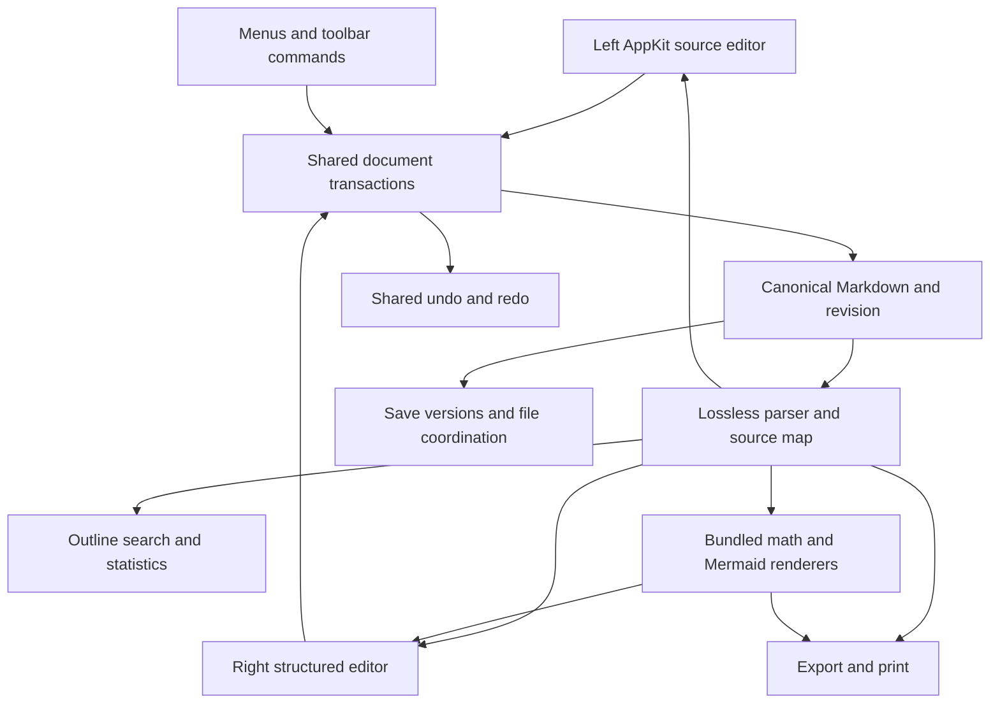
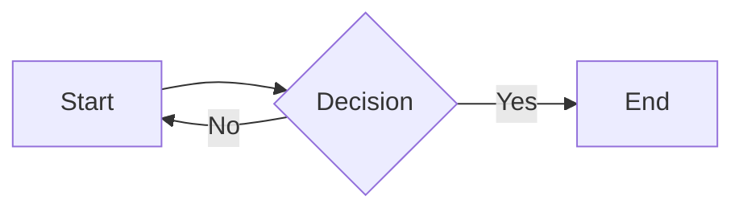
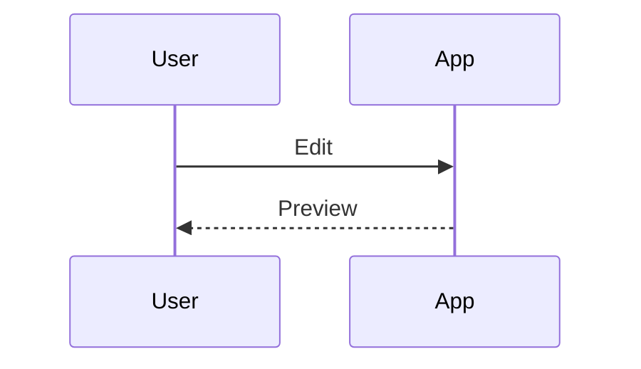
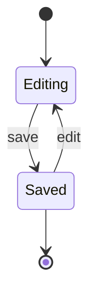
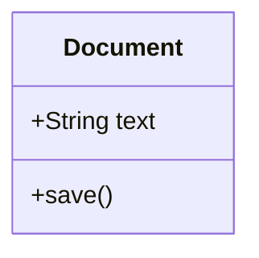
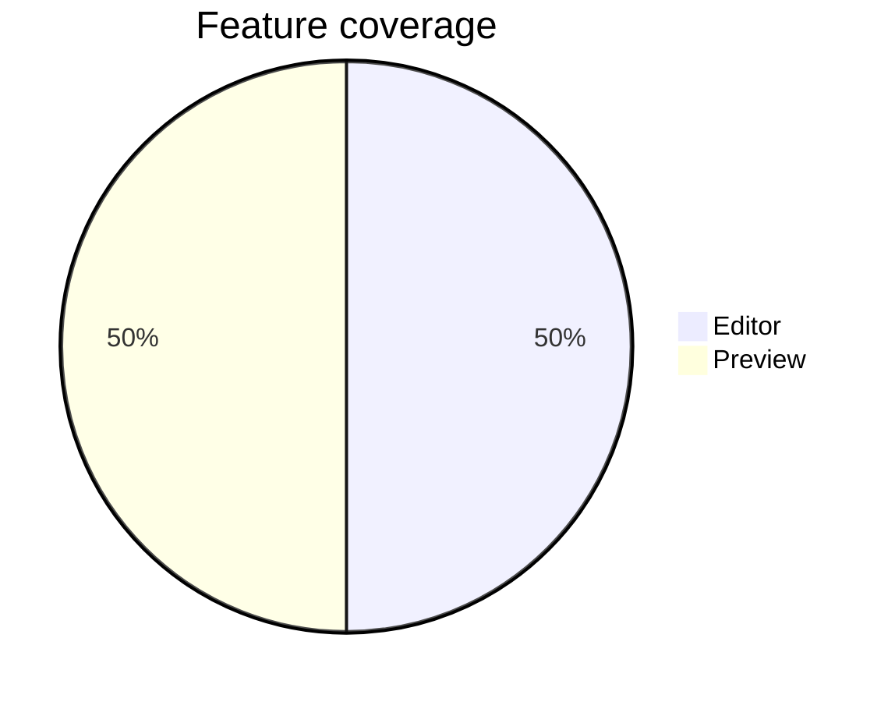
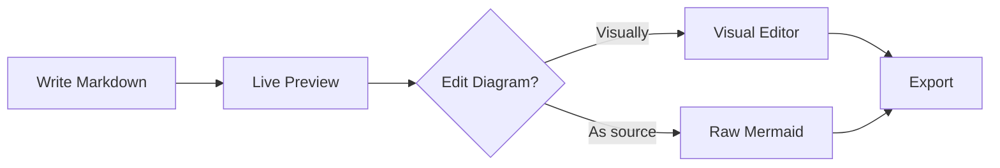
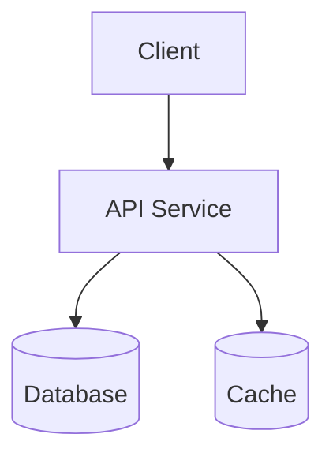
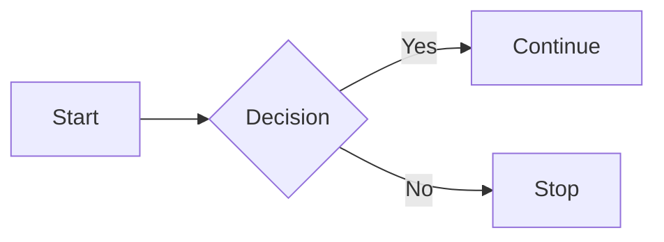

# Remarque: complete Codex build specification

Specification revision **1.4**, 29 October 2026. Baseline: **Remarque 2.1 (733)** for macOS. The user’s latest toolbar decision supersedes the three-tab design: one formatting row, with **Mermaid** and **LaTeX** buttons immediately after **Table**. Markdown document extensions remain `.md`, `.markdown`, and `.mdown`.

This is the implementation brief for rebuilding the surviving product and adding synchronized editing in both panes. It contains the complete **226-record feature inventory**, exact observed controls, new interaction requirements, engineering contracts, implementation milestones, acceptance criteria, original verification limits, and embedded fixtures. The supporting dossier provides additional evidence; no essential requirement is intentionally delegated to a link.

**Delivery status:** implemented as a signed development build; see `docs/implementation/BUILD_REPORT.md` for current verification and outstanding qualification. A compiled application cannot prove that every hidden original code path was discovered. Verified behavior, observed controls, documented promises, and implementation inferences remain distinguished throughout this document.

## Contents

- [Build mandate](#build-mandate)
- [Decisions and precedence](#decisions-and-precedence)
- [Required interaction specification](#required-interaction-specification)
- [Comprehensive Mermaid formats and styles](#comprehensive-mermaid-formats-and-styles)
- [Engineering implementation contract](#engineering-implementation-contract)
- [Product behavior details](#product-behavior-details)
- [Implementation plan and release gates](#implementation-plan-and-release-gates)
- [Complete baseline feature inventory](#complete-baseline-feature-inventory)
- [Exact control reference](#exact-control-reference)
- [Baseline verification and regression ledger](#baseline-verification-and-regression-ledger)
- [Recovery and resource provenance](#recovery-and-resource-provenance)
- [Embedded fixture and starter templates](#embedded-fixture-and-starter-templates)
- [Codex handoff prompt](#codex-handoff-prompt)

## Build mandate

When instructed to implement this document, build a working **native macOS document application**, not a browser mockup or an inventory viewer. Preserve the discovered Remarque functionality and implement these mandatory additions:

1. Selecting text or an object in the right rendered editor reveals and mirrors its actual Markdown source in the left editor without moving keyboard focus out of the right editor.
2. Both panes edit one canonical Markdown document. Right edits appear in the left source in real time; left edits update the right editor. All editing commands share one chronological undo history.
3. A compact, familiar Word-like toolbar stays at the top of the right pane. Use one formatting row with **Mermaid** and **LaTeX** insertion buttons immediately after **Table**, visible even at narrow widths.
4. Expand Mermaid to the full 33-family catalogue below, including at least 41 starter templates, comprehensive source/render/output coverage, and supported appearance/layout choices.

Implement the full baseline scope, including file lifecycle, source editing, Markdown extensions, tables, equations, diagram rendering and visual editing, workspace links, history, snippets, automation integrations, nine export formats, printing, settings, themes, help, and accessibility. A two-pane demonstration is an intermediate milestone, not completion.

Keep Markdown portable and user-owned. No accounts, server, cloud database, subscription system, AI service, or network dependency is required. Preserve original documents and the installed `/Applications/Remarque.app`. Use the archived app and screenshots for comparison; never patch or replace the surviving installation during development.

### Required delivery from the eventual build

- Complete editable source, a checked-in Xcode project with shared scheme, dependency locks and notices, bundled rendering resources, and reproducible build/test scripts.
- A working development `.app`, plus instructions for a reproducible universal release build. Report signing/notarization status accurately.
- Unit/integration/UI tests, fixtures, export samples, performance measurements, and manual accessibility/export verification records.
- A feature coverage ledger with one entry for every baseline feature ID, every `SYNC-*`, `EDITNEW-*` and `MER-*` requirement, A01–A28, and the additional release checks below. Each entry identifies implementation files, tests/evidence, and status.
- Build, run, architecture, backup/recovery, and troubleshooting documentation. Remaining limitations must be explicit and tied to requirements.

## Decisions and precedence

The user's requested changes and this section take precedence over descriptions of the old application. The engineering contract below resolves otherwise unspecified behavior. The baseline inventory and control reference remain preservation requirements unless explicitly superseded here. Audit gaps describe uncertainty or defects; they are not instructions to reproduce those defects.

| Topic | Rebuild decision |
| --- | --- |
| Platform | Native macOS, minimum deployment target macOS 14; support Apple Silicon and Intel. Use current installed Xcode while checking availability of newer APIs against the deployment target. |
| Application identity | Product and display name **Remarque**. Bundle/signing identifier **`ca.forensicintelligence.remarkable`**, matching the original application identity per the user’s correction. Use FI Forensic Intelligence, Ltd. Developer ID Application signing (team PATM9DNCLA). Preserve the installed original binary and do not change file associations during automated tests. |
| Primary editor | AppKit source editor on the left; a locally bundled structured WebKit editor on the right; SwiftUI/AppKit shell and tools. The first implementation milestone must prove the editing core before building the remaining UI around it. |
| Native preview | Preserve a separate Native Preview proofreading mode and its diagram actions. Default right pane is the editable structured view. Selecting Edit in a read-only preview returns to the structured editor at the same source anchor. Label the mode clearly; do not call a read-only view editable. |
| Source Live Editing Mode | Preserve the original optional marker-hiding/tile behavior in the left pane, labelled **Source Live Editing** where needed to remove ambiguity. It is distinct from right-pane editing. |
| Live-preview preference | May control passive preview refresh and expensive generated graphics. It never suspends synchronization of the active editable document or permits stale edits. If a passive preview is paused, show its state and offer Refresh. |
| Toolbar arrangement | One row, without a tab strip. Formatting controls, then Table, Mermaid, LaTeX. Mermaid and LaTeX open insertion tools directly; adjacent menus retain selected-object actions. Extensions and File export names retain `.md`. |
| LaTeX scope | Inline and display equations inside Markdown, plus the existing LaTeX export. A standalone `.tex` authoring application is outside this rebuild. |
| Presentation boundaries | Split at H1, including Setext H1. Any visible preamble before the first H1 becomes one introductory slide; front matter does not create a slide. H2–H6 remain within their H1 slide. A nonempty document without H1 has one slide; an empty document has none. In-app and exported slides use the same algorithm. |
| Bundle format | Preserve ZIP-compatible `.remarque` export. Safe user extraction must yield a normal Markdown document plus assets. Native `.remarque` reopening/import is not a baseline requirement and must not be advertised unless implemented and tested. |
| Legacy migration | No speculative reading/writing of the old protected container. Start with isolated new preferences/history. A future importer requires a verified legacy schema, a copy-first migration, and separate tests. Ordinary old Markdown documents must open now. |
| Observed settings | Adopt the captured values as initial rebuild defaults except where this section changes semantics, notably making the right editor editable. These are chosen rebuild defaults, not a claim about the original factory defaults. |
| Unobserved details | Use the concrete defaults in this document. For minor remaining choices, choose a conservative, reversible behavior, record it in the decision log, and continue. Do not silently remove a capability. |
| Backup destination | Establish local version control when implementation begins. Document how to configure an independent remote/off-device backup; no remote account or destination has been supplied. Do not invent one or upload user content. Its absence does not block local implementation. |

### Resolutions for every recorded discrepancy

| Audit ID | Required implementation outcome |
| --- | --- |
| GAP-01 | Precise right-selection-to-source mapping passes A01–A05. |
| GAP-02 | Distinguish source live mode, editable right pane, and read-only previews in labels and documentation. |
| GAP-03 | Preserve visual editing for simple state diagrams as well as flowcharts and sequence diagrams. |
| GAP-04 | Bundle the full Mermaid renderer; do not substitute a renderer limited to visually editable types. |
| GAP-05 | A diagram's opening fence and associated metadata belong to that diagram. Outline/card commands always target its stable identity, never the preceding block. |
| GAP-06 | Parse Markdown imports with the document parser, including front matter and variable-length fences. Show all real Mermaid blocks for selection; raw `.mmd`/`.mermaid` source also works. |
| GAP-07 | Apply the H1/preamble slide policy above consistently. |
| GAP-08 | LaTeX export saves `.tex`, never an unwanted `.tex.txt` suffix. |
| GAP-09 | `[[Other Note\|Wiki alias]]` displays Wiki alias and resolves Other Note. The backslash in this table escapes a table separator; the document syntax uses a plain pipe. |
| GAP-10 | The structured right editor includes diagram selection, edit, size, alignment, source, copy, zoom and export actions. |
| GAP-11 | Longer fences cannot terminate early, disable later highlighting, or hide later live tiles. Retain source bytes and test parsing, styling, and tile presentation independently. |
| GAP-12 | Verify offline operation and outbound-request policy at runtime; do not infer them from a marketing sentence or entitlement. |
| GAP-13 | Label shared page settings as PDF and DOCX settings, and apply them to both. |
| GAP-14 | Test bundle contents/asset portability; do not claim app-level reopen support solely because ZIP extraction works. |
| GAP-15 | Test presentation arrows/Space/Escape with real focus in both app and exported deck. |
| GAP-16 | Actual requirements and verified output govern implementation. Marketing text is supporting context only. |

## Required interaction specification

### Required outcome

Rebuild Remarque as a native macOS Markdown application that preserves its discovered document, editing, diagram, math, workspace, history and export functionality. Add the following capabilities:

1. Selecting content in the **right rendered pane** reveals the equivalent Markdown section in the **left source pane**.
2. Both panes are editable. Right-pane changes update the left source in real time; left-source changes update the right rendered view.
3. Put a simple Word-like toolbar above the right pane, with one formatting row and **Mermaid** and **LaTeX** insertion buttons immediately to the right of **Table**.
4. Expand Mermaid to the full 33-family catalogue, with at least 41 starter templates, source editing, offline rendering, supported styles/layouts, and format-by-format tests. See [comprehensive support](#comprehensive-mermaid-formats-and-styles).

“Left pane” means the Markdown source editor; the optional outline remains an additional sidebar to its left. “LaTeX” means mathematical authoring within the Markdown document in this specification. These controls act on the current selection or insertion point; they do not change the document's file type or convert the whole document.

The existing single-pane Live Editing Mode, vertical Markdown palette, menu commands and source formatting ribbon remain available. The new right-pane editor is an additional capability; baseline export/presentation views remain faithful rendered outputs.

### Workspace arrangement

```text
App toolbar: document / layout / outline / find / export / settings
┌────────────────┬─────────────────────────┬──────────────────────────────────┐
│ Optional       │ Markdown source         │ Style B I … Table Mermaid LaTeX   │
│ outline        │ Existing source tools   │ One compact formatting toolbar   │
│                │                         ├──────────────────────────────────┤
│ Headings       │ # Current section       │ Current section                  │
│ Diagrams       │                         │ Rendered, editable document      │
│                │ Source selection mirror │ Active caret / selection         │
└────────────────┴─────────────────────────┴──────────────────────────────────┘
Status: words / reading time / diagrams / line and column / save state
```

The right toolbar stays pinned while the document scrolls. Table, Mermaid and LaTeX stay visible at narrow widths; the formatting group may scroll horizontally or overflow. Preserve pane widths and layout choices. The new toolbar must not consume so much vertical space that it prevents normal writing.

### Right selection to source navigation

| ID | Requirement |
| --- | --- |
| SYNC-01 | A click in rendered prose, heading, list item, quote, callout, table cell or code block reveals the corresponding source location. |
| SYNC-02 | Drag selection and keyboard selection reveal and mirror the matching source range, including selections spanning several blocks. |
| SYNC-03 | Clicking an image, equation or Mermaid diagram selects its complete corresponding source construct. Figure selection includes its directly associated layout comment when applicable. |
| SYNC-04 | For prose, map the rendered text position into the source's actual token range. Do not search by displayed text or estimate from proportional scroll position. Duplicate paragraphs/headings must remain distinct. |
| SYNC-05 | Keep input focus and the active caret in the right pane. The left pane shows a secondary highlight; mirroring must not steal focus or collapse the user's selection. |
| SYNC-06 | Scroll the left pane only enough to reveal the target with useful context. Avoid recentering on every keystroke when the target is already visible. |
| SYNC-07 | Clicking a generated item such as a footnote number chooses a deterministic source origin. A reference maps to its reference token; its rendered footnote body maps to its definition. |
| SYNC-08 | Markers without rendered characters map to the owning source token/block. Markdown punctuation remains visible in the source pane. |
| SYNC-09 | Selection mapping works with soft wrapping, zoom, Unicode, composed characters, emoji, nested formatting, hidden front matter, collapsed sections and asynchronously sized graphics. |
| SYNC-10 | If the source pane is hidden in a single-pane layout, update the logical selection without forcing a layout change. An explicit Reveal in Source command opens/reveals it. |
| SYNC-11 | A source caret/selection updates right-side context and toolbar state. Passive mirrors must not cause reciprocal scrolling loops. |
| SYNC-12 | Distinguish scrolling from selection. Selection jumps to the precise block even when the optional continuous Scroll Sync preference is off. |
| SYNC-13 | Command-click a link opens its destination; ordinary click selects/edits its label. Expose Open Link by keyboard and context menu as well. Preserve internal navigation semantics outside editing contexts. |
| SYNC-14 | If a parse result is stale, use the current source transaction map or wait for its revision; never navigate using an old offset silently. |

Selection acceptance example: place the source at the top of a long file, scroll the right pane to the **second** identically titled section, then click a word there. The left pane reveals that second section and highlights the correct source word; the right caret retains focus. Repeat with a selection crossing a bold span, a table cell and a Unicode word.

### Editing in both panes

Markdown is the persisted source of truth. Both views apply operations to one document state and one undo history. There must not be two independent strings periodically overwriting one another.

| ID | Requirement |
| --- | --- |
| EDITNEW-01 | Type, delete, select, cut, copy, paste and perform normal text navigation directly in right-pane prose. |
| EDITNEW-02 | Each accepted right-side edit updates canonical Markdown and the left editor immediately; no Apply button for ordinary text editing. |
| EDITNEW-03 | Left-side edits update the right editor at the same document revision. Preserve the active caret and unaffected scroll positions while updating. |
| EDITNEW-04 | Preserve untouched source exactly, including whitespace, blank lines, marker choices, reference definitions, comments, front matter, line endings and unknown constructs. |
| EDITNEW-05 | A formatting action changes only the selected span/owning block. It may normalize syntax within that changed construct, never silently format the entire file. |
| EDITNEW-06 | All commands from the right toolbar, left toolbar, menus, shortcuts, palette, equation tools, table tools and diagram tools use the same transaction system. |
| EDITNEW-07 | Shared undo/redo follows chronological user actions across panes. Undo from either pane reverses the most recent transaction and restores associated selection. Group continuous typing sensibly. |
| EDITNEW-08 | IME composition, dead keys, dictation and emoji insertion are preserved. Do not re-render the active composing subtree or split grapheme clusters. Broadcast provisional composition separately from the final undo unit if necessary. |
| EDITNEW-09 | Rapid alternation between panes must not overwrite recent input with a late render or stale selection. Document-scoped revision numbers are mandatory. |
| EDITNEW-10 | Persist the same canonical text from either pane. Dirty indicators, save, autosave, versions, search and export all use the latest committed revision. |
| EDITNEW-11 | Incomplete Markdown, math or Mermaid remains editable. Store the user's source, show an inline diagnostic, and clearly mark any last-successful render as stale. |
| EDITNEW-12 | Cancel in the existing modal editors retains its existing meaning. New inline/source-inspector editing is immediate; its changes are reversed through shared Undo. Do not present a misleading Cancel button after committing live edits. |
| EDITNEW-13 | Unknown or unsupported constructs appear as bounded source blocks/objects that can be edited as source. Switching panes must never delete them. |
| EDITNEW-14 | Rich paste converts to supported Markdown after sanitization. Offer plain-text paste; do not preserve arbitrary browser formatting without a defined source representation. |
| EDITNEW-15 | Delete/Backspace at block boundaries has defined behavior for merging paragraphs, leaving lists, removing empty headings, and deleting selected objects. Test each operation. |
| EDITNEW-16 | A selected linked image/equation/diagram has an accessible label and focusable edit action. Never treat its generated SVG or bitmap as directly editable prose. |
| EDITNEW-17 | Resolve external-file changes with the same document-conflict workflow for both panes. Never reload over unsaved right-side input without the existing conflict choice. |
| EDITNEW-18 | Multi-window editing must share file coordination and avoid stale saves. Opening the same file twice must not create divergent unsupervised writers. |

#### Editable content coverage

| Content | Right-side behavior | Markdown update |
| --- | --- | --- |
| Paragraph and heading | Direct typing, Enter, split/merge, style menu | Change text and heading markers locally. |
| Marks and links | Select text, apply/remove marks, edit label and URL | Preserve nesting; update only affected delimiters/destination. |
| Lists and tasks | Continue/indent/outdent; click task checkbox | Update list markers/indentation or `[ ]` / `[x]`. |
| Quotes and callouts | Direct body editing; change callout type/title through tools | Preserve quoting prefixes and callout marker. |
| Tables | Direct cell editing and keyboard cell navigation; structural commands | Patch affected cell/row/table, retain escaped pipes and extra data. |
| Code block | Literal code editing and language selector | Preserve fence length adequate for contents; no rich-text substitutions inside code. |
| Math | Click selects formula; LaTeX button inserts; its menu edits source and display mode | Patch inline or display formula with correct delimiters. |
| Mermaid | Click selects diagram; Mermaid button opens the gallery; its menu opens source/canvas tools | Patch that fence and its associated metadata, preserving unsupported lines. |
| Image | Select object; edit alt text/path and replace image | Change image token/reference and authorized local asset handling. |
| Details section | Toggle disclosure; edit summary/body | Preserve details/summary structure and hidden contents. |
| Footnotes/references | Edit body/definition through source-aware UI | Patch the correct definition or reference occurrence. |
| Front matter/raw HTML/unknown extension | Source-block editor/fallback | Retain original bytes outside the explicit edit. |

### Unified toolbar and commands

Use one persistent formatting row. Place **Mermaid**, then **LaTeX**, immediately after **Table**. Clicking a button opens its insertion tool. Each adjacent arrow opens a menu with the insertion action and context-sensitive editing actions. Retain the document selection when opening tools. Opening a tool alone never changes source or dirty state.

#### Markdown formatting controls

Keep the default row simple. Use familiar text-formatting icons with tooltips and accessible names; put less frequent commands in Insert or overflow menus.

| Group | Commands | Source semantics |
| --- | --- | --- |
| History | Undo, Redo | Shared document history. |
| Style | Body, Heading 1–6, Quote | Current block type, with mixed state for a multi-block selection. |
| Text | Bold, Italic, Strike, Highlight, Inline Code | Existing supported Markdown marks; pressed state reflects selection. |
| Lists | Bullets, Numbered, Tasks; Indent, Outdent | Preserve list nesting and numbering intent. |
| Insert | Link, Image, Table, Code Block, Rule, Callout, Footnote, Details | Contextual dialog/popover where needed; insert at retained anchor. |
| More formatting | Superscript, Subscript, Clear supported formatting | Use existing syntax; clearing marks must preserve content and objects. |
| Table context | Add/remove row/column, column alignment, table placement | Only enabled for a table; preserve neighboring source. |
| View | Text zoom/size; optional Reveal in Source | Display scale, not arbitrary persisted font formatting. |

Do not imply arbitrary Word document formatting that plain Markdown cannot represent. Arbitrary font-family/color, text-box placement, paragraph justification, page margins and manual pagination are outside the initial right-toolbar scope unless a separately approved Markdown extension is defined. Existing export page settings remain in Export preferences.

#### The Mermaid button and tools

| Group | Commands and behavior |
| --- | --- |
| Target | Selected diagram title/type, or an Insert Diagram action when no diagram is selected. |
| Templates | Searchable gallery covering all 33 Mermaid families and at least 41 starter templates; see [comprehensive Mermaid requirements](#comprehensive-mermaid-formats-and-styles). |
| Source | Editable Mermaid source, live diagnostic, optional source visibility. Source edits immediately update the matching fence in the left pane. |
| Visual tools | Select/Move, Add Node, Connect, Delete, Auto Layout, Snap, direction, shapes, edge style/label for supported types. |
| Sequence tools | Participants, messages, sender/receiver, message order, arrow type. |
| Placement | Title, size, aspect-ratio lock, left/center/right, Reset Size. Update readable diagram metadata. |
| View/output | Zoom, Fit, Copy Source, Copy SVG, Export PNG. |

Supported visual manipulations update source as transactions. One drag is one undo unit; it may broadcast intermediate positions for live feedback. Preserve source statements the canvas cannot understand. Any operation that would remove unsupported constructs must be explicitly disclosed before it runs. Source editing and rendering remain available for every supported renderer type.

When switching from a diagram to prose, retain a valid insertion anchor and update toolbar target state. Do not silently edit the previous diagram after the selection has moved elsewhere. The legacy full-window/modal visual editor may remain with Apply/Cancel; the Mermaid source inspector must clearly use live editing.

#### The LaTeX button and tools

| Group | Commands and behavior |
| --- | --- |
| Target | Edit selected equation or Insert Equation at the current insertion anchor. |
| Display mode | Inline / Display. Convert delimiters around this equation only. |
| Structures | Exponent, subscript, fraction, square/nth root, sum/product, integrals, limit, binomial, vector/hat/bar, matrix and cases. |
| Symbols | Preserve all existing Greek, operator, relation, arrow, symbol and function palettes. |
| Source/preview | Editable LaTeX field plus immediate rendered preview and accessible diagnostics. |
| Navigation | Template insertion puts caret into the first slot; keyboard traversal must work without a mouse. |

The equation source inspector edits the selected equation source in the left pane as the user types, including temporary invalid LaTeX. It does not convert a Markdown document to a standalone `.tex` document. Existing File Export LaTeX remains a separate export command.

#### Toolbar interaction rules

1. Remember the document selection when a toolbar control takes focus. Apply to that selection, never the accidental toolbar focus target.
2. Enable commands only where meaningful. Use mixed states for selections with mixed formatting; disable destructive table/diagram actions when no valid target exists.
3. Keyboard shortcuts keep the existing bindings. Commands act on the active editing pane but share source semantics and undo.
4. Selecting a diagram or equation updates enabled menu actions without replacing the formatting toolbar. Its buttons remain in the same order for every selection.
5. Esc returns focus to the document without discarding edits already committed through the live interface.
6. Buttons, menus, fields and canvas objects must be reachable and named for VoiceOver. Selected-object state and validation messages must be understandable without sight.

### Document architecture

Use the surviving application structure as a guide, not as recovered implementation. Retain a native SwiftUI/AppKit document shell and bundled local renderers. The right editor needs a structured editing layer; merely adding `contenteditable` to the exported HTML is insufficient because the export does not retain source ranges or lossless editing semantics.



#### Core document state

Keep these concepts explicit, even if their final type names differ:

- Document identity and file URL, source buffer, line-ending policy, encoding, current revision, saved revision and permissions.
- Lossless syntax/tokens plus a semantic tree. Preserve comments, trivia, delimiters, reference definitions and opaque constructs in the lossless representation.
- Source ranges, rendered-text maps and stable session identities for blocks/inline spans. Stable identity is not a hash of the text alone.
- Active editing surface and logical selection anchor/focus, plus secondary selections for inactive surfaces.
- Transactions with source range replacements, origin, expected base revision, selection before/after and undo grouping.
- Render jobs/caches keyed by source and configuration, with document and revision identity.

#### Mapping rules

Use half-open source ranges `[start, end)` with one documented coordinate convention. AppKit and browser DOM offsets both involve UTF-16; Swift `String` indexes do not. Provide tested conversion helpers and respect grapheme boundaries for editing. Normalize line-ending offsets in one place, not in every component.

Rendered text has many-to-one and one-to-many relationships with source: emphasis markers disappear, escaped entities shrink, emoji shortcodes expand, smart punctuation may transform, and math becomes graphics. Retain per-token mappings and explicit object origins. Formatting nested within links, table cells, callouts or list markers must resolve to the right source owner.

A cross-block selection may have a contiguous enclosing source interval plus discontiguous text-token subranges. The mirror can highlight the enclosing interval while edit commands use exact semantic subranges; blindly replacing the enclosing interval would destroy structural delimiters. Decide selection affinity at token boundaries and test it.

Generated document elements such as a TOC, footnote labels, diagram SVG nodes and preview-only decorations must identify their source owner or be explicitly non-editable. Do not serialize render-generated markup into the Markdown file.

#### Transaction and render ordering

1. Capture edit intent against a known document revision and semantic selection.
2. Convert it to minimal valid source replacements. Reject stale edits or rebase using intervening transactions; never use stale offsets directly.
3. Apply the replacements and selection changes atomically. Increment revision, update dirty state and shared undo.
4. Publish changes to both editors, outline, search, status and persistence. A view does not echo an already-applied transaction back as new input.
5. Incrementally reparse affected context. Fences, list nesting and reference definitions can affect subsequent blocks, so reparsing cannot always stop at one line.
6. Update only changed rendered blocks. Retain active composition/caret and viewport anchors.
7. Run expensive math/diagram rendering asynchronously. Accept only results matching the current document/block revision and configuration; discard old results and callbacks after a document closes.

A selection/scroll event carries its origin. Mirroring does not generate another user-origin event. Asynchronous image heights and zoom changes must preserve logical viewport anchors rather than triggering proportion-based feedback loops.

#### Right editor implementation boundary

The selected starting architecture is a locally bundled WebKit structured editing surface, with a native AppKit source editor. Prove its schema and input handling in the first prototype. Any alternative must pass the same editing, accessibility and preservation gates before replacing this choice.

The first prototype must prove lossless round trips, nested marks, mixed-block selection, table cells, IME, undo across panes, source mappings and opaque blocks before the rest of the product is rebuilt around it. Any third-party component must be evaluated for its exact supported Markdown grammar, serialization changes, licensing, local/offline packaging and maintenance; no dependency choice is assumed by this inventory.

If WebKit is used, bundle editor assets and fonts locally, isolate the bridge, validate message origin/type/size/revision, and avoid arbitrary script execution from Markdown, Mermaid, raw HTML, pasted content, links or document metadata. Image/file access must use authorized scopes. Network independence must be demonstrated, not inferred from branding.

### Compatibility and preservation rules

- Open and save the original `.md`, `.markdown` and `.mdown` documents. Preserve UTF-8 text and line endings unless the user explicitly reformats.
- Read both `remarque:mermaid` and legacy `remarkable:mermaid` metadata. Preserve unknown keys and values; write canonical metadata only for the edited diagram.
- Retain `table-align` comments, YAML front matter, wiki links, reference links/images, footnotes, nested details, callouts and all recovered syntax families.
- Preserve linked and embedded media. Do not read or rewrite unrelated folders or bake sandbox-specific absolute paths into portable exports.
- Preserve per-format output settings and document structure options. Preview, print and export should use one semantic document model and consistent renderer versions.
- Distinguish engine capabilities: source rendering may support more Mermaid types than graph editing. Never silently downgrade a complex graph to the canvas's subset.
- Keep baseline Live Editing Mode optional. It must not corrupt source or interfere with the new right editor's selection/undo model.
- Maintain native document commands, workspace navigation, local history, snippets, Services, Shortcuts, help and keyboard access from the inventory.
- Treat observed bugs as regression targets, not required compatibility behavior. Decide intended behavior explicitly where documentation and output disagree.
- Existing private settings/history migrations require a separately verified data schema. Do not guess or overwrite old app-container data. First-run migration should preserve originals and be retryable.

### Performance and resilience targets

These are rebuild acceptance targets, not measurements of Remarque 2.1. Record the test machine and measured distributions when implementing.

| Operation | Target |
| --- | --- |
| Ordinary right edit reflected in source | p95 within 50 ms for a 100 KB representative document, excluding intentional IME composition. |
| Selection mirrored/revealed | p95 within 100 ms after selection settles; no forced focus transfer. |
| Ordinary prose preview update | p95 within 150 ms; avoid blocking the typing event path. |
| Large document typing | A 1 MB/10,000-line mixed fixture remains responsive, with incremental updates; measure latency rather than claiming it. |
| Math and diagram generation | Background/cancellable work; immediate source update even while render is pending. |
| Undo | Exact source restoration and valid caret state after interleaved left/right edits. |
| Export/save | Use a captured latest revision, atomic destination replacement, and meaningful error reporting. |
| Recovery | Restore unsaved work after simulated crash; a failure must not destroy the previous saved file/version. |

A complex diagram has no guaranteed fixed render time. Show pending/error/stale states and allow continued writing. Tests must include delayed, failed and out-of-order engine responses.

### Acceptance suite

The implementation is not complete until the complete baseline inventory is accounted for and the following additions pass. [VERIFICATION.md](#baseline-verification-and-regression-ledger) lists what has and has not been tested on the installed app.

| ID | Scenario | Required result |
| --- | --- | --- |
| A01 | Click a paragraph/heading in distant right-pane content | Correct source block revealed; right focus retained. |
| A02 | Select the second of repeated identical headings/paragraphs | Exact second source occurrence selected. |
| A03 | Drag or keyboard-select across bold/link/plain text and blocks | Accurate source mirror and safe edit ranges. |
| A04 | Unicode, combining accents, emoji, CJK and CRLF | No shifted offsets, split characters or corrupted text. |
| A05 | Click equation/diagram/image/table cell/footnote | Correct source object or token selected, no neighboring-block ambiguity. |
| A06 | Type and delete in right prose, headings, lists, callouts and cells | Left Markdown updates live and unrelated bytes remain identical. |
| A07 | Type incomplete Markdown/math/Mermaid on the left | Source retained; right reports pending/error without blocking. |
| A08 | Alternate rapidly between panes | No lost edit, duplicate edit, caret jump or stale overwrite. |
| A09 | Undo/redo interleaved source, toolbar, table, math and diagram edits | One chronological history and exact source restoration. |
| A10 | IME, dead keys, dictation and emoji insertion | Composition survives rendering and toolbar focus changes. |
| A11 | Paste formatted text or plain source in each pane | Supported Markdown conversion; safe links and preserved selection. |
| A12 | Format nested bold/italic/code/highlight/super/sub spans | Correct toggle semantics; no stacked or orphan delimiters. |
| A13 | Modify a table containing escaped pipes, math and extra cells | No truncated data, neighbor changes or malformed delimiter row. |
| A14 | Toggle task checkboxes and continue/indent lists | Exact Markdown markers and numbering; shared undo. |
| A15 | Use the unified toolbar and both insertion buttons with and without a target | Table, Mermaid, LaTeX remain visible in order; tools retain the anchor; opening or cancelling a tool never mutates content. |
| A16 | Edit a diagram through source and supported canvas actions | Left fence updates live; unsupported directives preserved or explicitly protected. |
| A17 | Edit simple state, flowchart and sequence; inspect unsupported class | Correct target and type; safe source fallback. |
| A18 | Edit an equation using templates and raw LaTeX | Source updates live; delimiters/mode/caret slots correct. |
| A19 | Scroll either pane, then select while another render completes | No feedback loop, focus theft or unexpected viewport jump. |
| A20 | Hidden outline/source/preview, collapsed details, zoom and theme changes | Mappings remain correct when content becomes visible again. |
| A21 | Save/reopen/export after right-side edits | All consumers see latest canonical Markdown. |
| A22 | External write while dirty, crash, autosave/history/restore | Explicit conflict handling and recoverable current text. |
| A23 | Long mixed document with hundreds of graphics | Measured typing responsiveness; bounded cache/memory behavior. |
| A24 | Keyboard-only and VoiceOver use of every toolbar control | All actions named/reachable; selection context understandable. |
| A25 | Open documents from the original app without editing and save | Byte-for-byte source stability; safe media and metadata handling. |
| A26 | Repeat all discrepancies in verification ledger | Fix or explicitly resolve each behavior; don't copy accidental bugs. |
| A27 | Export all nine formats, plus diagram PNG/SVG and print variants | Structural validation, visual review and appropriate downstream opening; compare preserved samples. |
| A28 | Run offline and inject remote navigation/script-bearing inputs | No required network call; source content cannot execute arbitrary code. |

For losslessness, build fixtures with both expected semantic behavior and exact source-byte assertions. For UI correctness, drive both panes and assert shared revision/selection, not merely screenshot similarity. Use round-trip tests and randomized valid edit sequences in addition to representative UI tests.

## Comprehensive Mermaid formats and styles

Added at the user's request on 29 October 2026. This expands the rebuild requirements; it does not claim these capabilities existed in Remarque 2.1 or have already been implemented. The term **comprehensive** has a testable scope: all **33 authoring families** in the catalogue below, their named variants, a searchable insertion gallery, live source editing, offline rendering, styling controls where supported, and output verification.

The official documentation and release page identify **Mermaid 12.2.0** as the reference release checked for this specification. The main syntax navigation lists 31 families, including ZenUML; the tagged renderer registry and additional documentation establish Agentflow and Railroad. Internal `info`/error renderers are diagnostic utilities, not extra chart families. [Official catalogue](https://mermaid.js.org/intro/), [12.2.0 release](https://github.com/mermaid-js/mermaid/releases/tag/mermaid%4012.2.0), [tagged renderer registry](https://github.com/mermaid-js/mermaid/blob/mermaid%4012.2.0/packages/mermaid/src/diagram-api/diagram-orchestration.ts).

### Engine and compatibility requirements

- **MER-01:** Pin the full Mermaid 12.2.0 distribution as the initial rebuild target, or a subsequently verified compatible release with at least this coverage. The old archived JavaScript is a comparison resource, not a ceiling on supported types. Package every required lazy-loaded module locally. Do not use a reduced/tiny build that omits required diagram types.
- **MER-02:** Bundle and explicitly register a compatible, pinned ZenUML extension locally. The core Mermaid bundle alone does not establish ZenUML support. Verify extension licensing and WebKit compatibility. [ZenUML integration](https://mermaid.js.org/syntax/zenuml.html).
- **MER-03:** Record exact engine, extension, layout, icon-pack and font versions/hashes in the app's dependency manifest. Use no runtime CDN. A new format that cannot render offline in the shipped app is not supported.
- **MER-04:** Preserve all original Mermaid source and recognized legacy syntax/aliases, including version-dependent `-beta` spellings. Use engine parsing/detection, not a hand-maintained first-word list alone. Test the old baseline documents after the engine upgrade; never rewrite them just to change the renderer version.
- **MER-05:** Label beta/experimental syntax accurately in the gallery/help. Include it in required coverage; a beta label is not permission to ship a broken template. Keep source editable on parse/render failure and identify the bundled engine version in diagnostic details.
- **MER-06:** Core authoring and all templates must render with network disabled. Bundle required layout modules/icon resources. Agentflow is diagram notation only; it does not execute agents, call tools, access accounts, or require an AI API.

### Required family catalogue

Every row is mandatory for **insert template → render → select/reveal source → edit source live → save/reopen → copy SVG/export PNG → document export**. The listed source entry forms are reference spellings for the selected release. Preserve accepted historical aliases; validate generated source against the actual bundled engine rather than assuming that a documentation page proves runtime behavior.

| ID | Family / gallery label | Source entry form | Required starter/variant coverage | Official reference |
| --- | --- | --- | --- | --- |
| MER-T01 | Flowchart | `flowchart`, legacy `graph` | Process, decision branches, subgraphs; vertical/horizontal; extended shapes and labelled edges | [Flowchart](https://mermaid.js.org/syntax/flowchart.html) |
| MER-T02 | Swimlanes | `swimlane-beta` | Multiple responsibility lanes and cross-lane handoffs | [Swimlanes](https://mermaid.js.org/syntax/swimlanes.html) |
| MER-T03 | Sequence | `sequenceDiagram` | Participants, calls/replies, notes, activation and nested control fragments | [Sequence](https://mermaid.js.org/syntax/sequenceDiagram.html) |
| MER-T04 | Class | `classDiagram` | Classes, properties/methods, relationships and multiplicity | [Class](https://mermaid.js.org/syntax/classDiagram.html) |
| MER-T05 | State | `stateDiagram-v2`, accepted legacy `stateDiagram` | Simple transitions and composite-state source example | [State](https://mermaid.js.org/syntax/stateDiagram.html) |
| MER-T06 | Entity Relationship | `erDiagram` | Entities, attributes, cardinality and identifying/nonidentifying relationships | [ER](https://mermaid.js.org/syntax/entityRelationshipDiagram.html) |
| MER-T07 | User Journey | `journey` | Sections, activities, scores and actors | [Journey](https://mermaid.js.org/syntax/userJourney.html) |
| MER-T08 | Gantt | `gantt` | Sections, dated/dependent tasks, milestones and status | [Gantt](https://mermaid.js.org/syntax/gantt.html) |
| MER-T09 | Pie | `pie` | Labelled values and optional value display | [Pie](https://mermaid.js.org/syntax/pie.html) |
| MER-T10 | Quadrant | `quadrantChart` | Axis labels, four quadrants and positioned points | [Quadrant](https://mermaid.js.org/syntax/quadrantChart.html) |
| MER-T11 | Requirements | `requirementDiagram` | Requirements, elements, risk/verification fields and relationships | [Requirements](https://mermaid.js.org/syntax/requirementDiagram.html) |
| MER-T12 | Use Case | `usecase-beta` | Actors, system boundary, use cases and typed relationships | [Use Case](https://mermaid.js.org/syntax/usecase.html) |
| MER-T13 | Git Graph | `gitGraph` | Branch/commit/merge and labelled commits | [Git Graph](https://mermaid.js.org/syntax/gitgraph.html) |
| MER-T14 | C4 | `C4Context`, `C4Container`, `C4Component`, `C4Dynamic`, `C4Deployment` | **Five distinct starters**, one for each named variant | [C4](https://mermaid.js.org/syntax/c4.html) |
| MER-T15 | Mindmap | `mindmap` | Nested topics, alternate node forms and locally available icons | [Mindmap](https://mermaid.js.org/syntax/mindmap.html) |
| MER-T16 | Timeline | `timeline` | Periods, multiple events and sections | [Timeline](https://mermaid.js.org/syntax/timeline.html) |
| MER-T17 | ZenUML | `zenuml` | Calls, return/conditional/loop constructs; registered local extension | [ZenUML](https://mermaid.js.org/syntax/zenuml.html) |
| MER-T18 | Sankey | `sankey`; preserve supported legacy aliases | Weighted flows with multiple sources/targets | [Sankey](https://mermaid.js.org/syntax/sankey.html) |
| MER-T19 | XY Chart | `xychart`, accepted `xychart-beta` | Separate **bar** and **line** starters; combined series example | [XY Chart](https://mermaid.js.org/syntax/xyChart.html) |
| MER-T20 | Block | `block`; preserve supported legacy aliases | Columns, spans, nested blocks and connections | [Block](https://mermaid.js.org/syntax/block.html) |
| MER-T21 | Packet | `packet`; preserve supported legacy aliases | Bit ranges, field labels and multirow layout | [Packet](https://mermaid.js.org/syntax/packet.html) |
| MER-T22 | Kanban | `kanban` | Columns, cards and supported card metadata | [Kanban](https://mermaid.js.org/syntax/kanban.html) |
| MER-T23 | Architecture | `architecture-beta` | Groups/services/ports, connections and local built-in icons | [Architecture](https://mermaid.js.org/syntax/architecture.html) |
| MER-T24 | Radar | `radar-beta` | Multiple axes and two comparable datasets | [Radar](https://mermaid.js.org/syntax/radar.html) |
| MER-T25 | Event Modeling | `eventmodeling` | UI/command/event/read-model sequence; compact and relaxed syntax fixtures | [Event Modeling](https://mermaid.js.org/syntax/eventmodeling.html) |
| MER-T26 | Treemap | `treemap-beta` | Nested categories with numeric leaves | [Treemap](https://mermaid.js.org/syntax/treemap.html) |
| MER-T27 | Venn | `venn-beta` | Labelled sets and pairwise/three-way overlaps | [Venn](https://mermaid.js.org/syntax/venn.html) |
| MER-T28 | Ishikawa / Fishbone | `ishikawa-beta` | Outcome, cause categories and nested causes | [Ishikawa](https://mermaid.js.org/syntax/ishikawa.html) |
| MER-T29 | Wardley Map | `wardley-beta` | User anchor, components, dependencies and evolution | [Wardley](https://mermaid.js.org/syntax/wardley.html) |
| MER-T30 | Cynefin | `cynefin-beta` | All five domains, example items and transitions | [Cynefin](https://mermaid.js.org/syntax/cynefin.html) |
| MER-T31 | Tree View | `treeView-beta` | Directory hierarchy and annotated nodes; indentation/box-drawing fixtures | [Tree View](https://mermaid.js.org/syntax/treeView.html) |
| MER-T32 | Agentflow | `agentflow-beta` | Flow containers and task/tool/decision nodes; static diagram only | [Agentflow](https://mermaid.js.org/syntax/agentflow.html) |
| MER-T33 | Railroad / Grammar | `railroad-beta`, `railroad-ebnf-beta`, `railroad-abnf-beta`, `railroad-peg-beta` | **Four distinct starters**: native DSL, EBNF, ABNF and PEG | [Tagged Railroad documentation](https://github.com/mermaid-js/mermaid/blob/mermaid%4012.2.0/packages/mermaid/src/docs/syntax/railroad.md) |

The catalogue therefore requires **at least 41 valid starter templates**: one per family, four additional C4 variants, three additional Railroad variants, and a second XY starter. Extra examples and direction/style presets increase that number. Aliases and themes do not count as additional diagram families. PlantUML, Graphviz, arbitrary JavaScript charts, and arbitrary third-party Mermaid plugins are not implied by “Mermaid support.”

### Gallery, editing and visual controls

- **MER-07:** The Mermaid button opens a searchable template gallery grouped by Process, Software/UML, Architecture, Planning, Data, Strategy and Grammar. Include readable thumbnails, a short purpose, syntax status and source preview. Search synonyms such as fishbone, ERD, bar, line, syntax diagram and directory tree. Use a compact gallery/popover rather than adding 33 top-level toolbar tabs.
- **MER-08:** Choosing a template previews it; **Insert** creates one fenced block at the retained selection. A template never replaces an existing diagram merely because it was clicked. Explicit Replace Diagram is undoable and names its target. Preserve the user's last insertion anchor while the gallery has focus.
- **MER-09:** Every family gets live Mermaid source editing in the source inspector with diagnostics and corresponding left-source updates. Card selection, size/alignment/title, source visibility, zoom, Copy Source, Copy SVG and Export PNG work for every rendered type.
- **MER-10:** Preserve the existing dedicated visual editors for flowchart, sequence and simple state diagrams. Provide a visible **Edit Source** path for every other type, and mark visual-canvas capability accurately. Comprehensive format support does not falsely claim arbitrary node/canvas editing for all grammars. A more complex diagram must remain source-backed rather than being coerced into a simpler canvas model.
- **MER-11:** Expand the flowchart shape picker to the pinned engine's supported shape catalogue, with thumbnails/names, filtering and safe source insertion. Preserve noneditable shape-specific properties. If a source shape has no safe canvas adapter, retain/render it and expose its source instead of converting it to a rectangle. Flowchart labels, direction, edge variants, subgraphs and safe style properties remain editable.
- **MER-12:** Use a declarative format registry shared by gallery, detection labels, help, imports, command palette and tests. Each record has a stable ID, display name, aliases, syntax entry, template IDs, required modules, beta status, visual-edit capability, styling/layout capabilities and reference URL. Do not maintain contradictory independent lists.

### Chart appearance and layout styles

Support diagram families and chart appearance as separate choices. The documented engine themes include `default`, `neutral`, `dark`, `forest`, `base`, `neo`, `neo-dark`, `redux`, `redux-dark`, `redux-color` and `redux-dark-color`. Offer these in an overflow Style control plus **Follow App**. Expose `classic`, `neo` and `handDrawn` looks only for types that actually implement them. Custom colors use validated supported theme variables; immutable engine/security configuration cannot be changed by a diagram. [Official theme configuration](https://mermaid.js.org/config/theming.html).

Expose layout selection only where applicable: engine default, Dagre, ELK, supported ELK variants, COSE-Bilkent and Tidy Tree. Bundle/register any additional required module and validate it offline. Some charts have fixed/custom layout; do not offer an ineffective generic layout selector there. The official layout and theme pages contain differing general statements about defaults, so set Remarque's choices explicitly and test the shipped registry. [Official layouts](https://mermaid.js.org/config/layouts.html).

- **MER-13:** Preserve the original visual feel for old files by explicitly selecting compatible classic/theme/layout defaults where possible; do not modify source on opening. New diagrams may use the selected style preset. Allow app-following light/dark defaults and a print-friendly monochrome choice.
- **MER-14:** A user-selected per-diagram theme/look/layout is saved in valid Mermaid front matter inside that diagram's fence, preserving existing front matter and unknown keys. Diagram dimensions/title/placement remain in Remarque metadata. Never confuse inner Mermaid front matter with the Markdown document's front matter. A purely temporary preview choice is visibly labelled temporary.
- **MER-15:** Clamp/validate supported style options, sanitize CSS/color/font/icon values, and retain strict security. Disable unsupported combinations with a short reason. Do not lower security or permit remote resource fetches to make a template render.
- **MER-16:** Style changes are source transactions with shared Undo when persisted. Passive app theme changes and view zoom are presentation changes. Keep source mapping and current diagram selection valid through either change. Respect reduced motion and disable unnecessary animation in print/export.

### Comprehensive-support release gate

These checks supplement the main specification's acceptance suite and must be tracked in its feature ledger:

| ID | Required check |
| --- | --- |
| MER-A01 | Registry has all MER-T01–MER-T33 families and at least 41 templates with the named C4/Railroad/XY variants. No visible template is an unimplemented placeholder. |
| MER-A02 | Every starter renders to nonempty, valid, sanitized graphic content in the shipped app while offline, in light and dark modes, with no missing dynamic import/font/icon/layout requests. |
| MER-A03 | Every starter survives insert, right-source edit, left-source edit, source reveal, save/reopen and shared undo/redo. A repeated title still selects the correct fence. |
| MER-A04 | Every family supports card operations, valid SVG copy and PNG export, plus representative appearance in HTML/PDF/DOCX/RTF/slides/EPUB/LaTeX output. Markdown/bundle exports retain original diagram source. Labelled source/graphic fallbacks are recorded, never blank silent omission. |
| MER-A05 | Test richer syntax for each family beyond the starter: the variant coverage in its catalogue row, malformed input, Unicode and a large example. Preserve unknown constructs during adjacent edits. |
| MER-A06 | Test old Mermaid fixtures and accepted legacy aliases against the new engine; compare semantics and documented visual differences. Upgrading the renderer cannot alter canonical Markdown. |
| MER-A07 | Test available theme/look/layout combinations by capability, including explicit per-diagram overrides and light printing. Selected styling survives save/reopen without losing existing configuration. |
| MER-A08 | All required external modules, including ZenUML, are pinned/bundled/licensed; all renderer responses obey document/revision identity and safe SVG/bridge rules. |
| MER-A09 | Gallery and source inspector work by keyboard and VoiceOver. Each diagram has an accessible title/type/source action; thumbnail color is not the only type/status indicator. |
| MER-A10 | A supported-format report generated from the same registry states engine version, family/variant coverage, visual-edit capabilities and actual test results. Reconcile official registry changes during planned dependency upgrades; do not auto-update engines at runtime. |

Do not label Mermaid support “comprehensive” in the finished product until these checks pass. Source editing with an error card is a recovery path, not evidence that a required format renders successfully.

## Engineering implementation contract

The following is the selected starting architecture for implementation. Names are suggested; the boundaries and invariants are required. Changes to a technical choice are permissible when documented and demonstrated to satisfy the same acceptance gates. Do not replace lossless editing with whole-document HTML-to-Markdown conversion.

### Repository and build layout

Use this logical layout; retain the existing `docs/` and `recovery/` evidence directories:

```text
RemarqueRebuild.xcodeproj/           # checked-in project and shared RemarqueRebuild scheme
App/                               # app entry, NSDocument integration, window controllers
App/UI/                            # layouts, right toolbar, dialogs, settings, help
App/Editors/                       # AppKit source adapter and WKWebView editor adapter
App/Platform/                      # bookmarks, file coordination, Services, App Intents
Packages/RemarqueCore/              # pure Swift package; no UI dependency in core model
  Sources/RemarqueCore/
    Document/                      # buffer, revisions, patches, selections, undo descriptors
    Parsing/                       # lossless tokens/CST, semantic AST, source maps
    Commands/                      # formatting, structural edits, search, snippets
    Diagrams/                      # Mermaid metadata and supported visual models
    Export/                        # format-neutral export model and serializers
  Tests/RemarqueCoreTests/
Resources/Editor/                   # local HTML/CSS/JS structured editor, bridge schema
Resources/Renderers/                # pinned Mermaid/MathJax and licenses
Resources/Templates/               # six start templates and insertion templates
Resources/Help/                    # 19 help topics, guides, shortcuts, release notes
Tests/Integration/                 # file lifecycle, imports, exports, history, bridge
Tests/UI/                          # real two-pane editing and keyboard/accessibility flows
Tests/Fixtures/                    # original probe plus generated/adversarial cases
scripts/                           # build, test, verify, local packaging, benchmark runners
docs/implementation/               # decisions, coverage ledger, test reports, release checklist
THIRD_PARTY_NOTICES.md
```

The Xcode project must build from a clean checkout without a locally installed project generator. Commit shared schemes and dependency lock files. Use native frameworks for document windows, text editing, file coordination, PDF extraction, rich text, permissions and menus. Use small, pinned third-party components only when they improve correctness; record licenses, versions, resource hashes and why they were chosen. Do not rely on an unpinned CDN, developer-global Node packages, or hidden files outside the repository.

The app must run without Node, Python, Homebrew, a TeX installation, or a web server. Development-only tooling may be used if documented and reproducible. MathJax provides mathematical rendering; do not require a system TeX distribution for everyday writing.

The following are **required future project commands**, not commands that already succeed in this specification-only folder:

```sh
swift test --package-path Packages/RemarqueCore
xcodebuild -project RemarqueRebuild.xcodeproj -scheme RemarqueRebuild -configuration Debug -destination 'platform=macOS' -derivedDataPath .build/DerivedData build
xcodebuild -project RemarqueRebuild.xcodeproj -scheme RemarqueRebuild -configuration Debug -destination 'platform=macOS' -derivedDataPath .build/DerivedData test
xcodebuild -project RemarqueRebuild.xcodeproj -scheme RemarqueRebuild -configuration Release -destination 'generic/platform=macOS' -derivedDataPath .build/Release ONLY_ACTIVE_ARCH=NO 'ARCHS=arm64 x86_64' build
```

Configure local development signing so ordinary local builds do not require the original developer's signing credentials. Use appropriate local/ad-hoc signing for development; document separately the owner's Developer ID and notarization steps for external distribution. A local build or signature is not evidence of notarization. Inspect produced architectures, minimum OS load commands, resources and entitlements in release verification. Check current tool versions at build time; the audit machine reported Xcode 27.0 and Swift 6.4, which are environment observations, not portable prerequisites.

### Core data and ownership

| Type/concept | Required fields and responsibilities |
| --- | --- |
| DocumentSession | Session/document UUID, canonical file identity/bookmark, canonical source buffer, monotonically increasing revision, saved revision/hash, active surface, lifecycle state, shared undo manager. One writer per open file identity. |
| SourceBuffer | Original UTF-8 bytes, efficient text access/patching, UTF-16 and byte offset conversion, line index, original newline bytes and optional UTF-8 BOM. Preserve untouched slices exactly, including mixed line endings. A piece table/rope or equivalent avoids copying the whole file per keystroke. |
| SourceRange | Half-open UTF-16 offsets `[start,end)` at a stated revision; conversion to UTF-8 byte spans is centralized and checked. User-visible line/column is one-based. CRLF is one line break. |
| SyntaxSnapshot | Revision, lossless token/concrete tree, semantic tree, reference/footnote indexes, diagnostics, heading/diagram index, source/render mappings. Unknown constructs retain source-backed opaque nodes. |
| NodeIdentity | Stable session ID retained across unaffected edits and block moves where identifiable; not text-only hashing. Duplicate identical blocks have distinct identities. |
| LogicalSelection | Anchor and focus node/token IDs plus offsets/affinity, direction, active surface, enclosing source range and exact editable subranges. Object selections have explicit ownership. |
| EditTransaction | Unique ID, document ID, expected base revision, origin, command/intent, nonoverlapping source patches, selection before/after, undo group, timestamp, optional composition/drag identity. |
| SourcePatch | Old range, replacement text/bytes, optional expected old-content hash. Apply an atomic batch in descending offset order or through an equivalent indexed operation. Store inverse patches before modification. |
| RenderRequest | Document/node identity, source digest, revision/configuration generation, renderer identity, theme/display parameters, cancellation token. Only matching results may enter the current view. |
| Diagnostic | Severity, message, source range/owner, current or stale revision, recovery action. Diagnostics never overwrite the document. |
| CommandDescriptor | Stable command ID, title, shortcut, category, availability, selected/mixed state and transaction builder. Menus, palette and both toolbars use this registry. |

Use main-actor/UI confinement for document mutation and selection. Parsing, searching, rendering preparation and export serialization may run on background tasks over immutable snapshots. Cancel work when a session closes; a result must not resurrect a closed document or apply to another window.

Dirty state compares the canonical content with the saved state, not merely whether a revision counter changed. Undo back to saved content clears dirty state. A selection change, pane resize, tab switch, theme change or display-size change is not a content edit.

### Parsing and round-trip invariants

1. Specify and test the supported Markdown grammar before editing adapters depend on it. Implement the CommonMark core behavior plus the extensions enumerated in the inventory. Record any deliberate extension precedence. Do not claim complete standards conformance without the corresponding test suite.
2. Preserve original tokens, indentation, trivia, delimiters, fence character/length, reference spelling, comments and opaque content. Rendering uses a semantic tree; persistence uses the source buffer. Reparse never serializes the whole document.
3. Explicit editing or Format Document may normalize the edited construct. Opening, rendering, selecting, switching tabs, exporting, or saving without an edit may not normalize source bytes.
4. Fences are length-aware and container-aware; a shorter nested fence cannot close a longer fence. Markdown syntax inside a code fence is literal. Incremental invalidation propagates until parsing state converges, including open fences, nested containers and reference changes.
5. Preserve ordered-list start numbers, list marker spelling, hard-break spaces, escaped pipes, code-span delimiters, optional table outer pipes, comments adjacent to objects, unknown metadata attributes and missing final newline.
6. Parse front matter only at the document beginning under the chosen grammar. Treat its contents as preserved text; read simple title/author/date metadata without rewriting YAML. Do not load executable/custom YAML tags. Invalid YAML remains editable.
7. Math detection ignores code, escaped dollars and obvious currency such as `$5 and $10`. Adopt and fixture-test delimiter rules for adjacent punctuation/whitespace, multiline display blocks and nested braces. TeX content itself is handed to MathJax without Markdown substitutions.
8. Details/summary, callouts, definition lists, references, footnotes and wiki links have explicit nodes. Unsupported or unsafe HTML has an inert source-backed representation. It is never silently dropped or executed.
9. Render-generated characters such as list bullets, footnote numbering and heading anchors are decorations with source owners, not text to serialize back into Markdown.
10. Test `open → parse → render → save` for exact bytes, then edit one construct and assert every source slice outside its allowed patch set is unchanged.

### Right editor and bridge protocol

Bundle a structured editor inside a WKWebView using a local custom resource scheme or equivalent constrained local resource loader. Use model-aware editable text blocks/node views and a precise token/source map. Do not use the browser DOM as the canonical document or replace its `innerHTML` after each keystroke.

The schema must represent paragraphs/headings, marks/links, list/task items, quotes/callouts, table cells, literal code, details, definitions/footnotes, and atomic media/math/diagram/opaque objects. Specialized object inspectors edit source through the same transaction API. The local editor may depend on a maintained structured-editing library if its input/composition/schema behavior passes the prototype gate; its serializer must not take ownership of canonical Markdown.

Use a versioned JSON bridge with these logical messages:

| Direction | Message | Payload/behavior |
| --- | --- | --- |
| Web → native | ready | Protocol version and capabilities; rejected mismatch displays recoverable editor error. |
| Native → web | initialize | Document ID, revision, semantic blocks, token maps, logical selection and theme. Full initialization is for open/recovery, not every edit. |
| Web → native | editIntent | Transaction ID, base revision, semantic selection, input operation and content. Native validates and produces source patches. |
| Native → web | transactionAccepted | Same transaction ID, committed revision, affected model/maps, corrected selection. Optimistic input reconciles once without being echoed as a second edit. |
| Native → web | transactionRejected | Reason/current revision and rebase/recovery instructions; preserve uncommitted input until reconciled. Never silently discard typed text. |
| Either | selectionChanged | Revision, owner IDs/positions, anchor/focus, origin and user-initiated flag. Passive mirrors cannot recursively emit user events. |
| Either | composition | Begin/update/end or cancel with composition identity; provisional visible text is separated from committed undo history. |
| Native → web | renderResult | Owner/revision/configuration, sanitized graphic, dimensions/baseline and pending/error/stale state. |
| Web → native | requestAction | Allowlisted command ID/target; no arbitrary filesystem path, JavaScript, shell or selector execution. |
| Either | viewportAnchor | Owner/token plus within-block offset for restoration after resizing, theme changes and async images. |

Validate message shape, type, numeric bounds, document ID, expected revision, main frame and allowed origin. Use bounded payloads/chunks for large documents. Do not interpolate document text into executable JavaScript strings; use structured serialization. Handle process termination by rebuilding the web view from canonical state and retained selection, not by recovering source from stale HTML.

### Input, transactions and undo

Translate `beforeinput`/composition/paste/drop and native text-editing callbacks into semantic intent. Maintain at most one ordered stream of accepted document mutations. If the web editor applies optimistic text locally, buffer subsequent dependent intents and reconcile them against the acknowledged transaction map. Stale edits must be rebased with explicit rules or preserved for conflict recovery; rejecting stale input without retaining the user's text is unacceptable.

Typing in a marked span inherits its marks according to caret affinity; clicking at the end of a link must not unexpectedly extend its destination. A multi-block formatting command edits semantic text ranges, not the whole enclosing source substring. Cross-block deletion and replacement reconstruct container boundaries and preserve unselected content.

Use one NSUndoManager-backed history (or a core equivalent bridged to it); suppress competing independent native/browser undo stacks. Undo/redo keyboard commands and menus route to this history. Group contiguous typing in one surface until a selection move, structural action, surface change, or idle boundary; choose a 500 ms idle boundary initially. IME finalization is one undo group; a diagram drag is one group; Replace All and Format Document each form one group. A modal editor commits one atomic group on Apply and nothing on Cancel. An inline inspector is live and has no misleading Cancel.

IME provisional text must appear correctly in the active editor and may mirror provisionally in the other pane. Saving/exporting while composition is active must first request a valid commit or explicitly use the last committed revision; never persist a half-applied composition. Cross-pane focus changes finalize or cancel composition according to platform behavior, retaining text. Do not replace composing DOM/native ranges during render updates.

### Source mapping and selections

Retain mappings at text-token granularity. Each rendered text run maps displayed UTF-16 offsets to source positions with affinity. Escapes, entities and emoji shortcodes may be nonlinear; collapsed markers map to the owning token boundary. Grapheme-aware user operations must not split surrogate pairs, combining sequences, emoji modifiers or ZWJ sequences even though bridge offsets use UTF-16.

For an atomic object, map to the complete source construct, including an immediately associated recognized metadata comment. Keep internal Mermaid canvas selection separate from document object selection; clicking a diagram first reveals its fence, while selecting a supported node can additionally reveal that node's Mermaid statement. The baseline requirement is reliable fence selection, not pretending every generated SVG element has a unique editable Markdown character.

Table cells map to cell content spans excluding structural pipes. A footnote reference maps to that occurrence; a rendered footnote body maps to its definition. Reference-link label editing affects the occurrence; changing a shared destination edits its definition and visibly indicates that other references share it. Heading links navigate without editing text.

Store a retained logical selection for toolbar focus. Resolve it against the current revision before executing commands. If its target has been deleted, offer insertion at a current valid caret or disable target-specific controls with an explanation; never edit a different object with similar text.

### Rendering and resource management

Bundle Mermaid and MathJax locally with dependency licenses. Use the preserved renderer assets for baseline comparison. Expand Mermaid using the reference release and local extensions in the comprehensive-support section; pin selected copies and test compatibility. Available baseline fingerprints are recorded later; possible version strings alone are not proof of a renderer version. MathJax SVG output and Mermaid SVG must be sanitized before insertion/copy/export. Preserve MathJax baseline metrics for inline equations.

Separate parse state, render state and presentation state. Cache by source digest plus renderer version, theme, relevant options and scale; map cache entries back to current owners. Use bounded LRU caches, initially a combined 128 MiB memory budget for generated graphics, and release cache pressure when windows close. Large files should prioritize visible blocks and nearby content. Native WK work must obey framework thread requirements even if preparation/serialization runs off the UI actor.

Use bounded concurrent render jobs (initially two Mermaid and two math jobs per app), cancellation and a configurable internal timeout (initially 10 seconds). Timeouts show a retryable diagnostic, not deleted source. Keep any previous success visibly marked stale when the current source fails. A render result must never move the source caret or commit an edit.

When exporting, capture a document revision and await its required graphics with bounded waits. A missing renderer/image yields a clear error or an explicitly labelled source/placeholder fallback included in an export summary. Never silently emit an apparently complete blank diagram.

### Local files, persistence and recovery

Use NSDocument-compatible save/close/duplicate/rename/move/revert semantics, coordinated file access and atomic replacement. Maintain a single document session for the same resolved file identity; native tabs/windows may show that session. Do not create independent writers by opening the same file through an alias or second window.

Read and write UTF-8; preserve BOM and line endings. A valid zero-byte Markdown file is an empty document, not an error. Invalid encoding or unreadable data produces an actionable open error without overwriting the file. Treat read-only files explicitly. After saving, record the content actually written, not a revision produced while asynchronous I/O was in flight.

Watch for external modifications, moves and deletion. Debounce notifications and ignore own-write signatures. A clean session reloads while preserving a mappable viewport; a dirty session presents Keep My Edits / Reload from Disk / Save a Copy. Record a recoverable snapshot before discarding local edits. Missing/deleted files keep the in-memory document and offer Save As.

Use the new app's Application Support container for versioned preference/snippet/history/recovery data. Use atomic writes, schema versions and backups before migration. Never store security-scoped bookmarks inside portable Markdown. Every security-scoped access must be balanced; stale bookmarks offer reauthorization rather than repeated prompts.

For saved documents, create an automatic version after 30 seconds of editing inactivity when content changed, and on successful save if no identical snapshot exists. Start with a retention policy of up to 200 automatic versions per document and a 100 MiB automatic-history budget per document; retain the newest automatic version even if oversized. Manual snapshots and the pre-restore safety snapshot are not silently purged by this policy. These are new defaults because the original policy was not recovered. Show timestamp, byte size and line diff. Restore is undoable and saves the previous current content first.

Crash recovery is independent of saved-document history: journal the latest committed state for unsaved and saved documents within two seconds after a transaction, with periodic compacted snapshots and atomic index updates. On abnormal restart, offer recovered documents without overwriting their disk counterparts. Verify interrupted writes, disk-full failures, corrupted recovery indexes, cancellation and duplicate recovery handling. Do not advertise a stronger durability guarantee than the measured journal behavior.

### File access and content isolation

Request access only to user-selected files/folders needed for the action. For sibling images and stylesheets, reuse authorized bookmarks and show a Grant Access recovery banner. Canonicalize paths, constrain asset resolution to granted roots, and handle symlinks without escaping permissions. A document cannot request arbitrary unrelated files through HTML, Mermaid directives or bridge messages.

Keep document web content in a nonpersistent, constrained WebKit environment. Block scripts from documents, event handlers, JavaScript URLs, remote frames, object/embed tags, unsafe SVG elements and external references. Allow only necessary local resources and explicit safe protocols. Mermaid runs with strict security settings; source directives cannot lower them. Use DOM/CSS sanitization and a restrictive content security policy consistent with bundled editor scripts.

Do not make automatic remote image fetches during ordinary rendering. Preserve remote URLs and offer an explicit load action if remote media support is added; disclose its network use. Explicit Open Link may launch the system browser for http/https/mailto or a clearly handled authorized local/wiki destination. Links cannot launch arbitrary apps or execute shell commands silently. Custom export CSS must not become a path to script execution or automatic remote fetches.

For DOCX/EPUB/ZIP processing, reject path traversal, absolute member paths, symlink escapes and excessive expansion. Put resource/count/size limits around malformed archives and untrusted XML; disable external entities. All export files are staged and validated before replacement. Exporting must not mutate the source document or modify arbitrary files referenced by it.

## Product behavior details

This section fills implementation details that grouped feature records cannot express alone. Unless called out as observed, these are selected rebuild behaviors.

### Layout, appearance and accessibility

Default to source plus right editor with the optional outline available on the far left. Preserve the seven captured layout choices, remembered split widths, focus/typewriter modes, palette/ribbon visibility, native window tabs, full screen and document status. The formatting group may scroll or overflow, but Table, Mermaid and LaTeX remain present and accessible. At a narrow window width, allow the user to switch to one-pane layouts; do not silently discard their active editing context.

Use a restrained native macOS appearance, clear dividers, SF/system UI fonts, readable source and prose columns, and the System/Paper/Midnight/Graphite theme set. Respect light/dark appearance, increased contrast, reduced motion and system text preferences. App/editor/preview/diagrams should share theme tokens, while print defaults to a light theme. Do not bake a particular user's pixel dimensions into layout constraints.

The captured 15 pt source font and 17 pt preview font are independent base preferences. The shared display-size control applies a common zoom factor to both without rewriting their base preferences or source. Persist zoom as presentation state. Clamp sizes/zoom to usable documented bounds; initially offer source/preview sizes 10–40 pt and zoom 50–200%. Pane layout and toolbar usability must be checked at each extreme.

All tabs/buttons/fields, source/editor regions, tables, objects and canvas controls require accessible roles, names, values and keyboard actions. Tooltips include shortcuts. The inactive source mirror must not steal VoiceOver focus. Accessible table navigation identifies row/column; equations expose their LaTeX; diagrams expose title/type and source/edit actions. Color alone cannot indicate selection, errors or mixed formatting. Verify a complete keyboard-only workflow and a real VoiceOver pass; accessibility identifiers in tests alone are insufficient.

### Editing edge behavior

| Context/action | Required behavior |
| --- | --- |
| Enter in prose/heading | Split at caret; Enter at a heading end creates a body paragraph. Empty heading can become body. Preserve selected-text replacement and undo. |
| Enter in list/task | Continue matching marker/indent; new task starts unchecked. Empty item exits one list level; indent/outdent preserves nested children and numbering. |
| Enter in quote/callout | Continue current quoted structure; leaving an empty final quoted line exits predictably. Callout header is not repeated for every body paragraph. |
| Backspace at block start | Merge compatible text blocks, outdent/exit containers as appropriate, or select an adjacent atomic object before deleting it. Never delete unseen object source on a caret-only navigation action. |
| Table Tab/Shift-Tab | Move next/previous cell. Tab from the final body cell adds one row as an undoable transaction. Shift-Tab from the first cell exits backwards. Enter does not silently create an invalid multiline pipe-table cell; use a documented line-break representation or move to the next row. |
| Table deletion | Removing a nonempty row/column is explicit and undoable; preserve all other cells, including irregular original extra cells. Zero-column tables become a paragraph only through an explicit removal operation. |
| Code input | Literal text and indentation, no smart quotes, emoji replacement or rich formatting. Increase fence length locally if the new contents would otherwise close it. |
| Plain-text paste in right prose | Insert literal text with appropriate Markdown escaping. Rich paste converts supported structures. Provide Paste as Plain Text and Paste Markdown for explicit intent. Code/math/Mermaid source fields always accept literal source. |
| Pasted image before first save | Stage the asset in session recovery storage. With linked mode, place it in the chosen document's sibling `assets/` folder when saving; with embedded mode, create a data URI. Do not invent a final absolute path. |
| Smart Tab precedence in source | Snippet trigger at caret first, then selected/list indentation, then heading cycling at line start, otherwise normal tab insertion. Code/math source is literal unless the user explicitly invokes a snippet. |
| Formatting under caret | Toggle the containing mark, otherwise current word; at an empty caret, set a pending mark for subsequent typing or insert a clearly selected placeholder. Keep command behavior consistent across panes. |
| Clear formatting | Remove supported inline marks from selected text; preserve links/objects/block structure unless a specifically labelled command removes them. |
| IME/dictation | Follow the composition contract; neither background rendering nor toolbar updates may discard an in-progress composition. |

### Mermaid editing details

Keep rendering support separate from visual-model support. Exercise every family and variant in the comprehensive Mermaid catalogue against the pinned engine, including the required local extension. Unknown/new engine-supported types still work through source; they do not replace required catalogue coverage. Document which diagram forms are visually editable; source fallback remains available for everything.

For flowcharts, support TB/TD, BT, LR and RL directions; add/rename/delete nodes; rectangle/rounded/diamond/circle/stadium shapes; connect source to target; labels; solid arrow/open line/dotted/thick variants; move/select, snap, zoom and fit. Standard Mermaid does not encode arbitrary canvas coordinates uniformly. Treat canvas drag positions as editor-session presentation state unless an explicit preserved Remarque metadata extension is implemented. Semantic graph edits update the Mermaid fence; document-card dimensions/alignment update metadata. Never invent invalid Mermaid syntax to store canvas positions. State plainly in help which layout changes survive re-rendering or reopening.

For sequence diagrams, preserve participant order and aliases, message order, sender/receiver, label, solid/dashed and arrow/line variants. A new message needs valid participants. For simple state diagrams, preserve aliases, labelled transitions and `[*]` start/end markers. Composite states, notes, loops, alt blocks and complex constructs remain source-backed passthrough unless explicitly supported by the visual model.

Visual operations must be patchable against a source-backed model. Preserve unknown statements in order. If removing/renaming an ID would invalidate preserved statements, show the exact affected statements and require a choice for that potentially lossy operation; cancellation leaves source unchanged. Ordinary safe node/label edits do not need a confirmation. Never regenerate an entire complex diagram using only the canvas subset.

Read both `remarque:mermaid` and `remarkable:mermaid` comments. For an edited/new diagram, the canonical comment form is:

```text
<!-- remarque:mermaid id="stable-id" title="Diagram title" width="720" height="420" align="center" -->
```

Recognize and preserve unknown keys, quoting/escaping and per-diagram source-visibility fields found in existing files. Validate edited dimensions as finite positive point values; use 720 × 420 pt and center when missing. Do not insert metadata merely on open/render/selection. Associate only the immediately adjacent recognized comment with its fence, allowing intervening whitespace. Keep block ownership correct at the opening fence and metadata boundary.

Mermaid import uses the same fence parser as the editor. Raw `.mmd`/`.mermaid` input becomes one diagram. Markdown input lists detected diagrams with type/title/source preview and allows selection of one or several in document order. For plain `.txt`, first detect valid fenced diagrams, otherwise treat it as raw diagram source and show diagnostic feedback. Cursor/append/replace affects the displayed explicit target; Replace is disabled without a valid target. Import/Cancel use staged changes. Never interpret prose/front matter as Mermaid just because the file extension is `.md`.

### Math and table tools

Retain every equation palette entry in the exact control reference. The native modal editor remains staged Insert/Apply and Cancel; the equation source inspector is live. Inserting a new equation is explicit, not a side effect of opening the tool. A new placeholder can be incomplete, but the source remains inspectable and undoable. Inline/display conversion changes only the selected formula's delimiters and necessary surrounding block boundaries. Invalid TeX shows a source-located diagnostic and preserves the typed text.

Table modal insertion starts at three columns and two body rows; Quick Table uses two columns and two body rows. Existing-table editing loads all rows/cells without trimming irregular data. Left/center/right column alignment changes separator markers; whole-table placement uses `<!-- table-align: center -->` or its left/right equivalent. The toolbar's live cell editing and modal staged editing share the same table model and patch engine. Sorting, formulas, merged cells and spreadsheet behavior are not implied by this feature.

### Workspace, search, snippets and capture

Workspace is a user-selected folder with a separate browsing/search/backlinks window. Recursively index `.md`, `.markdown`, `.mdown` files; exclude hidden directories, package bundles, `.git`, build caches and symlink cycles by default. Never leave the granted root through a symlink. Show unavailable files and indexing progress without blocking typing. Watch filesystem changes and incorporate the current in-memory revision of open documents, including unsaved edits to saved workspace notes.

Quick Open uses filename/path fuzzy matching with stable tie-breaking. Cross-file search returns filename, relative path, one-based line and matching context; selecting it opens the correct source range. Scope plain phrase search to workspace notes; do not silently run replacements across files. In-document Find covers canonical source, including fences and hidden front matter. Whole-word behavior must be Unicode-aware; regex errors are visible. For zero-width matches, advance by a valid character boundary to avoid loops. Replace All computes against one revision and applies one transaction; re-evaluate stale matches before Replace Current. `$1` replacement groups are supported; literal-dollar escaping must be documented and tested.

Wiki-link resolution first checks an explicit relative path, then an exact note name relative to the current note/workspace. Normalize recognized Markdown extensions for matching without changing the file itself. If multiple notes match, show choices with relative paths; never choose an arbitrary duplicate. Preserve display aliases. Missing notes offer an explicit Create action, not an automatic file write on hover. Backlinks resolve actual target identity and exclude link-like text inside code. Provide heading-fragment support when implemented consistently with unique heading anchors.

Persist snippets in a versioned local store with an atomic backup. Names/triggers are editable; duplicate triggers produce a validation error or explicit replacement, not ambiguous execution. `$0` means the final caret location; a literal marker escape must be supported and documented. Preserve the seven built-ins exactly as recorded below. Expansion acts through the common transaction engine and honors indentation/container context.

Services and App Intents provide New Markdown Note and Append to Scratchpad. New Note creates an unsaved document with optional selected/initial text. For scratchpad, choose or explicitly create a local `.md` destination on first use and remember its permission. Append at a paragraph boundary with a newline separator and no unsolicited timestamp. Serialize concurrent appends with file coordination; if the scratchpad is open, route through its canonical session so pending edits are retained. A background action without required permission reports the need to finish setup in Remarque; it must not silently write to an invented location.

### Import/export/print contract

All exporters consume an immutable snapshot of the latest committed canonical document plus explicit options. Display export progress/cancel when needed. Save panels use the correct file type and suffix, detect replacement through native behavior, and preserve an existing destination if generation fails. Stage asset directories as well as the main file; publish references only after their assets are available. Export never marks a document saved or rewrites its source.

| Format | Required artifact and fidelity |
| --- | --- |
| HTML | UTF-8 standalone document, semantic headings/unique anchors, inline marks/lists/tables/callouts/details/footnotes, optional inline CSS/custom CSS, SVG math/diagrams, safe links and selected local-image policy. Core rendering needs no remote scripts. |
| PDF | Valid paginated document, readable headings/body/code/tables, embedded images/math/diagrams, Letter/A4 and portrait/landscape, title page/TOC/page numbers, light print theme. Resolve TOC page numbers after layout. Avoid clipping wide/tall content and split long tables coherently. |
| DOCX | Valid OOXML ZIP relationships/content types, styles/headings, numbered/nested lists, tables, marks/links, media, page settings, title/TOC/page numbering. Math/diagrams may use images as in baseline; include accessible descriptions. Open in a real word processor and inspect. |
| RTF | Valid RTF with styled text, supported lists/tables and image-backed math/diagrams. Escape Unicode/control characters correctly; inspect in a real rich-text app. |
| Slides | One local HTML deck with bundled navigation script and CSS, H1 boundary policy, graphics, keyboard arrows/Space/Escape and visible navigation. Long-slide content must remain reachable rather than clipped. |
| EPUB | EPUB 3 package with correct mimetype/container/OPF/nav/spine/XHTML/styles/media; portable links, chapters and SVG/image fallbacks where needed. Validate with an EPUB validator and open in a reader when available. |
| LaTeX | `.tex` article source with preamble, escaped text, structure/marks/lists/tables/verbatim, native math and explicit diagram/media strategy. Export accompanying local assets when referenced and list them in the result. No `.txt` suffix. Validate compilation with an available TeX toolchain; if unavailable, record that limitation. |
| Remarque bundle | ZIP-compatible `.remarque` containing the `.md` and needed permitted local assets under relative safe paths. Avoid including unrelated folders. Rewrite paths only in the exported copy. Missing assets are reported, not falsely claimed embedded. |
| Embedded Markdown | `.md` with permitted local images converted to correct MIME/base64 data URIs, including reference-image definitions. Preserve non-image source bytes where possible; do not reinterpret Mermaid/math as source images. Large assets receive an explicit size warning rather than silent truncation. |

Preserve independent Mermaid-source controls for HTML/slides/general rendered output and DOCX, and per-card preview source visibility. Define options in one typed model; unsupported options are disabled or explicitly scoped by format, not silently ignored. Shared PDF/DOCX page settings must be labelled accordingly. The HTML Inline CSS toggle governs presentation CSS, not inclusion of executable document content.

Title-page metadata uses front matter title/author/date when present, then the first H1 for a missing title, then the file stem. The exact fallback policy is a rebuild decision. Front matter content is included only when requested. Generated TOCs/footnote labels map to source for navigation but are not editable prose in the right editor.

RTF and DOCX import create new unsaved Markdown documents. Extract headings/paragraphs/marks/lists/links/tables/images; DOCX numbering/nesting and recognizable equations should be preserved, with explicit fallback/reporting for unsupported constructs. Never silently claim perfect Word round trips. PDF import uses text extraction, maintains reading order where recoverable, and states when a page has no extractable text; OCR is not an implied requirement. Imported assets use the same staging/storage policy as pasted images.

Provide Print Document, Print Source, and Print Rendered & Source. Combined output has rendered pages followed by a labelled source section, with consistent page settings. Source printing retains meaningful line breaks and readable code. Printing a dark-theme document should use light output unless the user explicitly chooses otherwise. Test actual pagination rather than relying only on a successful PDF write.

### Documentation, templates and status

Ship six start templates, all 19 recorded help topics, Markdown and Mermaid guides, keyboard reference, onboarding, What's New and About/publisher information. The embedded starter text below and local recovered strings provide content foundations; correct stale help claims and teach the new right editing/toolbar model. Help must describe actual implemented keyboard bindings, visual-diagram limits, source losslessness, offline behavior, scratchpad setup, asset portability and backups.

Status shows words, estimated reading time, diagram count, active source line/column, layout and save state. Define words using a consistent Unicode-aware tokenizer over prose/headings/list/table text; exclude code, Mermaid source and raw TeX. Start with 200 words/minute rounded up for nonempty prose and zero for empty prose. Diagram count counts actual Mermaid blocks, not fence-like text inside code. These are selected rebuild conventions because the original exact counting algorithm was not recovered.

## Implementation plan and release gates

### Work sequence

| Milestone | Work and tangible deliverable | Gate before proceeding |
| --- | --- | --- |
| M0 — Preserve and scaffold | Keep the evidence/archive immutable; initialize source control if absent; create Xcode project/core package/resources, dev identity, shared scheme and baseline ledger. Inventory dependency licenses and hashes. | Clean-checkout build launches a native document window without replacing the original app. Build/run commands work. |
| M1 — Prove lossless editing | Buffer/CST/AST/maps, transactions/revisions, source editor, minimal structured right editor, shared undo, paragraphs/headings/marks/lists/tables/opaque objects and composition. | A01–A04, A06–A12 for this content, A25 and malformed/opaque round trips pass. No stale-write or whole-file normalization shortcut. Complete unsupported A05/object work in M3, not by declaring A05 passed early. |
| M2 — Complete toolbar and basic writing | One formatting row with Mermaid/LaTeX buttons, selection retention, command registry, all Markdown tools, native menus/shortcuts, source smart/live modes, table modal, themes/layout/outline/find. | A12–A15/A19–A20 for implemented content; complete command-state and keyboard tests. |
| M3 — Graphics and specialized editing | Bundled math/Mermaid, all palettes, source inspectors, visual graph editors, card sizing/alignment, media, import, cache/error handling. | A05 and A13–A18 fully pass, source passthrough and modal cancellation are verified, all 33 required families and named variants have fixtures; MER-A01–MER-A10 pass for supported work before complete-product signoff. |
| M4 — Document and local workflows | Complete save/conflict/recovery, workspace/backlinks, history/snippets, templates/help/onboarding, Services/App Intents. | File lifecycle, crash/recovery, permissions, concurrent capture, workspace ambiguity and persistence tests pass. |
| M5 — Complete output | Nine exports, three print modes, slides, import conversions and downstream output validation. | A21/A27 and the per-format matrix pass; known extension/slide/media defects fixed. |
| M6 — Qualify complete product | Full feature ledger, regression gaps, offline/content isolation, accessibility, large files, packaging and clean-machine recovery documentation. | All mandatory rows accounted for and passing with recorded evidence; no unresolved source-loss, data-corruption, stale-write or inaccessible-core-flow defect. |

Keep each milestone runnable and commit coherent changes after verification. Do not claim later milestones are complete based on a scaffold, mock response, disabled button or screenshot. Continue within the authorized build scope; routine engineering choices do not require repeated user approval. External distribution, buying services, publishing a repository, or choosing a private backup account require the user's actual destination/authorization and are separate from local product completion.

### Coverage ledger

Create `docs/implementation/feature-coverage.json` and a readable summary. Suggested row:

```json
{
  "requirement": "SYNC-04",
  "status": "not_started",
  "implementation": [],
  "automated_tests": [],
  "manual_evidence": [],
  "known_limitations": [],
  "last_verified_revision": null
}
```

Allowed statuses: `not_started`, `in_progress`, `implemented_unverified`, `verified`, `blocked`, `approved_exclusion`. An exclusion requires explicit owner agreement; an audit uncertainty is not an exclusion. Associate grouped inventory rows with all constituent controls/palettes/menu variants. A `V` in the historical inventory is evidence about the old app, not a pass for rebuilt code.

### Additional release checks

The A01–A28 suite in the interaction specification and MER-A01–MER-A10 comprehensive Mermaid checks are mandatory. Add these checks and record actual results:

| ID | Check | Required evidence |
| --- | --- | --- |
| R01 | Fresh checkout build | Debug build/tests and universal release build from documented commands; dependency locks/resources present. |
| R02 | Original-app coexistence | Distinct bundle/container identity; original app and archived hashes unchanged; tests use disposable documents. |
| R03 | Whole preservation scope | All 226 feature IDs mapped; every menu, setting, palette, snippet and integration accounted for. |
| R04 | Unified toolbar | One row without tabs; Mermaid and LaTeX immediately after Table; insertion and contextual actions remain accessible at narrow widths; extensions remain correct. |
| R05 | Byte fidelity | LF/CRLF/mixed endings, BOM/no BOM, no final newline, unknown comments/HTML, nested fences and references survive no-op save; edits preserve disjoint slices. |
| R06 | Randomized edits | Seeded sequences of left/right text/structure/undo actions preserve invariants; undo all returns exact initial bytes and redo all exact final bytes. |
| R07 | Lifecycle/failure injection | Save/close/revert/rename/move, disk-full/permission failure, external edit/delete, crash during journal/save and web-process restart leave recoverable data. |
| R08 | Media/assets | PNG/JPEG/GIF/SVG, reference/data URI/local paths, unsaved document staging, folder-grant denial/regrant, asset exports and collisions. No unrelated file reads. |
| R09 | Workspace | Recursive search, duplicate names, aliases/backlinks, moved roots, unsaved open notes, watcher races and symlink confinement. |
| R10 | History/snippets/capture | Automatic/manual snapshot policies, nonempty diff and restore safeguard, snippet corruption backup, concurrent Services/Shortcuts scratchpad appends. |
| R11 | Export matrix | Nine outputs with local media, Unicode, long tables/code, footnotes, math and diagrams; structural validators plus visual/downstream checks. Record unavailable validators honestly. |
| R12 | Print and slides | Three print variants; H1/preamble boundary fixture; actual app/browser keyboard navigation; no clipped unreachable content. |
| R13 | Security/offline | Network-disabled core workflows; observed outbound requests; script/URL/SVG/Mermaid/bridge/archive tests; no content-triggered code execution. |
| R14 | Accessibility | Keyboard and VoiceOver task walkthrough for opening, selecting/editing both panes, all toolbar controls, table/math/diagram, find, save and export; contrast/large-text checks. |
| R15 | Performance | Record machine/OS/build, fixture sizes, sample count and p50/p95; targets below; delayed/out-of-order render jobs and bounded caches. |
| R16 | Documentation/packaging | Help matches actual behavior; third-party notices; correct architecture/minimum OS/resources/entitlements; signing status, restore-from-checkout and backup instructions. |

For responsiveness, collect at least 100 ordinary edit/selection samples after warm-up in a 100 KB representative fixture. Target source echo p95 ≤50 ms, selection reveal p95 ≤100 ms and ordinary prose render p95 ≤150 ms with the default debounce. Also exercise a 1 MiB, approximately 10,000-line fixture and hundreds of equations/diagrams; report actual latency/memory rather than extrapolating from the small fixture. Do not count expensive graphic generation against source-commit latency. Input remains available while graphics render.

Use exact-byte assertions and semantic assertions for source transformations, property tests for offset conversion/patch inverses, real cross-pane UI tests for focus/composition, and human visual/accessibility review where automation cannot establish quality. Screenshot similarity alone cannot establish editing correctness. Export ZIP/XML parsing alone cannot establish visual or format conformance.

### Completion and handoff standard

The final implementation report must identify the build artifact, exact source revision, verified commands, coverage summary, performance results and remaining limitations. Never equate generated files with qualified output. Do not mark an app feature verified without a behavior test. No known source-loss, silent data-loss, wrong-document mutation, stale overwrite, broken shared undo, or core accessibility failure may be accepted as complete.

Local implementation may finish before owner-specific distribution credentials or an off-device backup destination are provided; state those operational items separately. A trusted local repository plus this machine's archive is not an off-device backup.

## Complete baseline feature inventory

This is the full preserved inventory. Baseline descriptions of a read-only preview are intentionally historical; the earlier requirements replace that behavior in the default right editor. Evidence links below are optional audit drill-downs, not additional hidden product requirements.

Baseline: **Remarque 2.1, build 733**, installed at `/Applications/Remarque.app`. Inspected on **29 October 2026**, America/Vancouver. This is the preservation inventory for the rebuild; requested additions are specified separately in [REBUILD_SPECIFICATION.md](#required-interaction-specification).

The baseline is a native, document-based macOS Markdown application with an AppKit source editor, SwiftUI interface, native and HTML previews, bundled Mermaid and MathJax engines, visual diagram and equation tools, and local import/export workflows. Its existing “Live Editing Mode” belongs to the **source editor**. The right preview has no general text-editing surface, and clicking its heading did not move the source cursor in the probe.

### How to use this inventory

Every discovered feature below is part of the preservation scope unless the rebuild specification explicitly changes its behavior. Stable feature IDs support implementation and acceptance tracking. Read the [verification record](#baseline-verification-and-regression-ledger) alongside this inventory: exposed controls and documentation are not equivalent to an end-to-end passing test.

| Evidence mark | Meaning |
| --- | --- |
| V | Behavior exercised in this audit, within the recorded probe's scope. |
| U | Control, option, or state directly observed in the installed UI. |
| D | Behavior described by the app's own help or release notes; not fully exercised. |
| B | Supported by installed bundle, executable strings, type/field metadata, or generated file structure. |

This inventory contains **226 feature records** and covers all discovered app menus, all 19 help articles, seven opened preferences pages plus the identified About section, templates, formatting tools, supported syntax families, editing modes, diagram/equation tools, workspace and automation contracts, and import/export surfaces. It cannot prove the absence of undiscoverable code paths in a compiled application. The explicit remaining checks are in [VERIFICATION.md](#baseline-verification-and-regression-ledger), rather than being silently assumed to work.

### Application and document lifecycle

Sources: [bundle metadata](docs/evidence/app-info.json), [File menu](docs/evidence/menu-file.txt), [start window](docs/evidence/ui-start.txt), [editor help](docs/evidence/help-the-editor.txt), [recovered metadata](docs/evidence/cstring.txt).

| ID | Feature | Baseline behavior and preservation contract | Evidence |
| --- | --- | --- | --- |
| APP-01 | Native macOS application | Universal Intel and Apple Silicon executable; minimum macOS 14.0. SwiftUI, AppKit, WebKit, native document windows. | B |
| APP-02 | Product identity | Remarque; “Markdown. Beautifully refined.” Bundle ID `ca.forensicintelligence.remarkable` retains the former Remarkable name. | U+B |
| APP-03 | Plain Markdown ownership | Documents remain user-owned UTF-8 text, not an application database format. | V+D+B |
| APP-04 | Registered file types | `.md`, `.markdown`, `.mdown`, standard Markdown UTI, legacy application Markdown UTI, and plain text. | B |
| APP-05 | New document | Native New command and start-window New Document / Blank Document. | V |
| APP-06 | Open document | Native file picker and recent-document opening; tested opening the local feature probe. | V |
| APP-07 | Recent documents | Start-window list and native Open Recent list; names, location context, Clear Menu. | U |
| APP-08 | Save lifecycle | Save, Save As, Duplicate, Rename, Move To, Revert To, Share; native command enablement depends on the active document. | U |
| APP-09 | Multiple documents | Separate document windows; native tab bar and tab overview appear with document windows. | U |
| APP-10 | Window management | Close, Close All, minimize/zoom, full screen, Bring All to Front, macOS tiling/arrangement. | U |
| APP-11 | Dirty state | Status bar reports Saved or document modification state; edits must participate in the document lifecycle. | U+D |
| APP-12 | External file changes | Clean document reloads automatically; unsaved edits prompt to reload/discard or keep editing. | D+B |
| APP-13 | Text validation | Error paths for unsupported type, invalid UTF-8, unreadable/empty file, encoding failure, open/save failure. | B |
| APP-14 | Atomic exports | Release notes promise atomic export writes so failed output does not destroy a previous file. | D |
| APP-15 | App menus | About, Settings, Services, Hide, Hide Others, Show All, Quit, Quit and Keep Windows. | U |
| APP-16 | Offline product contract | Local document processing, no account/cloud/telemetry dependency. Bundled rendering assets verified; absence of network traffic is not proven. | D+B |
| APP-17 | File access grants | Sandboxed file access, remembered security-scoped folder bookmarks for sibling images and custom stylesheets. | D+B |
| APP-18 | Image access recovery | One-time folder-access prompt and a Grant Access banner after decline; grants also support export. | D+B |

### Start window and learning surfaces

Sources: [start window](docs/evidence/ui-start.txt), [documentation](docs/evidence/ui-documentation.txt), [embedded text](docs/evidence/cstring.txt), [recovered templates](recovery/recovered-text).

| ID | Feature | Baseline behavior and preservation contract | Evidence |
| --- | --- | --- | --- |
| START-01 | Start window | Brand/sidebar; New Document, Open, Documentation, recent files, Open Other. Show Start Window command. | V+U |
| START-02 | Blank Document template | Empty Markdown document. | U |
| START-03 | Guided Tour template | Welcome, outline guidance, formatting shortcuts, flowchart with layout metadata, export comparison table. Opened during audit. | V+B |
| START-04 | Technical Spec template | Overview, goals, architecture diagram, risks/tasks, references. | U+B |
| START-05 | Meeting Notes template | Meeting title, date, attendees, agenda, notes, action-item tasks. | U+B |
| START-06 | Diagram Doc template | Named flowchart with size/alignment metadata and decision branches. | U+B |
| START-07 | Product Plan template | Problem, solution, and milestone table. | U+B |
| START-08 | Onboarding | Welcome, structured writing, diagramming, export, privacy, and setup-default pages. Image storage and default export choices. | D+B |
| START-09 | What's New | Versioned release highlights; remembered last-seen version/onboarding state. | U+B |
| START-10 | Searchable documentation | Dedicated window, searchable sidebar, 19 help articles. Full article evidence retained. | V |
| START-11 | Markdown Guide | Syntax examples for headings, marks, lists, links, images, tables/alignment, callouts, math, details, front matter. | U+B |
| START-12 | Mermaid Guide | Diagram examples/templates, source insertion, and visual-editor entry for supported types. | U+D+B |
| START-13 | Keyboard reference | Dedicated window plus Settings Keyboard and documentation article. | V |
| START-14 | About and publisher link | Version/product attribution and Forensic Intelligence website. External link not followed during audit. | U+B |

### Layout and navigation

Sources: [layout selector](docs/evidence/menu-layout.txt), [View menu](docs/evidence/menu-view.txt), [outline help](docs/evidence/help-outline-navigation.txt), [guided-tour screenshot](docs/evidence/guided-tour.png), [presentation](docs/evidence/ui-presentation.txt).

| ID | Feature | Baseline behavior and preservation contract | Evidence |
| --- | --- | --- | --- |
| NAV-01 | Editor layout | Source editor alone. | U |
| NAV-02 | Editor and Preview layout | Side-by-side source and typeset preview. | V |
| NAV-03 | Editor and Outline layout | Source and structural navigation. | U |
| NAV-04 | Full layout | Outline, source editor, preview; observed on launch of test documents. | V |
| NAV-05 | Preview layout | Preview-only proofreading. | U+D |
| NAV-06 | Mermaid editor layout | Generated source, interactive canvas, inspector; distinct document layout. | V |
| NAV-07 | Splitters | Adjustable pane widths; stored outline/preview width and last-layout fields exist. | U+B |
| NAV-08 | Pane toggles | Toolbar/menu commands toggle preview and outline. | U |
| NAV-09 | Outline headings | Hierarchical headings, current-section highlighting, heading count, click-to-source navigation. | V+D |
| NAV-10 | Outline diagram landmarks | Optional diagram entries labelled by metadata title or diagram source/type. | V |
| NAV-11 | Duplicate heading anchors | Unique IDs generated, e.g. `repeated-heading` and `repeated-heading-1`; verified in HTML output. | V+B |
| NAV-12 | Focus Mode | Hides chrome, readable centered column, optional inactive-paragraph dimming. | U+D |
| NAV-13 | Typewriter Mode | Keeps caret line vertically centered. | U+D |
| NAV-14 | Scroll sync | Setting advertises source-to-preview and preview-to-source scrolling. Precise behavior differs by engine and needs regression testing. | U+D |
| NAV-15 | Status bar | Word count, reading minutes, diagram count, source line/column, layout name, saved state. | V |
| NAV-16 | Presentation | In-app slide overlay, slide counter, exit control, documented arrows/Space/Escape. Probe reported 12 slides; see discrepancy record. | U+D |
| NAV-17 | Empty states | No headings, nothing to present, no recents, no workspace folder, no versions, no matching commands. | U+B |
| NAV-18 | Selection from preview | Ordinary HTML preview heading click did not move source cursor. This is a requested new feature, not established baseline behavior. | V |

### Source editing and formatting commands

Sources: [editor help](docs/evidence/help-the-editor.txt), [Format menu](docs/evidence/menu-format.txt), [ribbon and palette](docs/evidence/ui-guided-tour.txt), [styles](docs/evidence/menu-style.txt), [Editing settings](docs/evidence/settings-editing.txt).

| ID | Feature | Baseline behavior and preservation contract | Evidence |
| --- | --- | --- | --- |
| EDIT-01 | Native text editing | AppKit text engine; selection, caret, copy/cut/paste/delete/select-all, keyboard movement and native undo/redo. | U+D+B |
| EDIT-02 | Syntax highlighting | Markdown structure, subdued markers, headings, links, Mermaid fence tint; incremental styling documented. | V+D |
| EDIT-03 | Code syntax highlighting | Optional preview/export highlighting; Swift, JS/TS, Python, Go, Rust and other languages documented. | V+D |
| EDIT-04 | Smart Editing master switch | Enabled in observed settings; disables smart behaviors for plain source editing. | U+D |
| EDIT-05 | Render-aware style toggles | Toggle whole styled span under caret, or current word without selection; avoid repeated marker stacking, including nested emphasis. | D |
| EDIT-06 | Smart headings | Tab at line start cycles body/H1/H2/H3/body. | U+D |
| EDIT-07 | List continuation | Return continues bullets, numbering or task boxes; automatic numbering; empty item Return exits list. | D |
| EDIT-08 | Quote continuation | Smart quote continuation is explicitly advertised in Editing settings. | U+D |
| EDIT-09 | Indent and outdent | Tab/Shift-Tab on list lines; snippet expansion shares Tab. | D |
| EDIT-10 | Bracket pairing | Brackets, parentheses and quotes pair or wrap selected text. | U+D |
| EDIT-11 | Rich paste conversion | HTML/Word rich text becomes Markdown headings, marks, links, code, and lists; switchable. | U+D |
| EDIT-12 | Image paste and drop | Clipboard/Finder images become Markdown references and stored media. | D |
| EDIT-13 | URL drop on text | Dropping a URL on selected text makes a Markdown link. | D |
| EDIT-14 | Spelling and typography | Spellcheck, smart quotes, smart dashes, soft wrap preferences; OS dictation and Emoji & Symbols menus. | U+D |
| EDIT-15 | Live Editing Mode | Conceals source markers and provides in-place math/Mermaid tiles; entering a block reveals source. Toggle and same source-editing surface observed; full tile behavior needs further testing. | U+D+B |
| EDIT-16 | Formatting ribbon | Existing ribbon is above the **left/source pane**. Style selector, bold, italic, strike, highlight, inline code, table alignment, text-size control. | V |
| EDIT-17 | Style selector | Body, Heading 1–6, Quote; applies to current source line. | U |
| EDIT-18 | Column alignment | Left/center/right commands enabled in table context. | U+D |
| EDIT-19 | Whole-table placement | Left/center/right table placement stored using an HTML comment. | U+D+B |
| EDIT-20 | Shared display size | Ribbon text-size stepper scales source and preview together; observed source size 15 pt. | U |
| EDIT-21 | Vertical Markdown tools | Bold, italic, strike, inline code, heading, blockquote, bullet/number/task lists, link, image, table editor, code fence, equation, rule, Mermaid. Hide/show command. | U |
| EDIT-22 | Format menu helpers | Bold, italic, inline code, code block, link, image, equation, heading, blockquote, lists, table editor, quick table, horizontal rule. | U |
| EDIT-23 | Selection wrapping | Helpers wrap selection or insert a placeholder; source edits participate in undo. | D |
| EDIT-24 | Format Document | One undoable pass normalizing whitespace/list markers/table columns. Preserve code/math content, rules, hashtags and hard breaks. | U+D |
| EDIT-25 | Standard platform commands | Native AutoFill, dictation, Emoji & Symbols, document/tab/window controls; some depend on macOS/context. | U |

### Markdown language contract

Sources: [Markdown reference](docs/evidence/help-markdown-reference.txt), [feature probe](docs/fixtures/feature-probe.md), [rendered probe](docs/evidence/ui-feature-rendered.txt), [HTML export](docs/evidence/exports/feature-probe.html). “V” means a representative example rendered, not full CommonMark conformance.

| ID | Feature | Baseline behavior and preservation contract | Evidence |
| --- | --- | --- | --- |
| MD-01 | ATX headings | H1–H6; heading hierarchy and IDs. H1/H2 exercised; other levels exposed by styles. | V+U |
| MD-02 | Setext headings | Underlined headings; `===` form exercised. | V+D |
| MD-03 | Paragraphs and breaks | Paragraph separation, soft wrapping, trailing-space hard line breaks. | V+D |
| MD-04 | Bold, italic, combined | Strong/emphasis/nested combination with asterisk and documented underscore forms. | V+D |
| MD-05 | Strikethrough | `~~text~~`. | V |
| MD-06 | Inline code | Literal code spans; underscores preserved in rendered `inline_code`. | V |
| MD-07 | Fenced code | Language annotation, code rendering/highlighting, four-backtick outer fence exercised. | V |
| MD-08 | Highlight | `==text==`; HTML uses contrasting mark colors, including inline code inside marks. | V+B |
| MD-09 | Superscript and subscript | `x^2^`, `H~2~O`. | V |
| MD-10 | Emoji shortcodes | Named shortcodes, aliases such as `:+1:`, broad embedded name table; `:rocket:` exercised. | V+D+B |
| MD-11 | Bullet lists | Nested unordered lists. | V |
| MD-12 | Ordered lists | Explicit start number and mixed/nested ordered/unordered children. | V |
| MD-13 | Task lists | Checked/unchecked task syntax. HTML preview checkboxes are disabled in the baseline. | V |
| MD-14 | Blockquotes | Quoted paragraphs and continued quoted lines. | V |
| MD-15 | Horizontal rules | Rule rendering; formatter promises preservation. | V+D |
| MD-16 | Inline links and autolinks | Standard links, titles, automatic URL syntax; parenthesized URLs called out in release notes. | V+D |
| MD-17 | Reference links | Definitions reused in paragraphs and table cells. | V |
| MD-18 | Images | Inline/block Markdown images, reference images, local assets, data URIs, alt text. | D+B |
| MD-19 | Wiki links | `[[Note]]` and documented alias syntax; links resolve toward local Markdown files/workspace. Alias label was incorrect in the probe. | V+D |
| MD-20 | Tables | Header/divider/body, inline formatting and links in cells, column alignment and escaped pipes. | V |
| MD-21 | Table placement metadata | `<!-- table-align: center -->` extension. | V+B |
| MD-22 | Built-in callouts | NOTE, TIP, IMPORTANT, WARNING, CAUTION; titles and body formatting. | V |
| MD-23 | Custom callouts and aliases | Custom bracket names and custom title; documented synonyms such as info/danger. | V+D |
| MD-24 | Footnotes | Definitions/references; numbered section at document end and links to it. | V |
| MD-25 | Definition lists | Term plus one or more colon-prefixed definitions. | V |
| MD-26 | Collapsible sections | `<details>`/`<summary>`, expansion state and Markdown content; nested sections with math/diagrams documented. | U+V+D |
| MD-27 | Front matter | YAML-style front matter, optional preview hiding, export-specific inclusion. Exact YAML semantics beyond demonstrated fields remain unspecified. | V+U |
| MD-28 | Math delimiters | Inline `$…$`, block `$$…$$`; literal currency such as `$5 and $10` stays text. | V |
| MD-29 | Mermaid fences | First-class rendered diagrams from fenced `mermaid` source. | V |
| MD-30 | Diagram metadata | Optional readable HTML comment storing diagram identity, title, size, alignment and source-display choices. Legacy `remarkable:mermaid` recognized in binary. | V+D+B |
| MD-31 | Escapes and literal punctuation | Escaped table pipe, literal snake_case, longer code fences verified; broad conformance suite still required. | V+D |
| MD-32 | HTML handling | Details and HTML/comment AST types exist; unrestricted raw HTML support/sanitization cannot be inferred. Preserve unknown constructs losslessly in rebuild. | B |

### Preview and media

Sources: [native preview](docs/evidence/ui-native-preview.txt), [HTML preview](docs/evidence/ui-feature-rendered.txt), [Preview settings](docs/evidence/settings-preview.txt), [media help](docs/evidence/help-the-editor.txt).

| ID | Feature | Baseline behavior and preservation contract | Evidence |
| --- | --- | --- | --- |
| PREV-01 | HTML preview | HTML engine selected initially; styled headings/text/tables, rendered math and diagrams. Related setting says matching print. | V+U |
| PREV-02 | Native preview | SwiftUI-native rendering and interactive diagram cards; manually switched to inspect, then restored. | V |
| PREV-03 | Live refresh | Source-driven render with configurable debounce; observed 150 ms setting. | U+D |
| PREV-04 | Typography and themes | Coordinated app/editor/preview/diagram colors, configurable preview size. | V+U+D |
| PREV-05 | Front-matter visibility | Hide-front-matter setting enabled in observed configuration. | V+U |
| PREV-06 | Link handling | Default-browser preference; wiki/local-note routing; internal heading and footnote links. | U+D+B |
| PREV-07 | Image formats | Insert PNG, JPEG, GIF, SVG. Animated GIF playback is not established. | D+B |
| PREV-08 | Image storage modes | Linked sibling `assets/` folder or embedded/base64 self-contained Markdown. | U+D |
| PREV-09 | Image performance | Cached/downsampled previews; embedded-media cache type survives. | D+B |
| PREV-10 | Folder permissions | Missing-access banner, approval and remembered folder grant; local-image export uses same permission. | D+B |
| PREV-11 | Engine errors | Error states for missing engine, parse failures, timeouts; self-healing transient render failures advertised. | U+D+B |
| PREV-12 | Render cache management | Separate math/diagram caches and in-flight/loading/ready/failed states, generation tokens. Exact limits not recovered. | B |
| PREV-13 | Read-only right panel | HTML text is not exposed as an editable area; task inputs disabled; heading click does not select corresponding source. | V+U |

### Tables

Sources: [table editor](docs/evidence/ui-table-editor.txt), [editor help](docs/evidence/help-the-editor.txt), [formatting ribbon](docs/evidence/ui-guided-tour.txt).

| ID | Feature | Baseline behavior and preservation contract | Evidence |
| --- | --- | --- | --- |
| TABLE-01 | Grid editor | Modal table builder with editable headers/cells; initial grid observed as 3 columns × 2 body rows. | U |
| TABLE-02 | Structure operations | Add Row, Add Column, remove row/column controls, visible dimensions. | U |
| TABLE-03 | Per-column alignment | Alignment menu for each column. | U |
| TABLE-04 | Existing-table editing | Select existing source table and open editor; preserve prefix/suffix and extra cells rather than trimming. | D+B |
| TABLE-05 | Insert or cancel | Explicit confirmation button and cancellation; source serialization is Markdown. | U+D |
| TABLE-06 | Quick Table | Direct insertion shortcut distinct from the grid editor; recovered 2-column/2-body-row template. | U+B |
| TABLE-07 | Table formatting | Source formatter aligns Markdown columns; visual placement and text alignment remain distinct. | U+D |

### Math and equations

Sources: [equation editor](docs/evidence/ui-equation-editor.txt), [math help](docs/evidence/help-math-equations.txt), [palette captures](docs/evidence/equation-greek.txt), [bundled assets](docs/evidence/installed-sha256.txt).

| ID | Feature | Baseline behavior and preservation contract | Evidence |
| --- | --- | --- | --- |
| MATH-01 | Offline TeX rendering | Bundled MathJax TeX-to-SVG engine; no CDN required. Sample inline/display equations rendered and exported. | V+B |
| MATH-02 | Equation editor | LaTeX field, live preview, Inline/Display toggle, Insert and Cancel, empty insert disabled. | U |
| MATH-03 | Structures palette | Powers, subscripts, fraction, square/nth roots, sum, product, integral, contour integral, limit, binomial, vector/hat/bar, matrix, cases. | U |
| MATH-04 | Greek palette | Lower/uppercase Greek choices; exact 30 buttons and TeX strings retained. | U |
| MATH-05 | Operators palette | Times/divide/plus-minus/minus-plus/dot/asterisk/star/circle/circled-plus/circled-times/nabla/partial/surd/percent. | U |
| MATH-06 | Relations palette | Equality, inequality, comparison, approximation, equivalence, similarity, proportionality, set membership/subsets/union/intersection. | U |
| MATH-07 | Arrows palette | Right/left/bidirectional, double arrows, maps-to, up/down. | U |
| MATH-08 | Symbols palette | Infinity, quantifiers, empty set, standard number sets, ellipses, angle/degree, perpendicular/parallel. | U |
| MATH-09 | Functions palette | sin, cos, tan, log, ln, exp, max, min, det, dim, gcd, mod. | U |
| MATH-10 | Template caret slots | Insertion positions caret in the first editable slot. | D+B |
| MATH-11 | Baseline alignment | Inline equation image baseline is tracked separately; proper text-baseline alignment advertised. | D+B |
| MATH-12 | Math export representations | SVG for HTML/EPUB/slides; image for PDF/DOCX/RTF; native TeX expressions for LaTeX. HTML SVG and DOCX image packaging exercised. | V+D+B |

### Mermaid diagrams

Sources: [visual editor](docs/evidence/ui-mermaid-visual.txt), [node inspector](docs/evidence/ui-mermaid-node.txt), [state editor](docs/evidence/ui-state-visual-selected-source.txt), [sequence inspector](docs/evidence/ui-state-visual-editor.txt), [diagram cards](docs/evidence/ui-selected-diagram-card.txt), [card menu](docs/evidence/menu-diagram-card.txt), [import options](docs/evidence/ui-mermaid-import-options.txt), [help](docs/evidence/help-mermaid-visual-editor.txt).

| ID | Feature | Baseline behavior and preservation contract | Evidence |
| --- | --- | --- | --- |
| DIA-01 | Bundled full renderer | Local Mermaid engine supports broader syntax than the native visual editor. Flowchart, sequence, state, class and pie examples rendered. | V+B |
| DIA-02 | Other rendered types | ER, Gantt, journey, mindmap and other engine-supported types advertised. Exact engine syntax support requires fixtures/version pinning. | D+B |
| DIA-03 | Menu insertion templates | Generic diagram/flowchart, sequence, ER from Diagram menu and palette. | U |
| DIA-04 | Additional templates | Class, state, Gantt, pie examples survive in built-in guide/template strings. | B+D |
| DIA-05 | Diagram outline entries | Named metadata landmarks or type/source fallback labels. | V |
| DIA-06 | Card selection | Native preview card selection reveals visual-edit, alignment, reset-size, copy-source and resize affordances. | V |
| DIA-07 | Card actions menu | Visual Edit, Zoom, Copy Mermaid Source, Copy SVG, Export Diagram, Show Source. | U |
| DIA-08 | Individual diagram export | PNG save dialog and actual PNG output observed; SVG copy is separate. | V+U |
| DIA-09 | Card resizing | Drag corner; Shift maintains ratio; live dimensions; setting enables controls. | U+D |
| DIA-10 | Card alignment and size reset | Left/center/right placement and reset to configured dimensions. | U |
| DIA-11 | Layout metadata | Optional comment written only after layout/title edits; one undoable edit; plain Markdown compatibility. | D+B |
| DIA-12 | Source visibility | Per-card Show Source plus global default and independent HTML/DOCX source-export preferences. | U |
| DIA-13 | Visual editing scope | Flowchart, sequence and simple `stateDiagram-v2` have visual interfaces. Class diagram explicitly reports unsupported visual editing. | V |
| DIA-14 | Visual editor panes | Generated source, canvas, inspector; independently toggle source and inspector. | V |
| DIA-15 | Flow direction | Direction selector; observed Left→Right and Top→Down values. Other direction enum choices need direct menu capture. | U+B |
| DIA-16 | Node creation and movement | Add Node, select/move tool, canvas placement/drag, node labels, delete, snap-to-grid. | U+D |
| DIA-17 | Node shapes | Rectangle, rounded, diamond/decision, circle, stadium represented in implementation metadata. | U+D+B |
| DIA-18 | Edge editing | Source-node then target-node connection; labels; arrow/open/dotted/thick styles. | U+D+B |
| DIA-19 | Canvas layout and zoom | Auto Layout, Zoom In/Out, Fit, zoom indicator, source/inspector toggles. | U |
| DIA-20 | Canvas shortcuts | Select/Move V, Add Node N, Connect E displayed in tooltips. | U |
| DIA-21 | Sequence participants | Add/remove/rename participants. | U |
| DIA-22 | Sequence messages | Add/remove, choose sender/receiver, edit text, reorder up/down, solid/dashed arrow/line styles. | U+B |
| DIA-23 | State diagrams | States/transitions on flowchart-like canvas, start/end circle markers, generated `stateDiagram-v2`; label aliases documented. | V+D |
| DIA-24 | Apply and Cancel | Generated source changes in visual editor; Apply writes back, Cancel leaves source unchanged. Cancel exercised; edit/apply round trips still require test suite. | V+U+D |
| DIA-25 | Unsupported visual source | “Edit as Source” fallback for unsupported diagram kinds; prevent silent loss. | V |
| DIA-26 | Passthrough preservation | Preserve subgraph/style/classDef/click/linkStyle/exotic-arrow lines; warn about deleted referenced node IDs. | D+B |
| DIA-27 | Loss warnings | Warnings for unsupported notes/composite states/sequence loops or alt blocks before Apply removes content. | B |
| DIA-28 | Import file types | `.mmd`, `.mermaid`, `.md`, `.txt`; raw source wrapped in fence, documented multi-block selection. Complex Markdown import failed in this audit. | U+D |
| DIA-29 | Import configuration | Source/rendered preview, title, width, height, alignment, cursor/append/replace insertion choice, Import/Cancel. | U |
| DIA-30 | Rendering preferences | Enable rendering, live rendering, theme following, outline entries, source visibility, visual editing, move/resize, size/alignment. | U |
| DIA-31 | Render errors | Parse error display and unavailable-engine/timeout/empty-diagram paths; source remains editable. | U+B |
| DIA-32 | Renderer isolation | Local WebKit harness calls strict Mermaid initialization and returns SVG/size/token via message bridge. | B |
| DIA-33 | Native versus HTML affordances | Native cards expose the rich interaction controls above. HTML preview presented static SVG content; do not assume card-feature parity. | V+U |

### Search and command discovery

Sources: [Find/Replace](docs/evidence/ui-find-replace.txt), [palette](docs/evidence/ui-command-palette.txt), [palette pages](docs/evidence/palette-page-3.txt), [search help](docs/evidence/help-command-palette-search.txt).

| ID | Feature | Baseline behavior and preservation contract | Evidence |
| --- | --- | --- | --- |
| SEARCH-01 | Find panel | In-document field, live count, previous/next, close; includes raw Mermaid because source is Markdown. | V+D |
| SEARCH-02 | Search options | Case sensitive, whole word, regex toggles. | U |
| SEARCH-03 | Replace expansion | Replace field, replace-current and replace-all actions. | U |
| SEARCH-04 | Replacement correctness | Match ranges recompute after edits; regex replacement accepts `$1` capture templates. | D |
| SEARCH-05 | Search keyboard flow | Return/Shift-Return cycle results while find field retains focus. | D |
| SEARCH-06 | Command palette | Fuzzy query, keyboard selection, Return to run, Escape to dismiss, empty-results state. | U+D |
| SEARCH-07 | Palette action coverage | Pane/mode toggles, diagram/table/code/link/task/equation insertion, table editor, formatter, snippets, diagram import/editor, HTML/PDF/DOCX export, Copy as HTML, themes, Settings. | U |
| SEARCH-08 | Dynamic navigation | Commands for each heading and diagram landmark in active document. | U |
| SEARCH-09 | Copy as HTML | Copies rendered HTML; clipboard fidelity not tested. | U+D |

### Workspace and links

Sources: [workspace window](docs/evidence/ui-workspace.txt), [workspace help](docs/evidence/help-workspace-linking.txt), [implementation fields](docs/evidence/swift5_reflstr.txt).

| ID | Feature | Baseline behavior and preservation contract | Evidence |
| --- | --- | --- | --- |
| WORK-01 | Folder workspace | Separate window; File Workspace, Open Folder as Workspace; no-folder state. | U |
| WORK-02 | Markdown file browsing | Lists Markdown notes from chosen folder. Recursion/exclusion policy not established. | D |
| WORK-03 | Quick Open | Fuzzy filename field; Return opens selected note. | D |
| WORK-04 | Cross-file search | Search tab, phrase search across notes, file and line result context, open result. | D |
| WORK-05 | Wiki links | Note names and aliases resolve inside workspace; opening linked notes is documented. | D+B |
| WORK-06 | Backlinks | Tab lists notes linking to active document; no-backlinks/no-active-document states. | D+B |
| WORK-07 | Workspace persistence | Folder path and security bookmark retained and restored at next launch. | D+B |

### Versions snippets and automation

Sources: [version history](docs/evidence/ui-version-snapshot.txt), [Snippets settings](docs/evidence/settings-snippets.txt), [automation help](docs/evidence/help-versions-snippets-automation.txt), [bundle services](docs/evidence/app-info.json).

| ID | Feature | Baseline behavior and preservation contract | Evidence |
| --- | --- | --- | --- |
| LOCAL-01 | Automatic versions | Local snapshots as saved documents are edited; history begins only after save. Frequency/retention limits not recovered. | D+B |
| LOCAL-02 | Manual version capture | File Save Version and history Snapshot Now; actual snapshot created for fixture. | V |
| LOCAL-03 | History list | Timestamp and byte size, version selection. | V |
| LOCAL-04 | Diff view | Compared to current, additions/removals counts and line list. Unchanged snapshot displayed +0 −0. | V |
| LOCAL-05 | Restore safety | Restore first captures current text; recoverable history, no cloud dependency. | U+D |
| LOCAL-06 | Snippet management | Select/add/remove, name, trigger, body editor, `$0` caret marker. | U+D+B |
| LOCAL-07 | Snippet expansion | Trigger followed by Tab; also insert via command palette. | U+D |
| LOCAL-08 | Built-in snippets | Note (`note`), warning (`warn`), fenced code (`code`), 2×2 table (`table`), link (`link`), details (`details`), front matter (`fm`). | U |
| LOCAL-09 | Snippet persistence | User snippets plus backup key survive in implementation metadata. Exact restore behavior untested. | B |
| LOCAL-10 | Shortcuts integration | “New Markdown Note” and “Append to Scratchpad” App Intents; optional initial text. | D+B |
| LOCAL-11 | macOS Services | Selected text becomes New Remarque Note or Append to Remarque Scratchpad. | U+B |

### Import export and print

Sources: [export help](docs/evidence/help-exporting.txt), [export commands](docs/evidence/menu-export.txt), [Export settings](docs/evidence/settings-export.txt), [actual outputs](docs/evidence/exports), [structural validation](docs/evidence/export-validation.json).

| ID | Feature | Baseline behavior and preservation contract | Evidence |
| --- | --- | --- | --- |
| IO-01 | Document conversion import | Native picker for RTF, Word DOCX, PDF; converts to new Markdown document. | U+D+B |
| IO-02 | DOCX import | In-app ZIP/XML reader; documented equations/images/numbering/nesting preservation, embedded images. | D+B |
| IO-03 | PDF import limits | Best-effort text extraction; layout, tables, equations are not promised to survive. | D+B |
| IO-04 | HTML export | Standalone styled HTML, inline CSS option, embedded diagram/math SVG, optional Mermaid source, custom CSS. Actual output contains 9 SVGs, no external script tags. | V+U |
| IO-05 | PDF export | Paginated output; TextKit exporter; math/diagrams as images; title page, TOC with page numbers, page numbers, page size and landscape documented. File generated, full visual fidelity not certified. | V+D+B |
| IO-06 | DOCX export | OOXML headings/styles, lists/numbering, tables, links, marks, diagrams/math images; structural options. Actual package has nine PNGs and valid XML. | V+D+B |
| IO-07 | RTF export | Styled rich text with image-backed diagrams/math. File generated; downstream word-processor fidelity untested. | V+D |
| IO-08 | Slides export | Single HTML deck with embedded graphics and navigation script. Probe created 12 slides; documentation says top-level-heading split, which does not match this fixture. | V+D |
| IO-09 | EPUB export | EPUB 3 ZIP, navigation, chapter XHTML, styles, local-image packaging documented. Generated ZIP/XML parses; reader/EPUB-validator conformance untested. | V+D+B |
| IO-10 | LaTeX export | Article preamble, mapped structure/marks/lists/tables/verbatim code, native math. Save panel produced `feature-probe.tex.txt`; compile not tested. | V+D+B |
| IO-11 | Remarque bundle | ZIP-compatible `.remarque` export packages Markdown and available assets. Probe archive contains its Markdown file; asset behavior not exercised. Reopen support not established. | V+D+B |
| IO-12 | Embedded Markdown | Self-contained `.md` with base64 images; sample without local images exported successfully. | V+D |
| IO-13 | Export entry points | File menu, toolbar export menu, and selected palette commands; native save dialog; reveal in Finder documented. | V+U+D |
| IO-14 | Default export preference | Configurable default format, initially HTML in observed settings. | U |
| IO-15 | Structural export options | Title page, table of contents, page numbers; Letter/A4, landscape, front matter, image embedding; PDF follows some DOCX-labelled controls. | U+D |
| IO-16 | Source inclusion options | Independent Mermaid-source inclusion for DOCX versus HTML/general exports. | U |
| IO-17 | Custom stylesheet | Choose custom CSS for HTML/slides; persistent bookmark across launches. | U+D+B |
| IO-18 | Print document | Rendered document command and Cmd-P. Web-print/native-print implementations survive. | U+B |
| IO-19 | Print source | Raw Markdown/Mermaid listing. | U+D |
| IO-20 | Combined printing | Rendered document followed by labelled source in one print job; light print theme documented. | U+D |
| IO-21 | Export fallback and failure handling | Diagram placeholder fallback; unreadable media/engine errors; atomic output promise. Exact error recovery requires regression tests. | D+B |

### Accessibility and product constraints

Sources: [privacy/accessibility help](docs/evidence/help-privacy-local-first.txt), all UI evidence, [entitlements](docs/evidence/entitlements.plist).

| ID | Feature | Baseline behavior and preservation contract | Evidence |
| --- | --- | --- | --- |
| ACCESS-01 | Accessible controls | Many controls provide names/help; diagram nodes exposed as selectable accessibility buttons. | V |
| ACCESS-02 | Keyboard operation | Standard shortcuts, menus, documented full keyboard navigation; complete accessibility audit outstanding. | U+D |
| ACCESS-03 | Text scaling | Editor/preview size preferences and shared ribbon size stepper. | U |
| ACCESS-04 | Theme choices | System, Paper, Midnight, Graphite; Graphite has light/dark variants by documentation. | U+D |
| ACCESS-05 | Sandboxed architecture | App Sandbox and user-selected read/write plus scoped bookmarks entitlements present. Network-client entitlement is also present; offline claims need runtime verification. | B |
| ACCESS-06 | No account workflow | No account, sign-in, sync, collaboration or subscription feature found in inspected product surfaces. This is an observed scope statement, not a proof about every code path. | U+D |

### Exact control inventories

The [control reference](#exact-control-reference) preserves all eight preference sections, observed values, keyboard shortcuts, menu command trees, equation palette entries, and documented help topics. These controls are part of this feature inventory, including individually configurable options grouped above.

### Evidence and preservation

- [Verification and discrepancies](#baseline-verification-and-regression-ledger) records each completed probe and outstanding acceptance area.
- [Recovery report](#recovery-and-resource-provenance) lists the archived executable bundle, hashes, extracted text, recovered templates and renderer assets.
- [Rebuild specification](#required-interaction-specification) defines the new interaction model and release gates.
- [Machine-readable feature index](docs/feature-index.json) mirrors the feature rows for tracking.

The shipped binary and bundled assets are preserved. **The original Swift source, project, tests, build configuration and repository history have not been recovered.**

## Exact control reference

All captured app-specific commands, settings, shortcuts, equation palette entries and snippet bodies follow. Native OS menu content varies with OS and installed services. Disabled controls indicate the original capture's context; do not hard-code them as permanently disabled. Apply the new naming and interaction decisions above where the historical labels conflict.

Exact control names observed in Remarque 2.1 (733), 29 October 2026. Values below are the configuration on this machine, **not certified factory defaults**. A disabled menu item reflects its capture context. Native macOS items and share/service destinations vary by OS and installed applications.

### Preferences

#### Appearance

[Original capture](docs/evidence/settings-appearance.txt).

```text
pop up button Theme, Value: System
heading Editor
text field (settable) Editor font, Value: SF Mono
slider (settable, float) Editor size: 15 pt, Value: 15
slider (settable, float) Line spacing: 1.45, Value: 1.45
switch Show line numbers, Value: off
switch Show current line highlight, Value: on
switch Syntax-highlight code blocks, Value: on
switch Show status bar, Value: on
heading Preview
slider (settable, float) Preview size: 17 pt, Value: 17
```

#### Editing

[Original capture](docs/evidence/settings-editing.txt).

```text
switch Smart editing mode (⌥⌘S), Value: on
switch Smart headings (Tab at line start cycles #, ##, ###), Value: on
switch Smart quotes, Value: off
switch Smart dashes, Value: off
switch Auto-pair brackets, Value: on
switch Smart paste (convert HTML/Word to Markdown), Value: on
text Render-aware style toggles, list & quote continuation, snippet expansion, and the options above. Turn off for a plain text editor.
switch Live editing mode — WYSIWYG (⌥⌘W), Value: off
switch Soft wrap, Value: on
switch Typewriter mode, Value: off
switch Spellcheck, Value: on
switch Dim inactive paragraphs in Focus Mode, Value: on
switch Show Markdown tool palette, Value: on
switch Show formatting ribbon, Value: on
switch WYSIWYG preview & matching print (HTML engine), Value: on
```

#### Preview

[Original capture](docs/evidence/settings-preview.txt).

```text
switch Live preview, Value: on
slider (settable, float) Preview debounce: 150 ms, Value: 0.15
switch Scroll sync, Value: on
switch Hide front matter in preview, Value: on
switch Open links in default browser, Value: on
```

#### Mermaid

[Original capture](docs/evidence/settings-mermaid.txt).

```text
heading Rendering
switch Enable Mermaid rendering, Value: on
switch Render Mermaid live in preview, Value: on
switch Mermaid theme follows app theme, Value: on
switch Show Mermaid source below diagram, Value: off
switch Show Mermaid diagrams in outline, Value: on
heading Editing
switch Enable visual Mermaid editing, Value: on
switch Enable move/resize controls, Value: on
heading Defaults
slider (settable, float) Default width: 720 pt, Value: 720
slider (settable, float) Default height: 420 pt, Value: 420
pop up button Default alignment, Value: Center
heading Security
text Security level, Value: Strict Remarque renders diagrams locally and never executes diagram scripts.
```

#### Export

[Original capture](docs/evidence/settings-export.txt).

```text
pop up button Default format, Value: HTML
pop up button Image storage, Value: Linked — sibling assets/ folder
heading Document
switch Include title page, Value: off
switch Include table of contents, Value: off
switch Include page numbers (DOCX), Value: off
heading DOCX
pop up button Page size, Value: Letter
switch Landscape orientation, Value: off
switch Include front matter, Value: off
switch Embed local images, Value: off
switch Include Mermaid source below diagrams, Value: off
heading HTML & Slides
switch Include inline CSS, Value: on
switch Include Mermaid source in exports, Value: off
text Custom CSS None
button Choose…
```

#### Snippets

[Original capture](docs/evidence/settings-snippets.txt).

```text
row (selectable) Note callout
note ⇥
row (selectable) Warning callout
warn ⇥
row (selectable) Fenced code
code ⇥
row (selectable) Table 2×2
table ⇥
row (selectable) Link
link ⇥
row (selectable) Details
details ⇥
row (selectable) Front matter
fm ⇥
button Add
button (disabled) Remove
text Select or add a snippet
```

#### Keyboard

[Original capture](docs/evidence/settings-keyboard.txt).

```text
text DOCUMENTS New ⌘N Open ⌘O Save ⌘S Save As ⇧⌘S Save Version ⌃⌘S Print ⌘P Import Document ⇧⌘I Import Mermaid ⌥⌘I Export DOCX ⇧⌘D Show Start Window ⌥⇧⌘N Workspace ⇧⌘0 FORMATTING Bold ⌘B Italic ⌘I Insert Link ⌘K Code Block ⌥⌘C Insert Equation ⌃⌘E Mermaid Diagram ⌥⌘M Format Document ⌥⌘L Emoji & Symbols ⌃⌘Space VIEW Command Palette ⇧⌘P Find ⌘F Toggle Preview ⌥⌘P Toggle Outline ⌥⌘O Focus Mode ⌥⌘F Typewriter Mode ⌥⌘T Smart Editing Mode ⌥⌘S Live Editing Mode ⌥⌘W Formatting Ribbon ⌃⌘R Start Presentation ⌥⌘↩ Mermaid Visual Editor ⇧⌘M HELP Documentation ⌘?
```

#### About Remarque

Eighth preferences item is present in the toolbar overflow; it was shown disabled in that menu capture. Its full preference-page body was not opened. The native About panel verifies Remarque 2.1 (733) and the product tagline; embedded settings text includes Forensic Intelligence attribution and publisher website. [Overflow](docs/evidence/settings-overflow.txt) · [About panel](docs/evidence/ui-about.txt).

#### Snippet fields and exact bodies

Fields: Name, Trigger (type + Tab to expand), Body. Add/Remove controls; `$0` specifies caret placement.

**Note callout** — [capture](docs/evidence/settings-snippet-detail.txt)

````text
> [!NOTE]
> $0
````

**Warning callout** — [capture](docs/evidence/snippet-warning-callout.txt)

````text
> [!WARNING]
> $0
````

**Fenced code** — [capture](docs/evidence/snippet-fenced-code.txt)

````text
```
$0
```
````

**Table 2×2** — [capture](docs/evidence/snippet-table-2-2.txt)

````text
| $0 | Header |
| --- | --- |
| Cell | Cell |
````

**Link** — [capture](docs/evidence/snippet-link.txt)

````text
[$0](https://)
````

**Details** — [capture](docs/evidence/snippet-details.txt)

````text
<details>
<summary>$0</summary>


</details>
````

**Front matter** — [capture](docs/evidence/snippet-front-matter.txt)

````text
---
title: $0
date: 
---
````

### Keyboard shortcuts

| Action | Shortcut |
| --- | --- |
| New document | ⌘N |
| Open | ⌘O |
| Save | ⌘S |
| Save As | ⇧⌘S |
| Save Version | ⌃⌘S |
| Print rendered document | ⌘P |
| Import Document | ⇧⌘I |
| Import Mermaid | ⌥⌘I |
| Export DOCX | ⇧⌘D |
| Show Start Window | ⌥⇧⌘N |
| Workspace | ⇧⌘0 |
| Bold | ⌘B |
| Italic | ⌘I |
| Insert Link | ⌘K |
| Code Block | ⌥⌘C |
| Insert Equation | ⌃⌘E |
| Mermaid Diagram | ⌥⌘M |
| Format Document | ⌥⌘L |
| Emoji & Symbols | ⌃⌘Space |
| Command Palette | ⇧⌘P |
| Find | ⌘F |
| Toggle Preview | ⌥⌘P |
| Toggle Outline | ⌥⌘O |
| Focus Mode | ⌥⌘F |
| Typewriter Mode | ⌥⌘T |
| Smart Editing Mode | ⌥⌘S |
| Live Editing Mode | ⌥⌘W |
| Formatting Ribbon | ⌃⌘R |
| Start Presentation | ⌥⌘Return |
| Mermaid Visual Editor | ⇧⌘M |
| Documentation | ⌘? |

Command symbols: ⌘ Command, ⌥ Option, ⇧ Shift, ⌃ Control. Additional contextual keys: V/N/E in graph canvas; Tab/Shift-Tab for smart headings/lists/snippets; Return/Shift-Return in Find; arrows/Return/Escape in palette; arrows/Space/Escape documented for presentation. See [shortcut capture](docs/evidence/help-keyboard-shortcuts.txt).

### Menu commands

#### Remarque

[Original capture](docs/evidence/menu-active-remarque.txt).

```text
About Remarque
Settings…
Services
  macOS service destinations vary by installation
Hide Remarque
Hide Others
Show All
Quit Remarque
```

#### File

[Original capture](docs/evidence/menu-active-file.txt).

```text
New
Show Start Window
Workspace
Open Folder as Workspace…
Open…
Open Recent
  Recent document names
  Clear Menu
Close
Close All
Save
Save As…
Duplicate
Rename…
Move To…
Revert To
    Browse All Versions…
Share
    AirDrop
    Messages
    Notes
    Freeform
    Journal
    Reminders
    Tailscale
    More…
Save Version
Version History…
Import Mermaid Diagram…
Import Document… (RTF, Word, PDF)
Export HTML…
Export PDF…
Export DOCX…
Export RTF…
Export Slides…
Export EPUB…
Export LaTeX…
Remarque Bundle (.remarque)…
Embedded Markdown (.md)…
Print Document…
Print Source…
Print Rendered & Source…
```

#### Edit

[Original capture](docs/evidence/menu-active-edit.txt).

```text
(disabled) Undo
(disabled) Redo
(disabled) Cut
(disabled) Copy
(disabled) Paste
(disabled) Delete
(disabled) Select All
Emoji & Symbols
AutoFill
    (disabled) Contact…
    (disabled) Passwords…
    (disabled) Credit Card…
Start Dictation…
Emoji & Symbols
```

#### View

[Original capture](docs/evidence/menu-active-view.txt).

```text
Show Tab Bar
Show All Tabs
Toggle Preview
Toggle Outline
Focus Mode
Typewriter Mode
Smart Editing Mode ✓
Live Editing Mode (WYSIWYG)
Start Presentation
Hide Markdown Tools
Hide Formatting Ribbon
Use Native Preview
Mermaid Visual Editor
Enter Full Screen
```

#### Format

[Original capture](docs/evidence/menu-format.txt).

```text
Bold
Italic
Inline Code
Code Block
Link
Image
Insert Equation…
Heading
Blockquote
Bullet List
Numbered List
Task List
Table…
Quick Table
Horizontal Rule
Format Document
```

#### Diagram

[Original capture](docs/evidence/menu-diagram.txt).

```text
(disabled) Open Mermaid Visual Editor
Insert Mermaid Diagram
Insert Mermaid Flowchart
Insert Mermaid Sequence Diagram
Insert Mermaid ER Diagram
Import Mermaid Diagram…
```

#### Tools

[Original capture](docs/evidence/menu-tools.txt).

```text
Command Palette
Find
Documentation
Markdown Guide
Mermaid Guide
```

#### Window

[Original capture](docs/evidence/menu-active-window.txt).

```text
Minimize
Minimize All
Zoom
Zoom All
(disabled) Fill
(disabled) Center
Move & Resize
    (disabled) Halves
    Left
    Right
    (disabled) Top
    (disabled) Bottom
    (disabled) Quarters
    (disabled) Top Left
    (disabled) Top Right
    (disabled) Bottom Left
    (disabled) Bottom Right
    (disabled) Arrange
    (disabled) Left & Right
    (disabled) Left & Quarters
    (disabled) Right & Left
    (disabled) Right & Quarters
    (disabled) Top & Bottom
    (disabled) Top & Quarters
    (disabled) Bottom & Top
    (disabled) Bottom & Quarters
    (disabled) Quarters
    Return to Previous Size
(disabled) Full Screen Tile
Remarque
Workspace
Welcome to Remarque
What's New
Remarque Documentation
Markdown Guide
Mermaid Guide
Keyboard Shortcuts
(disabled) Show Previous Tab
(disabled) Show Next Tab
(disabled) Move Tab to New Window
Merge All Windows
Bring All to Front
Arrange in Front
(disabled) Remove Window from Set
```

#### Help

[Original capture](docs/evidence/menu-help.txt).

```text
Remarque Documentation
Welcome to Remarque
Markdown Guide
Mermaid Guide
Keyboard Shortcuts
```

### Layout source ribbon and diagram card menus

- Layout: Editor; Editor + Preview; Editor + Outline; Outline + Editor + Preview; Preview; Mermaid Visual Editor; Focus Mode.
- Source styles: Body; Heading 1–6; Quote.
- Source ribbon: style; bold; italic; strike; highlight; inline code; per-column left/center/right; whole-table placement; shared text size.
- Diagram card: Visual Edit; Zoom; Copy Mermaid Source; Copy SVG; Export Diagram; Show Source. Selection also exposes left/center/right alignment, Reset Size and Copy Source.
- Export: HTML; PDF; DOCX; RTF; Slides; EPUB; LaTeX; Remarque Bundle (.remarque); Embedded Markdown (.md).

### Equation palettes

#### Structures

[Original capture](docs/evidence/ui-equation-editor.txt).

```text
x², Help: ^{}
xₙ, Help: _{}
a∕b, Help: \frac{}{}
√, Help: \sqrt{}
ⁿ√, Help: \sqrt[]{}
∑, Help: \sum_{}^{}
∏, Help: \prod_{}^{}
∫, Help: \int_{}^{}
∮, Help: \oint
lim, Help: \lim_{ \to }
(ⁿₖ), Help: \binom{}{}
x⃗, Help: \vec{}
x̂, Help: \hat{}
x̄, Help: \bar{}
[matrix], Help: \begin{pmatrix} a & b \\ c & d \end{pmatrix}
{cases}, Help: \begin{cases} a & x>0 \\ b & x\le 0 \end{cases}
```

#### Greek

[Original capture](docs/evidence/equation-greek.txt).

```text
α, Help: \alpha
β, Help: \beta
γ, Help: \gamma
δ, Help: \delta
ε, Help: \varepsilon
ζ, Help: \zeta
η, Help: \eta
θ, Help: \theta
κ, Help: \kappa
λ, Help: \lambda
μ, Help: \mu
ν, Help: \nu
ξ, Help: \xi
π, Help: \pi
ρ, Help: \rho
σ, Help: \sigma
τ, Help: \tau
φ, Help: \phi
χ, Help: \chi
ψ, Help: \psi
ω, Help: \omega
Γ, Help: \Gamma
Δ, Help: \Delta
Θ, Help: \Theta
Λ, Help: \Lambda
Π, Help: \Pi
Σ, Help: \Sigma
Φ, Help: \Phi
Ψ, Help: \Psi
Ω, Help: \Omega
```

#### Operators

[Original capture](docs/evidence/equation-operators.txt).

```text
×, Help: \times
÷, Help: \div
±, Help: \pm
∓, Help: \mp
·, Help: \cdot
∗, Help: \ast
⋆, Help: \star
∘, Help: \circ
⊕, Help: \oplus
⊗, Help: \otimes
∇, Help: \nabla
∂, Help: \partial
√, Help: \surd
%, Help: \%
```

#### Relations

[Original capture](docs/evidence/equation-relations.txt).

```text
=
≠, Help: \neq
≤, Help: \leq
≥, Help: \geq
≈, Help: \approx
≡, Help: \equiv
∼, Help: \sim
∝, Help: \propto
≅, Help: \cong
⊂, Help: \subset
⊆, Help: \subseteq
⊃, Help: \supset
∈, Help: \in
∉, Help: \notin
∪, Help: \cup
∩, Help: \cap
```

#### Arrows

[Original capture](docs/evidence/equation-arrows.txt).

```text
→, Help: \to
←, Help: \leftarrow
↔, Help: \leftrightarrow
⇒, Help: \Rightarrow
⇐, Help: \Leftarrow
⇔, Help: \Leftrightarrow
↦, Help: \mapsto
↑, Help: \uparrow
↓, Help: \downarrow
```

#### Symbols

[Original capture](docs/evidence/equation-symbols.txt).

```text
∞, Help: \infty
∀, Help: \forall
∃, Help: \exists
∄, Help: \nexists
∅, Help: \emptyset
ℝ, Help: \mathbb{R}
ℕ, Help: \mathbb{N}
ℤ, Help: \mathbb{Z}
ℚ, Help: \mathbb{Q}
ℂ, Help: \mathbb{C}
⋯, Help: \cdots
…, Help: \ldots
∠, Help: \angle
°, Help: ^{\circ}
⊥, Help: \perp
∥, Help: \parallel
```

#### Functions

[Original capture](docs/evidence/equation-functions.txt).

```text
sin, Help: \sin
cos, Help: \cos
tan, Help: \tan
log, Help: \log
ln, Help: \ln
exp, Help: \exp
max, Help: \max
min, Help: \min
det, Help: \det
dim, Help: \dim
gcd, Help: \gcd
mod, Help: \bmod
```

### Built-in help articles

- [Command Palette Search](docs/evidence/help-command-palette-search.txt)
- [Exporting](docs/evidence/help-exporting.txt)
- [Getting Started](docs/evidence/help-getting-started.txt)
- [Keyboard Shortcuts](docs/evidence/help-keyboard-shortcuts.txt)
- [Live Preview](docs/evidence/help-live-preview.txt)
- [Markdown Reference](docs/evidence/help-markdown-reference.txt)
- [Math Equations](docs/evidence/help-math-equations.txt)
- [Mermaid Importing](docs/evidence/help-mermaid-importing.txt)
- [Mermaid Move Resize Align](docs/evidence/help-mermaid-move-resize-align.txt)
- [Mermaid Templates Types](docs/evidence/help-mermaid-templates-types.txt)
- [Mermaid Visual Editor](docs/evidence/help-mermaid-visual-editor.txt)
- [Mermaid Writing Diagrams](docs/evidence/help-mermaid-writing-diagrams.txt)
- [Outline Navigation](docs/evidence/help-outline-navigation.txt)
- [Privacy Local First](docs/evidence/help-privacy-local-first.txt)
- [Settings Reference](docs/evidence/help-settings-reference.txt)
- [The Editor](docs/evidence/help-the-editor.txt)
- [Themes Appearance](docs/evidence/help-themes-appearance.txt)
- [Versions Snippets Automation](docs/evidence/help-versions-snippets-automation.txt)
- [Workspace Linking](docs/evidence/help-workspace-linking.txt)

### Machine-readable feature catalogue

The [feature index](docs/feature-index.json) contains **226 feature records** with category, contract and evidence marks. Its records are grouping units, not a count of independently passed tests. Individual settings, palette buttons and menu variants above remain part of the scope.

## Baseline verification and regression ledger

The following is the original investigation record, retained to distinguish evidence from assumptions. Its “remaining checks” become rebuild QA obligations. Its “session impact” describes the historical audit, not an action performed by a future implementation agent.

Inspected 29 October 2026. Installed baseline: Remarque 2.1 (733). Tests used a new Guided Tour document and [feature-probe.md](docs/fixtures/feature-probe.md), created for this audit. Existing user documents were not edited.

This is an inventory investigation, not a completed product qualification run. A menu's presence, a help promise, a generated file and a verified round trip are different levels of evidence. [FEATURE_INVENTORY.md](#complete-baseline-feature-inventory) preserves those distinctions.

### Completed investigations

| Probe | Outcome | Evidence |
| --- | --- | --- |
| Installed identity | Version/build, bundle identifier, supported extensions, minimum macOS, universal executable and entitlements captured. | [Info](docs/evidence/app-info.json), [entitlements](docs/evidence/entitlements.plist), [hashes](docs/evidence/installed-sha256.txt) |
| Local recovery | Installed app archived; UTF-8 executable strings, reflection fields, Obj-C selectors, symbols and embedded template/harness strings extracted. Original source project not found in inspected paths. | [Recovery report](#recovery-and-resource-provenance) |
| Start/menu inventory | Start window, all app-specific menu categories, template names, layout/style/export menus recorded. | [Start](docs/evidence/ui-start.txt), `evidence/menu-*.txt` |
| Help inventory | All 19 documentation articles saved from the running app. Shortcuts retain the actual modifier symbols. | `evidence/help-*.txt` |
| Preferences | Appearance, Editing, Preview, Mermaid, Export, Snippets, Keyboard pages read. About Remarque identified in toolbar overflow and native About panel captured. | `evidence/settings-*.txt`, [About](docs/evidence/ui-about.txt) |
| Snippets | Seven names/triggers inventoried; body editor and all supplied snippet bodies captured. | [Detail](docs/evidence/settings-snippet-detail.txt), `evidence/snippet-*.txt` |
| Guided Tour | New template opened; three-pane layout, existing source ribbon/palette, diagram rendering and status observed. | [UI](docs/evidence/ui-guided-tour.txt), [screenshot](docs/evidence/guided-tour.png) |
| Markdown render probe | Headings, marks, code, lists, task states, quotes/callouts, references, tables/escaped pipe, front matter hiding, details control, definition list, footnotes, emoji, Setext heading and math produced rendered content. | [Source](docs/fixtures/feature-probe.md), [UI](docs/evidence/ui-feature-rendered.txt), [HTML](docs/evidence/exports/feature-probe.html) |
| Heading identity | Duplicate heading IDs were unique in exported HTML. | [HTML](docs/evidence/exports/feature-probe.html) |
| Preview click | Clicking the first rendered heading left source status at Line 153, Col 1; focus was HTML content. No click-to-source mapping observed. | [Click result](docs/evidence/probe-preview-click.txt) |
| Right-pane editing affordance | HTML content was not exposed as editable; task checkboxes disabled. No existing general right-panel editing toolbar/surface discovered. | [Rendered UI](docs/evidence/ui-feature-rendered.txt) |
| Source context menu | Right-click inspection failed with computer-use errors (`cannotClickOffscreenElement`, then `noWindowsAvailable`) even though normal AX reads/screenshots worked. Native text context-menu extras remain unenumerated. | Tool-session limitation; source/menu commands otherwise captured. |
| Both preview engines | Switched to native rendering, inspected selected diagram cards, restored original HTML preview mode. | [Native](docs/evidence/ui-native-preview.txt), [selected card](docs/evidence/ui-selected-diagram-card.txt) |
| Existing Live Editing Mode | Mode toggled, same source text view remains; screenshot retained; restored source mode. Block tiles did not become demonstrable in this mixed fixture. | [UI](docs/evidence/ui-live-editing.txt), [screenshot](docs/evidence/live-editing.png) |
| Equation tools | Opened equation editor and inspected all seven palettes, Inline/Display, source field, preview and Insert/Cancel states; cancelled without insertion. | [Editor](docs/evidence/ui-equation-editor.txt), `evidence/equation-*.txt` |
| Table tools | Opened new table grid, headers/cells, add/remove controls, alignment, size and Insert/Cancel; cancelled. | [Table editor](docs/evidence/ui-table-editor.txt) |
| Flowchart visual tools | Opened Guided Tour flowchart, selected node, read label/shape inspector and canvas controls; cancelled. | [Editor](docs/evidence/ui-mermaid-visual.txt), [node](docs/evidence/ui-mermaid-node.txt) |
| Sequence visual tools | Participant/message inspector observed, including arrows and reorder controls; cancelled. | [Sequence UI](docs/evidence/ui-state-visual-editor.txt) |
| State visual tools | Selected `stateDiagram-v2` text directly; State Diagram editor and generated state source opened; cancelled. | [State UI](docs/evidence/ui-state-visual-selected-source.txt) |
| Class visual fallback | Selected class source; explicit visual-editing-unavailable message and Edit as Source action appeared; cancelled. | [Fallback](docs/evidence/ui-class-visual-unsupported.txt) |
| Mermaid import | Opened file chooser and selected mixed Markdown probe. Import settings appeared but source was treated as a whole document and preview failed. Did not apply import. | [Import UI](docs/evidence/ui-mermaid-import-options.txt) |
| Find | Query `Repeated` found matching text; case/word/regex and replace UI inspected. No replacement was applied. | [Find/Replace](docs/evidence/ui-find-replace.txt) |
| Palette | Scrolled list to capture actions, snippets, themes and dynamic heading/diagram commands. | [Initial](docs/evidence/ui-command-palette.txt), `evidence/palette-page-*.txt` |
| Local history | Created a manual snapshot of saved fixture; timestamp/size and +0 −0 comparison shown. Did not restore or remove history. | [Snapshot](docs/evidence/ui-version-snapshot.txt) |
| Workspace | Opened no-folder workspace state. Did not change a persistent workspace folder. | [Workspace](docs/evidence/ui-workspace.txt) |
| Presentation | Opened overlay; counter showed 1 / 12. Right-arrow probe did not visibly advance; exited. Keyboard navigation remains unverified. | [Initial](docs/evidence/ui-presentation.txt), [next](docs/evidence/ui-presentation-next.txt) |
| All export formats | Generated HTML, PDF, DOCX, RTF, Slides HTML, EPUB, LaTeX source, `.remarque`, embedded `.md`. | [Outputs](docs/evidence/exports), [hashes/structure](docs/evidence/export-validation.json) |
| Diagram PNG | Exported selected native diagram card to PNG. | [PNG](docs/evidence/exports/Flow%20probe.png), [dialog](docs/evidence/ui-diagram-export.txt) |

### Export evidence and limits

| Format | Verified result | Still unverified |
| --- | --- | --- |
| HTML | 107,977 bytes; 9 inline SVGs; unique duplicate-heading anchors; no script tags in this output. | All syntax/media variants, custom CSS and option combinations; screen/print pixel parity. |
| PDF | 327,426-byte file produced. | Every page visually reviewed, pagination/layout correctness, title/TOC/page-number options, font fallback and downstream print. |
| DOCX | 214,383 bytes; ZIP CRC check passes; 18 entries; XML parses; 9 PNG media files. | Word/Pages/LibreOffice visual fidelity, editing semantics, nested-list/math/image import round trip. |
| RTF | 406,709-byte file produced. | Downstream word-processor opening and full visual fidelity. |
| Slides | 106,486-byte HTML output; 12 `section.slide` elements. | Keyboard behavior in target browser, slide overflow, speaker/presenter behavior beyond documented commands. |
| EPUB | 107,666 bytes; ZIP CRC check passes; 8 entries with container/package/nav/3 chapters/styles; XML/XHTML parses. | EPUBCheck and Apple Books/other readers, local asset packaging and accessibility. XML parsing is not EPUB conformance certification. |
| LaTeX | 4,167-byte article source with preamble/native math; saved filename became `feature-probe.tex.txt`. | Compilation, all syntax transformations, diagram handling in TeX, correct save extension. |
| Remarque bundle | 2,540-byte ZIP; one `feature-probe.md` member; CRC passes. | Linked asset collection, missing-file handling, relative-path rewrite, reopening/importing bundle. |
| Embedded Markdown | 2,410-byte `.md` produced. | Actual image embedding, MIME/size handling and round-trip fidelity; fixture contained no local image. |
| Diagram PNG | 20,220-byte PNG produced. | Resolution/scale/transparency options and exact SVG copy fidelity. |

Files are retained exactly as exported, including the LaTeX filename anomaly. Export success must not be confused with downstream visual correctness. No test output was uploaded or published.

### Discrepancies and regression targets

| ID | Finding | Evidence and implication |
| --- | --- | --- |
| GAP-01 | No preview click-to-source behavior | Heading click preserved Line 153, Col 1. New precise mappings are necessary; continuous scroll sync is not a substitute. |
| GAP-02 | Existing WYSIWYG wording is ambiguous | Help describes source-side render-in-place editing and a separate HTML “WYSIWYG preview.” Neither establishes general right-panel editing. Rebuild labels must distinguish editing from viewing. |
| GAP-03 | State diagrams omitted in one support description | Templates/types help says Flowchart & Sequence visual editing; visual-editor help and actual State Diagram UI support simple state diagrams. Preserve tested state support. |
| GAP-04 | Stale statement about other diagram types | Writing Diagrams help says other types render as a graceful card; full engine and actual class/pie rendering demonstrate richer rendering. Do not rebuild only a small native renderer. |
| GAP-05 | Diagram landmark boundary selected previous diagram | Clicking the state-diagram outline row set source to Line 120, Col 1, then opening visual editor opened the preceding sequence. Selecting actual `stateDiagram-v2` at Line 121 opened the correct state. Investigate fence-boundary ownership rather than assuming unsupported state syntax. |
| GAP-06 | Mixed Markdown Mermaid import failed | Importing feature-probe.md showed the whole document as source and “No diagram type detected”; no multi-diagram selector observed. This fixture has front matter, normal text, a longer code fence and five Mermaid fences. Isolate those factors before assigning a root cause. |
| GAP-07 | Slide splitting differs from documentation | Help says each top-level heading. Fixture has 11 total headings, only 2 H1 headings, but generated 12 slides and in-app counter 12. Decide intended boundary policy; verify handling of front matter/preamble. |
| GAP-08 | LaTeX filename gains `.txt` | Requested `feature-probe.tex` in save name; result `feature-probe.tex.txt`. Retain evidence and fix destination type/extension behavior. |
| GAP-09 | Wiki-link alias label lost | `[[Other Note\|Wiki alias]]` rendered label “Other Note” rather than “Wiki alias,” with target Other%20Note.md. Correct label/target mapping in rebuild. |
| GAP-10 | Native and HTML preview features differ | Native card selection exposes resize/alignment/edit/export tools. HTML probe contains rendered SVG but no comparable card toolbar. New right editor must deliberately provide these functions. |
| GAP-11 | Source highlighting and live tiles need investigation | Styling in source AX capture stops after the longer fenced-code example; Live Editing Mode screenshot still shows raw lower Mermaid fences. AX text includes formatting annotations and is not a raw-source dump. Isolate parser/highlighter/tile behavior before calling it source corruption. |
| GAP-12 | Offline claim is stronger than entitlement evidence | Sandbox present, but `com.apple.security.network.client` is true. This does not show that the app makes network calls; it means the entitlement does not enforce the advertised zero-network contract. Runtime verification remains required. |
| GAP-13 | Export UI labels underdescribe PDF options | Page numbering is labelled DOCX and page size is in DOCX settings, while help/release notes say PDF also uses them. Rebuild should label shared settings clearly. |
| GAP-14 | Bundle import/open not established | `.remarque` export exists and is ZIP-compatible. Bundle file type is absent from registered document extensions; successful reopen was not tested. Do not claim a full round trip yet. |
| GAP-15 | Presentation navigation not confirmed | Right-arrow action left counter at 1 / 12 in this automation probe. Could reflect focus/tool interaction; do not label it a proven product bug. |
| GAP-16 | Developer website is not authoritative for behavior | Local marketing copy claims broad CommonMark/export fidelity. Installed help itself contains stale claims. Treat app probes/actual outputs as stronger evidence for this build. |

### Required remaining baseline acceptance checks

These are implementation/release QA obligations. They are listed explicitly so the inventory does not turn untested claims into assumed compatibility.

1. Save, Save As, Duplicate, Rename, Move, Revert, Share, reopen, autosave, unsaved-close prompts, multiple windows/tabs and conflicting external changes.
2. Full Markdown grammar/conformance and malformed-input suite, escaping/nesting/edge cases, exact code-highlighting languages, all emoji aliases, raw HTML policy and invalid UTF-8 handling.
3. Every formatting command with caret/selection/mixed marks; smart heading/list/quote behavior, pairing, snippets, plain/rich paste, IME, native spelling and undo.
4. Long documents, incremental parsing/highlighting, live-mode tiles, focus/typewriter behavior, source/preview scroll synchronization in both engines and stable selection after resizing.
5. Image insert/paste/drop for all four formats, alt text, references, linked/embedded modes, missing media, folder grant denial/regrant, grant persistence and export assets.
6. Table insertion/editing, row/column removal, escaping, alignment/placement and preservation of extra cells and surrounding text.
7. Equation insertion/editing in both modes, all template slots, invalid math, baseline geometry, render cache/retry, large expressions and every export representation.
8. Diagram node/edge/participant/message mutations and Apply/Cancel/Undo; state aliases, unsupported syntax preservation and warnings, drag/resize/zoom, copies, all render types, valid/raw/multi-diagram imports and error recovery.
9. Find next/previous, replacement after document changes, regex failures and capture groups, Unicode, empty/overlapping/zero-width matches, keyboard focus.
10. Workspace folder browsing/recursion, fuzzy quick-open, cross-file search, wiki resolution/aliases, missing/ambiguous notes, backlinks, folder restoration and moved-folder handling.
11. Version automatic interval/retention, non-empty diff, restore safeguard and crash recovery. Snippet persistence, duplicates, malformed data and backup restoration.
12. Shortcuts and Services invocation from another app, scratchpad location/append semantics, permission failures and concurrent capture.
13. All nine exports under every material setting, actual local media, very tall/wide diagrams, long tables, custom CSS, cancellation/failures, existing destination preservation and atomicity.
14. All three print modes, page breaks, light print styling and rendered/source ordering.
15. Screen-reader, keyboard, large text, theme/contrast and narrow-window usability; source/preview controls absent from AX require special attention. Enumerate native source/HTML context-menu extras and the complete About preferences body in a subsequent manual pass.
16. Network-observation test, hostile Markdown/HTML/Mermaid/link inputs, archive path handling, file scope restrictions, cache/memory pressure and lifecycle cancellation.

### Session impact

All new files are in the rebuild workspace. The installed app was not patched, replaced, re-signed or updated. A fixture file was opened, exported and manually snapshotted in its local history. The source/live mode and HTML/native preview setting were restored to the initially observed source + HTML configuration. App window/pane positions and recent-document ordering may reflect the inspection. The original user's recent documents were only listed by the app; their contents were not opened for this audit.

The operating system denied direct inspection of the application's protected data container. No attempt was made to bypass that restriction. Settings were inventoried through the app UI; private history/workspace/snippet storage schemas remain unverified.

## Recovery and resource provenance

The installed Remarque 2.1 (733) application survives. Its original source repository was not present in the empty rebuild workspace and was not found in the app bundle or name-indexed Remarque/Remarkable locations inspected. Several local marketing-site copies were found; they are not the application source.

### Preserved materials

| Material | Location | What it provides |
| --- | --- | --- |
| Installed app archive | [Remarque-2.1-733.zip](recovery/Remarque-2.1-733.zip) | Local archive of the entire installed app bundle, including executable and resources. |
| Installed executable and asset hashes | [installed-sha256.txt](docs/evidence/installed-sha256.txt) | Fingerprints for executable, Mermaid JavaScript and MathJax JavaScript. |
| Bundle configuration | [app-info.json](docs/evidence/app-info.json) | Version, IDs, document types, Services, macOS requirement and build metadata. |
| Code-signing entitlements | [entitlements.plist](docs/evidence/entitlements.plist) | Sandbox, user-selected file access, scoped bookmarks, picture access and network-client entitlement. |
| UTF-8 executable strings | [cstring.json](docs/evidence/cstring.json), [readable form](docs/evidence/cstring.txt) | 1,042 ARM64 C-string entries, including help, templates, errors, export fragments and rendering harnesses. |
| Swift reflection field strings | [swift5_reflstr.json](docs/evidence/swift5_reflstr.json) | 1,027 field/case names supporting data-model and preference reconstruction. |
| Objective-C selectors | [objc_methname.json](docs/evidence/objc_methname.json) | 706 method-name entries, including framework integration points. |
| General executable strings | [executable-strings.txt](docs/evidence/executable-strings.txt) | Broader raw strings including Swift type names; duplicated/noisy due to universal binary and instruction bytes. |
| Demangled symbol listing | [demangled-symbols.txt](docs/evidence/demangled-symbols.txt) | Mostly imported framework/runtime symbols. This is not decompiled app source. |
| Recovered multiline text | [recovered-text](recovery/recovered-text) | Seven Markdown snippets/templates/examples and two HTML renderer harness strings, saved separately for reuse. These may be string fragments rather than complete original source files. |
| Reproducible extractor | [extract_metadata.py](recovery/extract_metadata.py) | Read-only Mach-O ARM64 string-section extraction; does not alter installed app. |
| Behavioral evidence | [evidence](docs/evidence) | UI snapshots, original screenshots, help articles, exact controls and actual exports. |

The temporary second `.app` copy was compressed and removed to avoid macOS resolving two apps with the same bundle identifier. The archive remains local. This is a preservation copy on the same machine, not an off-device disaster-recovery backup.

### Installed application facts

- Version 2.1, build 733; bundle ID `ca.forensicintelligence.remarkable`.
- Native universal executable for x86_64 and arm64; minimum macOS 14.0.
- Bundled `mermaid.min.js` and `mathjax-tex-svg.js`; no original Swift project or source files in the shipped bundle.
- Bundled app icon/assets and App Intents metadata.
- Markdown extensions `.md`, `.markdown`, `.mdown`; document role Editor/Owner for declared Markdown types, plus plain text handling.
- Sandbox, user-selected read/write and security-scoped-bookmark entitlements. Network-client entitlement is enabled; do not infer enforced offline isolation from the sandbox alone.

### Recoverable architecture clues

Names below are surviving implementation/type metadata, not guarantees of full implementation behavior. They give the rebuild a useful component map.

| Area | Surviving names and concepts |
| --- | --- |
| Application/document shell | `RemarqueApp`, `AppCommands`, `RemarqueAppDelegate`, `MarkdownDocument`, `WindowConfigurator`, `DocumentFileWatcher`, `FileWatcher` |
| Shared editing | `EditorViewModel`, `EditorCommandTarget`, `EditorAction`, `MarkdownTextView`, `MarkdownTextViewRepresentable`, `MarkdownEditorView`, `MarkdownLineEditing`, `MarkdownFormatter` |
| Source presentation | `MarkdownSyntaxHighlighter`, `LineNumberRulerView`, `LiveMarkerHider`, `LiveTileAttachment`, `LiveBlockTile` |
| UI tools | `MainEditorView`, `EditorRibbonView`, `MarkdownToolPaletteView`, `LayoutSelectorView`, `StatusBarView`, `CommandPaletteView`, `SearchPanelView` |
| Parsing | `MarkdownParser`, `MarkdownParseContext`, `MarkdownAST`, `MarkdownBlock`, `MarkdownInline`, `ListItem`, `DefinitionItem`, `Footnote`, `ColumnAlignment`, `CalloutKind` |
| Outline | `OutlineItem`, `DocumentOutlineView`, `OutlineRowView`; heading/diagram kind, source line and title |
| Preview | `MarkdownPreviewView`, `MarkdownWebPreviewView`, `MarkdownRenderer`, `PreviewTheme`, `PreviewScrollObserver`, `TablePreviewView`, `CollapsibleSectionView`, `ImageAccessBanner` |
| Highlighting | `CodeHighlighter`, `CodeToken`, `CodeTokenType`, `LangConfig`, `Lexer` |
| Tables | `MarkdownTableModel`, `TableEditorView`; headers, rows, alignments, prefix/suffix lines, existing-table state |
| Math | `EquationModel`, `EquationEditorView`, `EquationField`, `EquationSymbol`, `EquationCategory`, `EquationPreview`, `MathEngineRenderer`, `MathImageStore`, `MathWebAssets` |
| Mermaid rendering | `MermaidEngineRenderer`, `MermaidImageStore`, `MermaidWebAssets`, `MermaidWebView`, `MermaidRenderer`, `MermaidRenderResult`, draw-list/primitives types |
| Mermaid editing | `MermaidVisualModel`, `MermaidEditorState`, `MermaidTool`, `MermaidCanvasView`, `MermaidVisualEditorView`, `MermaidDiagramInspectorView`, flowchart/sequence node/edge/message models |
| Mermaid integration | `MermaidDiagramMetadata`, `MermaidDiagramCardView`, `MermaidImportSheet`, `DiagramZoomView`, `FlowchartLayout`, `SequenceLayout` |
| Export/print | `ExportOptions`, `ExportFormat`, `PageSize`, `AttributedDocumentBuilder`, `PaginatedText`, `PDFExporter`, `WebPrinter`, `PrintCoordinator`, `DOCXDocumentXMLBuilder`, `ZipArchiveWriter` |
| Import | `DocxReader`, `ZipArchiveReader`; Word document/relationship/numbering XML paths |
| Local data | `DocumentVersion`, `DiffLine`, `SnippetStore`, `SearchService`, `WorkspaceModel`, `WorkspaceFile`, `WorkspaceSearchHit`, `FolderAccessStore` |
| Settings/themes | `AppSettings`, `AppStoragePublished`, `AppTheme`, `ThemePalette`, `SyntaxPalette`, `MermaidPalette`, `MediaStorageMode` |
| Help/integration | `DocumentationView`, `DocArticle`, `DocBlock`, `MarkdownGuideView`, `MermaidGuideView`, `KeyboardShortcutsView`, `OnboardingView`, `WhatsNewView`, `ReleaseNotes`, `RemarqueServiceProvider`, `RemarqueShortcuts`, `QuickCaptureIntent`, `NewNoteIntent` |

Reflection reveals existing block-line mappings, source/selection state, scroll ownership/throttling, render generations, cache state, security bookmarks and preferences. It does **not** establish that the original parser preserved a lossless concrete syntax tree or precise rendered-text source mapping; the new editing requirements need those guarantees explicitly.

### What has not been recovered

Original `.swift` files, Xcode project/workspace, package manifests, tests, compiler settings, source-control history, release pipeline, migration schemas and signing workflow are not recovered. Some Swift source filenames occur in assertion strings, but those strings contain no implementation.

Direct reading of the protected app data container was denied by macOS. User settings were read through the app, while internal version retention, scratchpad storage, bookmark persistence format and migration behavior remain unverified. No broader filesystem backup or remote-repository recovery was performed.

Future source recovery can investigate known backups/remotes/build archives if the user identifies them. The current rebuild specification does not depend on those becoming available.

### Immutable original resource fingerprints

| Material | SHA-256 |
| --- | --- |
| `recovery/Remarque-2.1-733.zip` | `e6e4ac3b062f1eeb87c5294a297bec9e99e4a94d1933b8c1c7be2c3766c9f947` |
| Installed Remarque executable | `2b4f7044d80afb74316490a2f6547e4d5a345f5fda484377b6caddce69b72672` |
| Installed `mathjax-tex-svg.js` | `a4354ff94fd868aea0cc6eaaa79a57fda0588646fc46ee3700a349ee0a11cbe6` |
| Installed `mermaid.min.js` | `70137e77bb273bb2ef972b86e8b0400cca8be53cb25bfc45911a186dc98665de` |

The original `recovery/preservation-manifest.json` records the initial audit. README and the focused rebuild specification were subsequently revised for this handoff; their old manifest hashes intentionally describe the earlier versions. The separate `specification-manifest.json` fingerprints this delivery.

Verify hashes before reusing local assets. Preserve original evidence unchanged; put new outputs under a separate implementation test-results location. Inventory third-party licenses before redistribution. If the dossier is unavailable on another machine, this document still defines the product; obtain and pin compatible licensed Mermaid/MathJax distributions, recreate fixtures from the embedded text, and mark unavailable original visual comparisons honestly. Do not pretend the archive reconstructs the original Swift source or build history.

## Embedded fixture and starter templates

The feature probe below is the actual synthetic source used in the baseline investigation. It is useful for regression comparison but is not a sufficient test suite. Expand it with images, CRLF/BOM, malformed syntax, nested/unknown constructs, duplicate paragraphs, Unicode grapheme sequences, many graphics, and the behavioral fixtures specified above. The outer fence is documentation only; save the content inside it as a UTF-8 `.md` file.

### Original feature probe

`````markdown
---
title: Remarque Feature Probe
author: Local inventory
---

# Remarque Feature Probe

Disposable document for the rebuild inventory. UNIQUE_TOP_ANCHOR

## Inline formatting

Plain **bold**, *italic*, ***both***, ~~strike~~, `inline_code`, ==highlight==, H~2~O, x^2^, :rocket: and snake_case.

An inline equation $E=mc^2$ and literal prices $5 and $10.

[Inline link](https://example.com) and [reference link][example]. [[Other Note|Wiki alias]]

[example]: https://example.com "Reference title"

## Lists and callouts

- Parent
  - Child
    1. Nested ordered child
- [ ] Unchecked task
- [x] Checked task

3. Third
4. Fourth

> Ordinary quote
>
> Continued paragraph.

> [!NOTE] Custom note title
> A note with **bold**.

> [!TIP]
> A tip.

> [!IMPORTANT]
> Important.

> [!WARNING]
> Warning.

> [!CAUTION]
> Caution.

> [!CUSTOM] Custom box
> A custom callout.

## Tables

<!-- table-align: center -->
| Left | Center | Right |
| :--- | :----: | ----: |
| **bold** | escaped \| pipe | 42 |
| [link][example] | `code` | $x^2$ |

## Code and equations

```swift
let greeting = "Hello"
// A comment
print(greeting)
```

````text
```nested fence```
````

$$
\int_0^\infty e^{-x^2}\,dx = \frac{\sqrt{\pi}}{2}
$$

## Extended structure

A footnote reference.[^one]

[^one]: Footnote **content**.

Term
: First definition
: Second definition

<details>
<summary>Expandable section</summary>

Hidden **Markdown** and $x^2$.

</details>

Setext heading
==============

Hard break follows.  
Second line.

---

## Diagrams

<!-- remarque:mermaid id="probe-flow" title="Flow probe" width="720" height="420" align="center" -->










## Repeated heading

First duplicate. UNIQUE_MIDDLE_ANCHOR

## Repeated heading

Second duplicate. Unicode: café, 日本語, 👩🏽‍💻.

## End marker

UNIQUE_BOTTOM_ANCHOR. Selecting this rendered sentence should identify this source paragraph in the rebuilt editor.
`````

### Recovered starter text

The following text was extracted from the installed executable. It includes complete-looking templates and small snippets/examples; do not assume every fragment is a separate start-window template. The six start-window choices are Blank Document, Guided Tour, Technical Spec, Meeting Notes, Diagram Doc and Product Plan. Match the recovered body to its named content, use an empty body for Blank, and update stale help wording without deleting template capabilities.

#### template-572.md

```markdown
# H1
## H2
### H3

**bold**  *italic*  ***both***  ~~strike~~  `code`
```

#### template-934.md

````markdown
# Welcome to Remarque

*Markdown. Beautifully refined.*

Remarque is a calm, native macOS editor for serious Markdown — technical
specs, product docs, research notes, and long prompts. Everything stays in
a plain `.md` file you fully own.

## Structure at a glance

Use the **outline** on the left to navigate large documents. Toggle the
**preview** to see your writing typeset beautifully.

## Write with flow

- Press **⌘B** for bold, **⌘I** for italic, **⌘K** for a link
- Create a fenced code block with **⌥⌘C**
- Insert a diagram with **⌥⌘M**

## Diagram visually or in source

Mermaid diagrams render live and can be edited visually (**⇧⌘M**):

<!-- remarque:mermaid id="diagram-welcome" title="Editing Flow" width="720" height="420" align="center" -->



## Export without drama

Export to **HTML**, **PDF**, or **Microsoft Word** locally — no cloud, no
account, no network.

| Format | Best for            |
| ------ | ------------------- |
| HTML   | Sharing on the web  |
| PDF    | Printing & archives |
| DOCX   | Reviews in Word     |

> Everything is local-first. Your words never leave your Mac.

Happy writing.
````

#### template-936.md

````markdown
# Project Title

## Overview
A short summary of what this document specifies.

## Goals
- Goal one
- Goal two

## Architecture



## Risks & Open Questions
- [ ] Risk one

## References
- [Link](https://example.com)
````

#### template-939.md

```markdown
# Meeting — Title

**Date:**
**Attendees:**

## Agenda
1. Item one
2. Item two

## Notes
-

## Action Items
- [ ] Owner — task
```

#### template-941.md

````markdown
# Diagram

<!-- remarque:mermaid id="diagram-1" title="Flow" width="720" height="420" align="center" -->


````

#### template-943.md

```markdown
# Product Plan

## Problem
What problem are we solving, and for whom?

## Solution
The proposed approach.

## Milestones
| Phase | Target |
| ----- | ------ |
| Alpha |        |
| Beta  |        |
| GA    |        |
```

#### template-982.md

```markdown
# Heading 1
## Heading 2
### Heading 3
```

### Mandatory supplementary fixture families

- Mapping: second identical heading and paragraph; nested mark/link/code; source markers with no rendered glyph; soft wrap; escaped punctuation; entity; emoji shortcode; footnote reference/definition; reference images; hidden front matter; collapsed nested details.
- Unicode: UTF-16 surrogate pairs, combining accents, ZWJ emoji, skin-tone modifier, right-to-left prose, CJK input, CRLF and tabs. Generate offset cases programmatically rather than relying on the Markdown document renderer preserving invisible distinctions.
- Structures: list split/merge/indent/outdent, quote/callout exit, task clicks, mixed selections, tables with escaped/code/math pipes and extra cells, literal triple backticks inside four-or-more-backtick fences, unclosed fence recovery.
- Graphics: valid/invalid inline/display math, each palette template, slow/out-of-order renders; every required Mermaid type; unsupported passthrough statements; duplicate diagram titles; selection exactly on fence/metadata boundaries.
- Persistence: no-op byte equality, failed atomic save, externally changed/deleted file, simultaneous panes/windows, scratchpad concurrency, corrupted history/snippet data and recovery after forced termination.
- Export: linked/reference/embedded/missing image variants; all nine formats with long tables, large graphics, Unicode, links, footnotes and title/TOC/page settings; separate syntax/structure and visual expected results.

## Codex handoff prompt

Use the following when authorizing implementation in this folder:

> Read `REMARQUE_BUILD_SPECIFICATION.md` in full and implement Remarque to that specification. Preserve the 226-feature baseline and add precise right-to-left source selection, live editing in both panes with shared undo, one right formatting toolbar with Mermaid and LaTeX buttons immediately after Table, and comprehensive Mermaid support for all 33 specified families and named variants. Follow the milestone gates, begin with the lossless document/editor core, keep the original installed app and evidence untouched, maintain the feature coverage ledger, and verify actual behavior. Continue through the full product scope; do not stop at a two-pane prototype. Make and record reasonable engineering decisions within the specification. Report real test results and any remaining limitations without claiming unverified parity.

The present document request does **not** itself start that implementation. It supplies the complete brief for the subsequent build.
