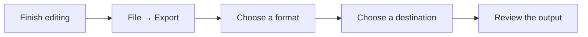

Choose an output for the people who will read it. Your editable source stays in Markdown.

## Pick the right format

| Format | Best suited to |
| --- | --- |
| HTML | A formatted web document |
| PDF | Paginated reading and printing |
| Word DOCX | Word editing and review |
| RTF | Rich text interchange |
| Slides | A presentation with H1 headings as slide boundaries |
| EPUB | An EPUB 3 book package |
| LaTeX | TeX source with companion graphic assets |
| Remarque Bundle | Markdown and associated assets in one package |
| Embedded Markdown | A Markdown document with embedded images |

## Export a document

**Settings → Export** controls paper size, orientation, title page, contents, numbering, images, custom CSS, and source inclusion. Word export includes rendered diagrams and equations as graphics. PDF uses native pagination.

> [!NOTE]
> Exports snapshot the current revision. If the document changes during preparation, export again. Review any conversion warnings and check the result in its destination application.

## Print or present

Use **Print Document**, **Print Source**, or **Print Document and Source** for native printing. In slides, each first-level heading starts a new slide.

## Bring another document in

Word, RTF, and PDF imports become **new unsaved Markdown documents**. Conversion can simplify formatting. PDF import extracts selectable text; it does not perform OCR.
