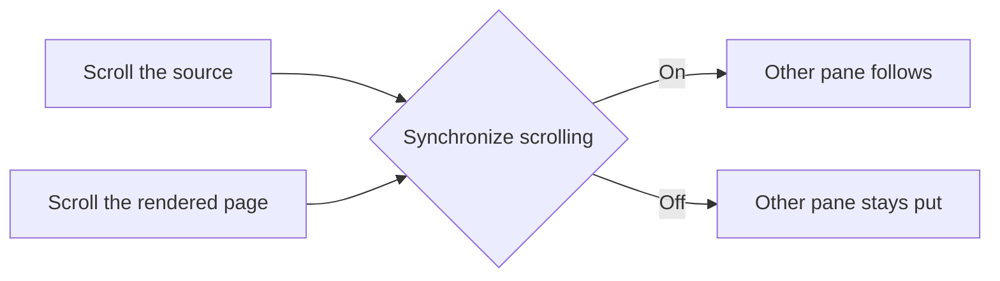

The right pane is a live editor for formatted Markdown, tables, code, math, and diagrams. Everything renders locally.

## Choose how scrolling behaves

Open **Remarque → Settings… → Preview**, or [open Preview settings here](#settings:Preview).

| Synchronize scrolling | What happens |
| --- | --- |
| **On — default** | Scroll either pane and the other follows the same document section. Works in source mode and Live Editing mode. |
| **Off** | Scroll the two panes independently, useful when comparing distant sections. |

The setting is remembered across launches and applies immediately to open documents. It follows source positions, so repeated headings remain distinct.

## Selection still finds the source

**Scrolling and selecting are separate actions.** Turning synchronization off does not disable the source reveal you get when selecting content on the right.

1. Turn **Synchronize scrolling** off.
2. Scroll the right pane to another section. The left pane stays where it was.
3. Select a word or heading on the right. The left pane reveals its Markdown; keyboard focus stays on the right.

## Keep preview updates comfortable

- **Live preview** controls automatic rendering after source edits.
- **Preview debounce** sets the brief pause before a source edit is rendered.
- **Hide front matter** keeps document metadata out of the rendered view.
- If preview is paused, choose **Refresh preview** to update it.

> [!NOTE]
> Invalid Mermaid or math source remains editable. An error does not remove your original text.
