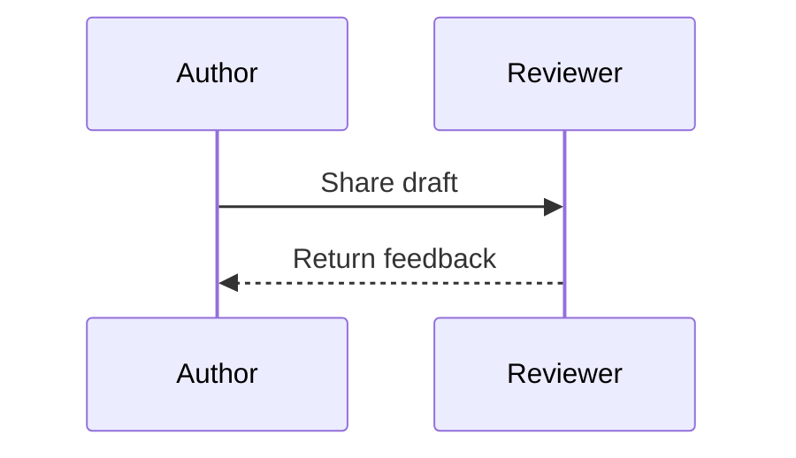
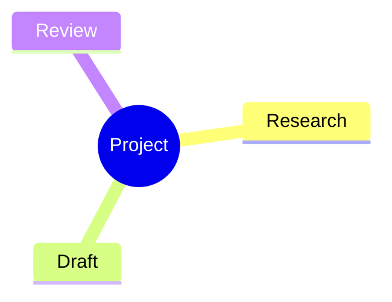

## Choose a starter

The Mermaid gallery contains 41 starters across 33 families. Search by name or category, inspect the preview, select a theme/look/layout, and insert the source.

## A few visual starting points

## Supported families

| Kind of diagram | Families |
| --- | --- |
| Process and people | Flowchart, swimlane, user journey, use case |
| Software and systems | Sequence, class, state, entity relationship, requirement, Git graph, C4, ZenUML, block, packet, architecture, event modeling, agentflow |
| Planning and organization | Gantt, Kanban, timeline, mind map, tree view |
| Data and relationships | Pie, quadrant, Sankey, XY, radar, treemap, Venn |
| Strategy and reasoning | Ishikawa, Wardley, Cynefin |
| Grammar | Railroad, including EBNF, ABNF, and PEG starters |

## Local rendering

The bundled engine is Mermaid 12.2.0 with ZenUML, ELK, and tidy-tree layout support. Family-specific options can differ; invalid combinations show an error and leave source intact.
