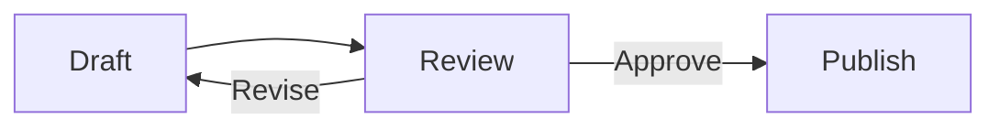

Turn a short block of text into a diagram. You can edit its source in either pane and see the graphic update locally.

## Start with a flowchart

````example

````

Copy the example into the source pane, or click **Mermaid** in the right toolbar to start from a template.

## Edit the rendered diagram

1. Select the diagram card on the right.
2. Choose **Source** to change its Mermaid text.
3. Watch the left source and rendered graphic update.
4. Use **⌘Z** to undo the change.

> [!NOTE]
> A syntax error leaves the original source intact. Correct the source to render the graphic again.

## Keep a useful copy

| Action | Result |
| --- | --- |
| Copy Source | The original Mermaid language |
| SVG | A vector graphic |
| PNG | A raster image |
| Layout | Title, width, height, and alignment |

Diagram layout metadata is stored in an HTML comment immediately before the Mermaid fence. Source remains portable text. Scripts, remote loaders, and Mermaid click callbacks are not executed.

- [Browse diagram families →](#topic:Mermaid%20Templates%20and%20Types)
- [Use the visual editor →](#topic:Mermaid%20Visual%20Editor)
