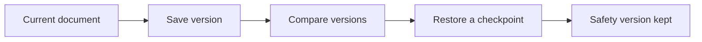

Keep checkpoints and reuse the text you write often.

## Save a checkpoint

File → Save Version captures a named manual checkpoint. Version History shows saved snapshots, compares text, and restores a selected version. Remarque captures a safety version before restoring.

## Recover interrupted work

Automatic history is bounded by count and storage size. Manual versions are retained. Recovery journals protect unsaved work; available recovery drafts appear in the Start window after an interrupted session.

## Reuse and capture text

Settings → Snippets lets you edit reusable text. Type a trigger followed by Tab in the source editor; $0 marks the insertion point. macOS Services and Shortcuts expose New Markdown Note and Append to Remarque Scratchpad.
