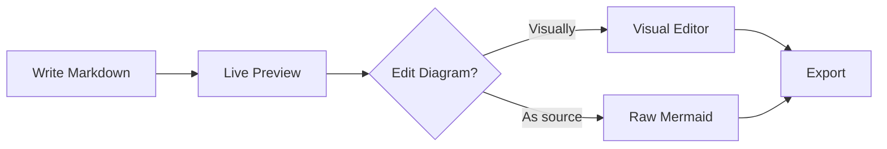

# Welcome to Remarque

*Markdown. Beautifully refined.*

Remarque is a calm, native macOS editor for serious Markdown — technical
specs, product docs, research notes, and long prompts. Everything stays in
a plain `.md` file you fully own.

## Structure at a glance

Use the **outline** on the left to navigate large documents. Toggle the
**preview** to see your writing typeset beautifully.

## Write with flow

- Press **⌘B** for bold, **⌘I** for italic, **⌘K** for a link
- Create a fenced code block with **⌥⌘C**
- Insert a diagram with **⌥⌘M**

## Diagram visually or in source

Mermaid diagrams render live and can be edited visually (**⇧⌘M**):

<!-- remarque:mermaid id="diagram-welcome" title="Editing Flow" width="720" height="420" align="center" -->

## Export without drama

Export to **HTML**, **PDF**, or **Microsoft Word** locally — no cloud, no
account, no network.

| Format | Best for            |
| ------ | ------------------- |
| HTML   | Sharing on the web  |
| PDF    | Printing & archives |
| DOCX   | Reviews in Word     |

> Everything is local-first. Your words never leave your Mac.

Happy writing.