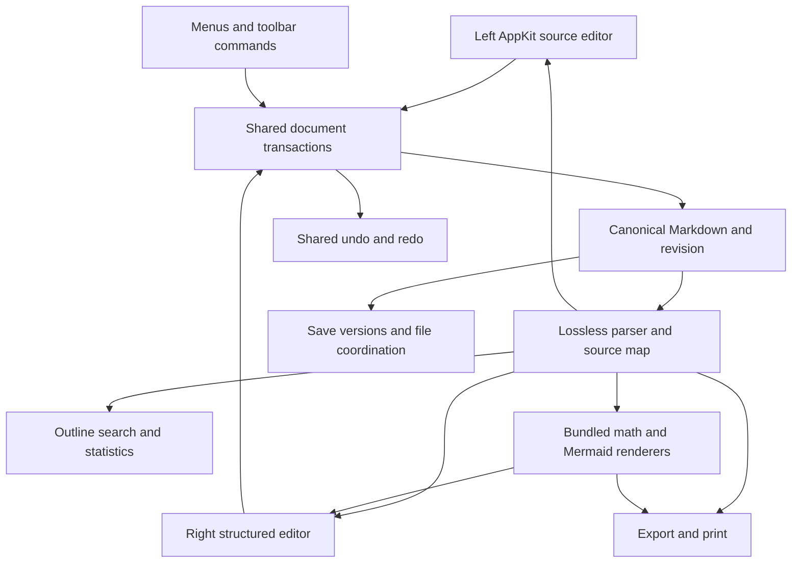

# Remarque rebuild specification

Prepared 29 October 2026 for review before implementation. Baseline: Remarque 2.1 build 733. Toolbar requirements updated to the user’s single-row decision; see the current implementation build report for delivery status. The baseline feature scope is [FEATURE_INVENTORY.md](FEATURE_INVENTORY.md); exact controls are in [CONTROL_REFERENCE.md](CONTROL_REFERENCE.md).

## Required outcome

Rebuild Remarque as a native macOS Markdown application that preserves its discovered document, editing, diagram, math, workspace, history and export functionality. Add the following capabilities:

1. Selecting content in the **right rendered pane** reveals the equivalent Markdown section in the **left source pane**.
2. Both panes are editable. Right-pane changes update the left source in real time; left-source changes update the right rendered view.
3. Put a simple Word-like toolbar above the right pane, with one formatting row and **Mermaid** and **LaTeX** insertion buttons immediately to the right of **Table**.
4. Expand Mermaid to the full 33-family catalogue, with at least 41 starter templates, source editing, offline rendering, supported styles/layouts, and format-by-format tests. See [comprehensive support](MERMAID_COMPREHENSIVE_SUPPORT.md).

“Left pane” means the Markdown source editor; the optional outline remains an additional sidebar to its left. “LaTeX” means mathematical authoring within the Markdown document in this specification. These controls act on the current selection or insertion point; they do not change the document's file type or convert the whole document.

The existing single-pane Live Editing Mode, vertical Markdown palette, menu commands and source formatting ribbon remain available. The new right-pane editor is an additional capability; baseline export/presentation views remain faithful rendered outputs.

## Workspace arrangement

```text
App toolbar: document / layout / outline / find / export / settings
┌────────────────┬─────────────────────────┬──────────────────────────────────┐
│ Optional       │ Markdown source         │ Style B I … Table Mermaid LaTeX   │
│ outline        │ Existing source tools   │ One compact formatting toolbar   │
│                │                         ├──────────────────────────────────┤
│ Headings       │ # Current section       │ Current section                  │
│ Diagrams       │                         │ Rendered, editable document      │
│                │ Source selection mirror │ Active caret / selection         │
└────────────────┴─────────────────────────┴──────────────────────────────────┘
Status: words / reading time / diagrams / line and column / save state
```

The right toolbar stays pinned while the document scrolls. Table, Mermaid and LaTeX stay visible at narrow widths; the formatting group may scroll horizontally or overflow. Preserve pane widths and layout choices. The new toolbar must not consume so much vertical space that it prevents normal writing.

## Right selection to source navigation

| ID | Requirement |
| --- | --- |
| SYNC-01 | A click in rendered prose, heading, list item, quote, callout, table cell or code block reveals the corresponding source location. |
| SYNC-02 | Drag selection and keyboard selection reveal and mirror the matching source range, including selections spanning several blocks. |
| SYNC-03 | Clicking an image, equation or Mermaid diagram selects its complete corresponding source construct. Figure selection includes its directly associated layout comment when applicable. |
| SYNC-04 | For prose, map the rendered text position into the source's actual token range. Do not search by displayed text or estimate from proportional scroll position. Duplicate paragraphs/headings must remain distinct. |
| SYNC-05 | Keep input focus and the active caret in the right pane. The left pane shows a secondary highlight; mirroring must not steal focus or collapse the user's selection. |
| SYNC-06 | Scroll the left pane only enough to reveal the target with useful context. Avoid recentering on every keystroke when the target is already visible. |
| SYNC-07 | Clicking a generated item such as a footnote number chooses a deterministic source origin. A reference maps to its reference token; its rendered footnote body maps to its definition. |
| SYNC-08 | Markers without rendered characters map to the owning source token/block. Markdown punctuation remains visible in the source pane. |
| SYNC-09 | Selection mapping works with soft wrapping, zoom, Unicode, composed characters, emoji, nested formatting, hidden front matter, collapsed sections and asynchronously sized graphics. |
| SYNC-10 | If the source pane is hidden in a single-pane layout, update the logical selection without forcing a layout change. An explicit Reveal in Source command opens/reveals it. |
| SYNC-11 | A source caret/selection updates right-side context and toolbar state. Passive mirrors must not cause reciprocal scrolling loops. |
| SYNC-12 | Distinguish scrolling from selection. Selection jumps to the precise block even when the optional continuous Scroll Sync preference is off. |
| SYNC-13 | Command-click a link opens its destination; ordinary click selects/edits its label. Expose Open Link by keyboard and context menu as well. Preserve internal navigation semantics outside editing contexts. |
| SYNC-14 | If a parse result is stale, use the current source transaction map or wait for its revision; never navigate using an old offset silently. |

Selection acceptance example: place the source at the top of a long file, scroll the right pane to the **second** identically titled section, then click a word there. The left pane reveals that second section and highlights the correct source word; the right caret retains focus. Repeat with a selection crossing a bold span, a table cell and a Unicode word.

## Editing in both panes

Markdown is the persisted source of truth. Both views apply operations to one document state and one undo history. There must not be two independent strings periodically overwriting one another.

| ID | Requirement |
| --- | --- |
| EDITNEW-01 | Type, delete, select, cut, copy, paste and perform normal text navigation directly in right-pane prose. |
| EDITNEW-02 | Each accepted right-side edit updates canonical Markdown and the left editor immediately; no Apply button for ordinary text editing. |
| EDITNEW-03 | Left-side edits update the right editor at the same document revision. Preserve the active caret and unaffected scroll positions while updating. |
| EDITNEW-04 | Preserve untouched source exactly, including whitespace, blank lines, marker choices, reference definitions, comments, front matter, line endings and unknown constructs. |
| EDITNEW-05 | A formatting action changes only the selected span/owning block. It may normalize syntax within that changed construct, never silently format the entire file. |
| EDITNEW-06 | All commands from the right toolbar, left toolbar, menus, shortcuts, palette, equation tools, table tools and diagram tools use the same transaction system. |
| EDITNEW-07 | Shared undo/redo follows chronological user actions across panes. Undo from either pane reverses the most recent transaction and restores associated selection. Group continuous typing sensibly. |
| EDITNEW-08 | IME composition, dead keys, dictation and emoji insertion are preserved. Do not re-render the active composing subtree or split grapheme clusters. Broadcast provisional composition separately from the final undo unit if necessary. |
| EDITNEW-09 | Rapid alternation between panes must not overwrite recent input with a late render or stale selection. Document-scoped revision numbers are mandatory. |
| EDITNEW-10 | Persist the same canonical text from either pane. Dirty indicators, save, autosave, versions, search and export all use the latest committed revision. |
| EDITNEW-11 | Incomplete Markdown, math or Mermaid remains editable. Store the user's source, show an inline diagnostic, and clearly mark any last-successful render as stale. |
| EDITNEW-12 | Cancel in the existing modal editors retains its existing meaning. New inline/source-inspector editing is immediate; its changes are reversed through shared Undo. Do not present a misleading Cancel button after committing live edits. |
| EDITNEW-13 | Unknown or unsupported constructs appear as bounded source blocks/objects that can be edited as source. Switching panes must never delete them. |
| EDITNEW-14 | Rich paste converts to supported Markdown after sanitization. Offer plain-text paste; do not preserve arbitrary browser formatting without a defined source representation. |
| EDITNEW-15 | Delete/Backspace at block boundaries has defined behavior for merging paragraphs, leaving lists, removing empty headings, and deleting selected objects. Test each operation. |
| EDITNEW-16 | A selected linked image/equation/diagram has an accessible label and focusable edit action. Never treat its generated SVG or bitmap as directly editable prose. |
| EDITNEW-17 | Resolve external-file changes with the same document-conflict workflow for both panes. Never reload over unsaved right-side input without the existing conflict choice. |
| EDITNEW-18 | Multi-window editing must share file coordination and avoid stale saves. Opening the same file twice must not create divergent unsupervised writers. |

### Editable content coverage

| Content | Right-side behavior | Markdown update |
| --- | --- | --- |
| Paragraph and heading | Direct typing, Enter, split/merge, style menu | Change text and heading markers locally. |
| Marks and links | Select text, apply/remove marks, edit label and URL | Preserve nesting; update only affected delimiters/destination. |
| Lists and tasks | Continue/indent/outdent; click task checkbox | Update list markers/indentation or `[ ]` / `[x]`. |
| Quotes and callouts | Direct body editing; change callout type/title through tools | Preserve quoting prefixes and callout marker. |
| Tables | Direct cell editing and keyboard cell navigation; structural commands | Patch affected cell/row/table, retain escaped pipes and extra data. |
| Code block | Literal code editing and language selector | Preserve fence length adequate for contents; no rich-text substitutions inside code. |
| Math | Click selects formula; LaTeX button inserts; its menu edits source and display mode | Patch inline or display formula with correct delimiters. |
| Mermaid | Click selects diagram; Mermaid button opens the gallery; its menu opens source/canvas tools | Patch that fence and its associated metadata, preserving unsupported lines. |
| Image | Select object; edit alt text/path and replace image | Change image token/reference and authorized local asset handling. |
| Details section | Toggle disclosure; edit summary/body | Preserve details/summary structure and hidden contents. |
| Footnotes/references | Edit body/definition through source-aware UI | Patch the correct definition or reference occurrence. |
| Front matter/raw HTML/unknown extension | Source-block editor/fallback | Retain original bytes outside the explicit edit. |

## Unified toolbar and commands

Use one persistent formatting row. Place **Mermaid**, then **LaTeX**, immediately after **Table**. Clicking a button opens its insertion tool. Each adjacent arrow opens a menu with the insertion action and context-sensitive editing actions. Retain the document selection when opening tools. Opening a tool alone never changes source or dirty state.

### Markdown formatting controls

Keep the default row simple. Use familiar text-formatting icons with tooltips and accessible names; put less frequent commands in Insert or overflow menus.

| Group | Commands | Source semantics |
| --- | --- | --- |
| History | Undo, Redo | Shared document history. |
| Style | Body, Heading 1–6, Quote | Current block type, with mixed state for a multi-block selection. |
| Text | Bold, Italic, Strike, Highlight, Inline Code | Existing supported Markdown marks; pressed state reflects selection. |
| Lists | Bullets, Numbered, Tasks; Indent, Outdent | Preserve list nesting and numbering intent. |
| Insert | Link, Image, Table, Code Block, Rule, Callout, Footnote, Details | Contextual dialog/popover where needed; insert at retained anchor. |
| More formatting | Superscript, Subscript, Clear supported formatting | Use existing syntax; clearing marks must preserve content and objects. |
| Table context | Add/remove row/column, column alignment, table placement | Only enabled for a table; preserve neighboring source. |
| View | Text zoom/size; optional Reveal in Source | Display scale, not arbitrary persisted font formatting. |

Do not imply arbitrary Word document formatting that plain Markdown cannot represent. Arbitrary font-family/color, text-box placement, paragraph justification, page margins and manual pagination are outside the initial right-toolbar scope unless a separately approved Markdown extension is defined. Existing export page settings remain in Export preferences.

### The Mermaid button and tools

| Group | Commands and behavior |
| --- | --- |
| Target | Selected diagram title/type, or an Insert Diagram action when no diagram is selected. |
| Templates | Searchable gallery covering all 33 Mermaid families and at least 41 starter templates; see [comprehensive Mermaid requirements](MERMAID_COMPREHENSIVE_SUPPORT.md). |
| Source | Editable Mermaid source, live diagnostic, optional source visibility. Source edits immediately update the matching fence in the left pane. |
| Visual tools | Select/Move, Add Node, Connect, Delete, Auto Layout, Snap, direction, shapes, edge style/label for supported types. |
| Sequence tools | Participants, messages, sender/receiver, message order, arrow type. |
| Placement | Title, size, aspect-ratio lock, left/center/right, Reset Size. Update readable diagram metadata. |
| View/output | Zoom, Fit, Copy Source, Copy SVG, Export PNG. |

Supported visual manipulations update source as transactions. One drag is one undo unit; it may broadcast intermediate positions for live feedback. Preserve source statements the canvas cannot understand. Any operation that would remove unsupported constructs must be explicitly disclosed before it runs. Source editing and rendering remain available for every supported renderer type.

When switching from a diagram to prose, retain a valid insertion anchor and update toolbar target state. Do not silently edit the previous diagram after the selection has moved elsewhere. The legacy full-window/modal visual editor may remain with Apply/Cancel; the Mermaid source inspector must clearly use live editing.

### The LaTeX button and tools

| Group | Commands and behavior |
| --- | --- |
| Target | Edit selected equation or Insert Equation at the current insertion anchor. |
| Display mode | Inline / Display. Convert delimiters around this equation only. |
| Structures | Exponent, subscript, fraction, square/nth root, sum/product, integrals, limit, binomial, vector/hat/bar, matrix and cases. |
| Symbols | Preserve all existing Greek, operator, relation, arrow, symbol and function palettes. |
| Source/preview | Editable LaTeX field plus immediate rendered preview and accessible diagnostics. |
| Navigation | Template insertion puts caret into the first slot; keyboard traversal must work without a mouse. |

The equation source inspector edits the selected equation source in the left pane as the user types, including temporary invalid LaTeX. It does not convert a Markdown document to a standalone `.tex` document. Existing File Export LaTeX remains a separate export command.

### Toolbar interaction rules

1. Remember the document selection when a toolbar control takes focus. Apply to that selection, never the accidental toolbar focus target.
2. Enable commands only where meaningful. Use mixed states for selections with mixed formatting; disable destructive table/diagram actions when no valid target exists.
3. Keyboard shortcuts keep the existing bindings. Commands act on the active editing pane but share source semantics and undo.
4. Selecting a diagram or equation updates enabled menu actions without replacing the formatting toolbar. Its buttons remain in the same order for every selection.
5. Esc returns focus to the document without discarding edits already committed through the live interface.
6. Buttons, menus, fields and canvas objects must be reachable and named for VoiceOver. Selected-object state and validation messages must be understandable without sight.

## Document architecture

Use the surviving application structure as a guide, not as recovered implementation. Retain a native SwiftUI/AppKit document shell and bundled local renderers. The right editor needs a structured editing layer; merely adding `contenteditable` to the exported HTML is insufficient because the export does not retain source ranges or lossless editing semantics.



### Core document state

Keep these concepts explicit, even if their final type names differ:

- Document identity and file URL, source buffer, line-ending policy, encoding, current revision, saved revision and permissions.
- Lossless syntax/tokens plus a semantic tree. Preserve comments, trivia, delimiters, reference definitions and opaque constructs in the lossless representation.
- Source ranges, rendered-text maps and stable session identities for blocks/inline spans. Stable identity is not a hash of the text alone.
- Active editing surface and logical selection anchor/focus, plus secondary selections for inactive surfaces.
- Transactions with source range replacements, origin, expected base revision, selection before/after and undo grouping.
- Render jobs/caches keyed by source and configuration, with document and revision identity.

### Mapping rules

Use half-open source ranges `[start, end)` with one documented coordinate convention. AppKit and browser DOM offsets both involve UTF-16; Swift `String` indexes do not. Provide tested conversion helpers and respect grapheme boundaries for editing. Normalize line-ending offsets in one place, not in every component.

Rendered text has many-to-one and one-to-many relationships with source: emphasis markers disappear, escaped entities shrink, emoji shortcodes expand, smart punctuation may transform, and math becomes graphics. Retain per-token mappings and explicit object origins. Formatting nested within links, table cells, callouts or list markers must resolve to the right source owner.

A cross-block selection may have a contiguous enclosing source interval plus discontiguous text-token subranges. The mirror can highlight the enclosing interval while edit commands use exact semantic subranges; blindly replacing the enclosing interval would destroy structural delimiters. Decide selection affinity at token boundaries and test it.

Generated document elements such as a TOC, footnote labels, diagram SVG nodes and preview-only decorations must identify their source owner or be explicitly non-editable. Do not serialize render-generated markup into the Markdown file.

### Transaction and render ordering

1. Capture edit intent against a known document revision and semantic selection.
2. Convert it to minimal valid source replacements. Reject stale edits or rebase using intervening transactions; never use stale offsets directly.
3. Apply the replacements and selection changes atomically. Increment revision, update dirty state and shared undo.
4. Publish changes to both editors, outline, search, status and persistence. A view does not echo an already-applied transaction back as new input.
5. Incrementally reparse affected context. Fences, list nesting and reference definitions can affect subsequent blocks, so reparsing cannot always stop at one line.
6. Update only changed rendered blocks. Retain active composition/caret and viewport anchors.
7. Run expensive math/diagram rendering asynchronously. Accept only results matching the current document/block revision and configuration; discard old results and callbacks after a document closes.

A selection/scroll event carries its origin. Mirroring does not generate another user-origin event. Asynchronous image heights and zoom changes must preserve logical viewport anchors rather than triggering proportion-based feedback loops.

### Right editor implementation boundary

The selected starting architecture is a locally bundled WebKit structured editing surface, with a native AppKit source editor. Prove its schema and input handling in the first prototype. Any alternative must pass the same editing, accessibility and preservation gates before replacing this choice.

The first prototype must prove lossless round trips, nested marks, mixed-block selection, table cells, IME, undo across panes, source mappings and opaque blocks before the rest of the product is rebuilt around it. Any third-party component must be evaluated for its exact supported Markdown grammar, serialization changes, licensing, local/offline packaging and maintenance; no dependency choice is assumed by this inventory.

If WebKit is used, bundle editor assets and fonts locally, isolate the bridge, validate message origin/type/size/revision, and avoid arbitrary script execution from Markdown, Mermaid, raw HTML, pasted content, links or document metadata. Image/file access must use authorized scopes. Network independence must be demonstrated, not inferred from branding.

## Compatibility and preservation rules

- Open and save the original `.md`, `.markdown` and `.mdown` documents. Preserve UTF-8 text and line endings unless the user explicitly reformats.
- Read both `remarque:mermaid` and legacy `remarkable:mermaid` metadata. Preserve unknown keys and values; write canonical metadata only for the edited diagram.
- Retain `table-align` comments, YAML front matter, wiki links, reference links/images, footnotes, nested details, callouts and all recovered syntax families.
- Preserve linked and embedded media. Do not read or rewrite unrelated folders or bake sandbox-specific absolute paths into portable exports.
- Preserve per-format output settings and document structure options. Preview, print and export should use one semantic document model and consistent renderer versions.
- Distinguish engine capabilities: source rendering may support more Mermaid types than graph editing. Never silently downgrade a complex graph to the canvas's subset.
- Keep baseline Live Editing Mode optional. It must not corrupt source or interfere with the new right editor's selection/undo model.
- Maintain native document commands, workspace navigation, local history, snippets, Services, Shortcuts, help and keyboard access from the inventory.
- Treat observed bugs as regression targets, not required compatibility behavior. Decide intended behavior explicitly where documentation and output disagree.
- Existing private settings/history migrations require a separately verified data schema. Do not guess or overwrite old app-container data. First-run migration should preserve originals and be retryable.

## Performance and resilience targets

These are rebuild acceptance targets, not measurements of Remarque 2.1. Record the test machine and measured distributions when implementing.

| Operation | Target |
| --- | --- |
| Ordinary right edit reflected in source | p95 within 50 ms for a 100 KB representative document, excluding intentional IME composition. |
| Selection mirrored/revealed | p95 within 100 ms after selection settles; no forced focus transfer. |
| Ordinary prose preview update | p95 within 150 ms; avoid blocking the typing event path. |
| Large document typing | A 1 MB/10,000-line mixed fixture remains responsive, with incremental updates; measure latency rather than claiming it. |
| Math and diagram generation | Background/cancellable work; immediate source update even while render is pending. |
| Undo | Exact source restoration and valid caret state after interleaved left/right edits. |
| Export/save | Use a captured latest revision, atomic destination replacement, and meaningful error reporting. |
| Recovery | Restore unsaved work after simulated crash; a failure must not destroy the previous saved file/version. |

A complex diagram has no guaranteed fixed render time. Show pending/error/stale states and allow continued writing. Tests must include delayed, failed and out-of-order engine responses.

## Acceptance suite

The implementation is not complete until the complete baseline inventory is accounted for and the following additions pass. [VERIFICATION.md](VERIFICATION.md) lists what has and has not been tested on the installed app.

| ID | Scenario | Required result |
| --- | --- | --- |
| A01 | Click a paragraph/heading in distant right-pane content | Correct source block revealed; right focus retained. |
| A02 | Select the second of repeated identical headings/paragraphs | Exact second source occurrence selected. |
| A03 | Drag or keyboard-select across bold/link/plain text and blocks | Accurate source mirror and safe edit ranges. |
| A04 | Unicode, combining accents, emoji, CJK and CRLF | No shifted offsets, split characters or corrupted text. |
| A05 | Click equation/diagram/image/table cell/footnote | Correct source object or token selected, no neighboring-block ambiguity. |
| A06 | Type and delete in right prose, headings, lists, callouts and cells | Left Markdown updates live and unrelated bytes remain identical. |
| A07 | Type incomplete Markdown/math/Mermaid on the left | Source retained; right reports pending/error without blocking. |
| A08 | Alternate rapidly between panes | No lost edit, duplicate edit, caret jump or stale overwrite. |
| A09 | Undo/redo interleaved source, toolbar, table, math and diagram edits | One chronological history and exact source restoration. |
| A10 | IME, dead keys, dictation and emoji insertion | Composition survives rendering and toolbar focus changes. |
| A11 | Paste formatted text or plain source in each pane | Supported Markdown conversion; safe links and preserved selection. |
| A12 | Format nested bold/italic/code/highlight/super/sub spans | Correct toggle semantics; no stacked or orphan delimiters. |
| A13 | Modify a table containing escaped pipes, math and extra cells | No truncated data, neighbor changes or malformed delimiter row. |
| A14 | Toggle task checkboxes and continue/indent lists | Exact Markdown markers and numbering; shared undo. |
| A15 | Use the unified toolbar and both insertion buttons with and without a target | Table, Mermaid, LaTeX remain visible in order; tools retain the anchor; opening or cancelling a tool never mutates content. |
| A16 | Edit a diagram through source and supported canvas actions | Left fence updates live; unsupported directives preserved or explicitly protected. |
| A17 | Edit simple state, flowchart and sequence; inspect unsupported class | Correct target and type; safe source fallback. |
| A18 | Edit an equation using templates and raw LaTeX | Source updates live; delimiters/mode/caret slots correct. |
| A19 | Scroll either pane, then select while another render completes | No feedback loop, focus theft or unexpected viewport jump. |
| A20 | Hidden outline/source/preview, collapsed details, zoom and theme changes | Mappings remain correct when content becomes visible again. |
| A21 | Save/reopen/export after right-side edits | All consumers see latest canonical Markdown. |
| A22 | External write while dirty, crash, autosave/history/restore | Explicit conflict handling and recoverable current text. |
| A23 | Long mixed document with hundreds of graphics | Measured typing responsiveness; bounded cache/memory behavior. |
| A24 | Keyboard-only and VoiceOver use of every toolbar control | All actions named/reachable; selection context understandable. |
| A25 | Open documents from the original app without editing and save | Byte-for-byte source stability; safe media and metadata handling. |
| A26 | Repeat all discrepancies in verification ledger | Fix or explicitly resolve each behavior; don't copy accidental bugs. |
| A27 | Export all nine formats, plus diagram PNG/SVG and print variants | Structural validation, visual review and appropriate downstream opening; compare preserved samples. |
| A28 | Run offline and inject remote navigation/script-bearing inputs | No required network call; source content cannot execute arbitrary code. |

For losslessness, build fixtures with both expected semantic behavior and exact source-byte assertions. For UI correctness, drive both panes and assert shared revision/selection, not merely screenshot similarity. Use round-trip tests and randomized valid edit sequences in addition to representative UI tests.

## Implementation sequence after review

1. **Recover and protect:** retain this evidence archive; establish a source repository and independently recoverable backup. The current archive is on this same machine and is not an off-device backup.
2. **Prove the document core:** parser/source mappings, transactions, undo, left editor and minimal right editor. Pass A01–A12 and unknown-syntax round trips before expanding UI.
3. **Build the requested toolbar:** one formatting row, Mermaid/LaTeX insertion buttons and contextual menus, accessibility and selection retention. Add tables, math and Mermaid with their preservation tests.
4. **Restore baseline product scope:** native document lifecycle, workspace/backlinks, snippets/history, modes/themes, media, import/export/print, guides/Services/Shortcuts.
5. **Verify parity and safety:** complete the feature matrix, downstream export checks, migration, performance, crash/offline tests, signing and packaging. Review discrepancies as intentional fixes.

Do not call the rebuild complete after a two-pane demonstration. The release gate is the full inventory plus the new editing acceptance suite, with any exclusions explicitly agreed before release.

## Resolved scope and implementation defaults

The consolidated [complete Codex build specification](../REMARQUE_BUILD_SPECIFICATION.md) governs implementation. It resolves presentation boundaries to H1 plus visible preamble, retains `.remarque` export without claiming native bundle reopening, isolates new app data rather than guessing legacy migration, and keeps LaTeX authoring scoped to equations within Markdown. Local version control is required during implementation; an off-device backup destination remains owner-specific and does not block local development.

The new right-pane behavior and comprehensive Mermaid coverage are mandatory. The complete build document contains engineering contracts, milestone gates, all baseline controls, and acceptance requirements.
