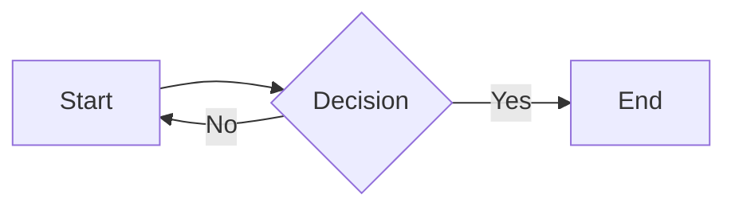
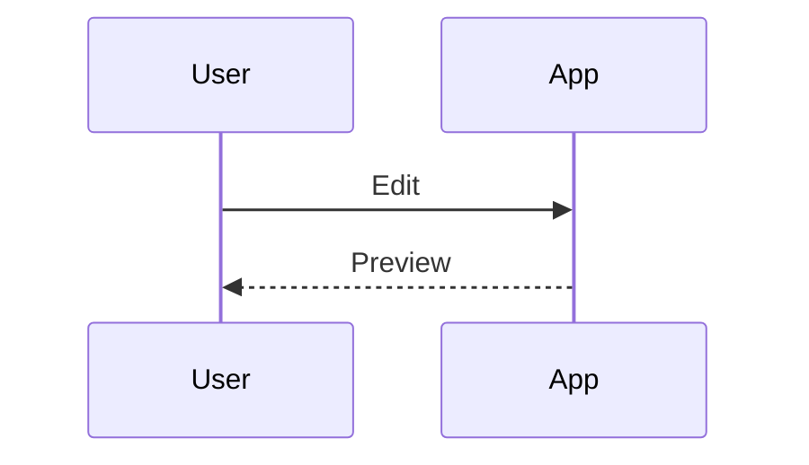
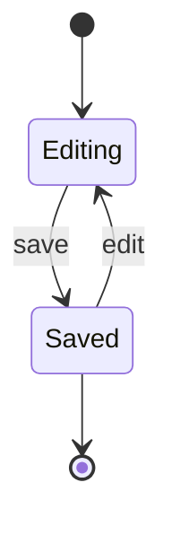
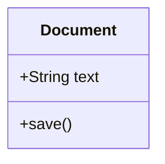
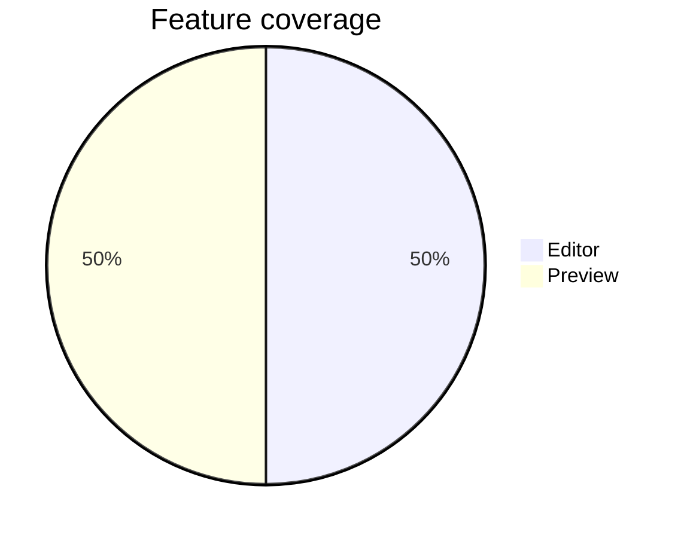

# Remarque Feature Probe

Disposable document for the rebuild inventory. UNIQUE_TOP_ANCHOR

## Inline formatting

Plain **bold**, *italic*, ***both***, ~~strike~~, `inline_code`, ==highlight==, H~2~O, x^2^, :rocket: and snake_case.

An inline equation $E=mc^2$ and literal prices $5 and $10.

[Inline link](https://example.com) and [reference link][example]. [[Other Note|Wiki alias]]

[example]: https://example.com "Reference title"

## Lists and callouts

- Parent
  - Child
    1. Nested ordered child
- [ ] Unchecked task
- [x] Checked task

3. Third
4. Fourth

> Ordinary quote
>
> Continued paragraph.

> [!NOTE] Custom note title
> A note with **bold**.

> [!TIP]
> A tip.

> [!IMPORTANT]
> Important.

> [!WARNING]
> Warning.

> [!CAUTION]
> Caution.

> [!CUSTOM] Custom box
> A custom callout.

## Tables

<!-- table-align: center -->
| Left | Center | Right |
| :--- | :----: | ----: |
| **bold** | escaped \| pipe | 42 |
| [link][example] | `code` | $x^2$ |

## Code and equations

```swift
let greeting = "Hello"
// A comment
print(greeting)
```

````text
```nested fence```
````

$$
\int_0^\infty e^{-x^2}\,dx = \frac{\sqrt{\pi}}{2}
$$

## Extended structure

A footnote reference.[^one]

[^one]: Footnote **content**.

Term
: First definition
: Second definition

<details>
<summary>Expandable section</summary>

Hidden **Markdown** and $x^2$.

</details>

Setext heading
==============

Hard break follows.  
Second line.

---

## Diagrams

<!-- remarque:mermaid id="probe-flow" title="Flow probe" width="720" height="420" align="center" -->










## Repeated heading

First duplicate. UNIQUE_MIDDLE_ANCHOR

## Repeated heading

Second duplicate. Unicode: café, 日本語, 👩🏽‍💻.

## End marker

UNIQUE_BOTTOM_ANCHOR. Selecting this rendered sentence should identify this source paragraph in the rebuilt editor.
