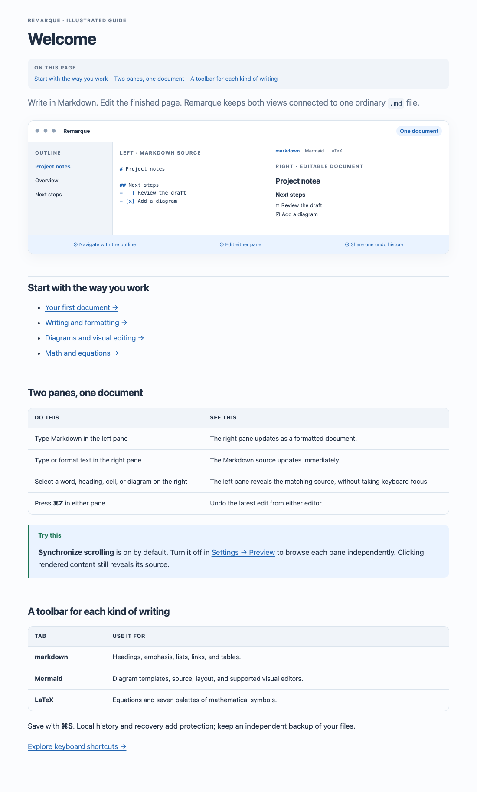
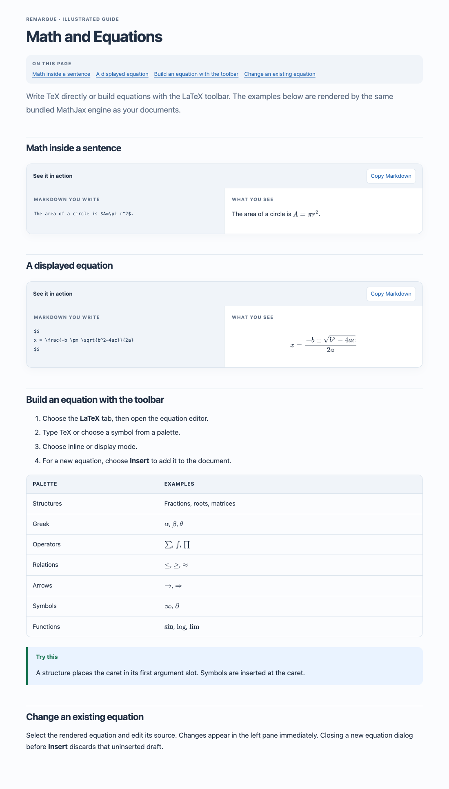
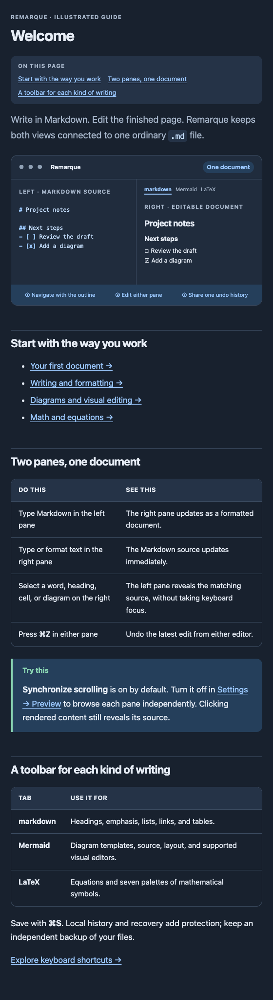

# Remarque 3.0.1 · build 737

## Synchronized scrolling

**Settings → Preview → Synchronize scrolling** defaults to **on** and remembers the user's choice. It applies immediately to open documents. Turning it off allows independent browsing; selecting rendered content still reveals its source. Both the native source editor and Live Editing mode support scrolling in either direction, without taking keyboard focus or echoing programmatic scroll updates back to the initiating pane.

## Illustrated documentation

All 21 bundled guides now use a dedicated offline reader. It provides proper headings, tables, callouts, a labelled editor illustration, Mermaid diagrams, rendered equations, and copyable Markdown examples beside their results. The native sidebar supports search and topic icons; the reader adds an article index, previous-topic navigation, direct settings links, and text-size controls. Light, dark, narrow-window, and reduced-motion styles are included. The Help menu opens the requested guide directly.

The docs use local assets and the existing pinned engines. There is no new service, runtime dependency, network request, or telemetry. The reader has a small, separate bridge for known topics, opening Preview settings, and copying a clicked example. It cannot edit a document or open arbitrary files.

## Rendering corrections

MathJax's startup configuration now parses correctly. Equations embed glyph paths instead of relying on SVG use references removed by sanitization. SVG normalization preserves namespaces while assigning unique IDs. These fixes also benefit the document editor and exports. Regression checks verify visible glyph paths, rather than merely counting SVG elements.

## Verification

The suite contains 65 tests: 15 Swift core, 13 projection/visual-model, 27 browser integration, and 10 native hosted tests. New coverage checks persisted/default scrolling settings, both directions in Live Editing, disabled synchronization, source reveal, native help loading, all help articles in both themes, no remote requests, safe untrusted content, copy/navigation, and actual equation glyphs. The settings toggle and native help UI were also inspected on this Mac.

The build retains the Developer ID identity, hardened runtime, universal architectures, and identifier `ca.forensicintelligence.remarque`. Production qualification and notarization remain separate; see [the build report](BUILD_REPORT.md).
