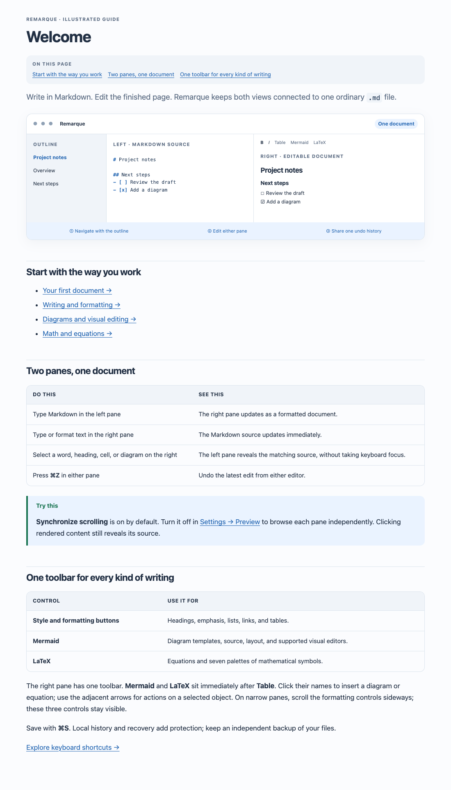

# Remarque 3.0.2 · build 738

The right pane now has one compact formatting toolbar. **Mermaid** and **LaTeX** sit immediately after **Table**. Click a name to insert a diagram or equation; use its arrow for actions on the selected object.

- Mermaid retains Insert Diagram, Edit Source, Visual Editor, and Copy SVG.
- LaTeX retains Insert Equation, Edit LaTeX, and Inline / Display.
- Selecting a diagram or equation keeps the formatting toolbar in place.
- Table, Mermaid, and LaTeX remain visible when the formatting group needs horizontal scrolling.
- The illustrated help and build specification now describe the single toolbar.

## Verification

All 65 existing tests passed: 15 Swift core, 13 web model, 27 browser integration, and 10 native hosted tests. Native UI inspection verified the single row and button order, direct gallery/equation opening, equation insertion updating the source, contextual equation actions, inline/display conversion, and the fixed controls in a roughly 370-point preview pane. Undo restored the temporary test document. The help rendering checks cover all 21 guides in light and dark modes, including the updated toolbar illustration.

The universal application retains the identifier `ca.forensicintelligence.remarque`, Developer ID Application signature for FI Forensic Intelligence, Ltd. (PATM9DNCLA), and hardened runtime. The separately extracted distribution ZIP is signature-verified. It remains a development build without notarization; see [the build report](BUILD_REPORT.md) for broader qualification limits.
