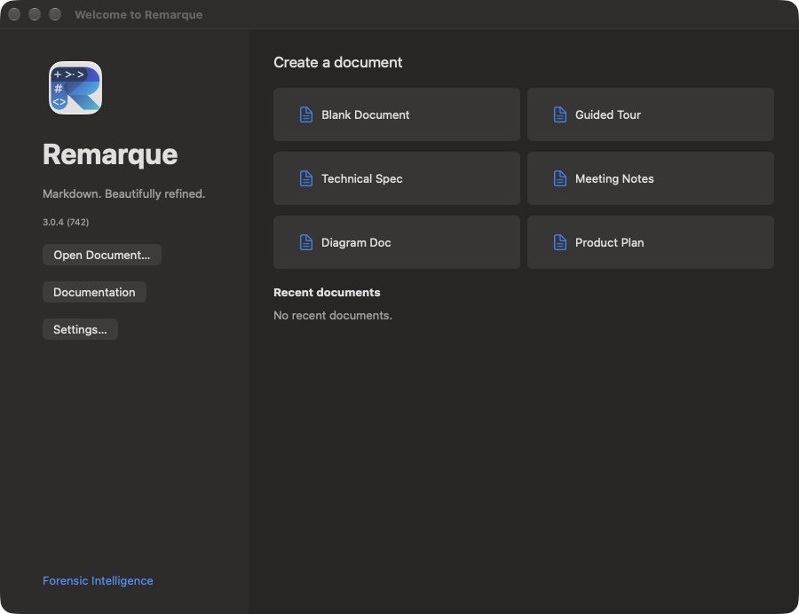

# Remarque 3.0.4 · build 742

30 October 2026. Product: **Remarque**. Bundle/signing identifier: **ca.forensicintelligence.remarkable**. Team: **PATM9DNCLA**.

## Changes

- Removed the hard-coded “Development” suffix from the welcome screen and editor. The About window shows **Version 3.0.4 (742)**.
- Added a custom About window with three animated characters made from the original Remarque icon. Slow bobbing, small tilts, and occasional blinks stay confined to the illustration. macOS Reduce Motion makes it stationary; closing or deactivating the window pauses animation. Decorative art is hidden from accessibility navigation.
- Included clear version and publisher information, plus documentation and website links.
- Limited welcome-screen recent documents to five, with single-line filenames and paths, truncation, and full-path tooltips. File → Open Recent retains the full history. Returning to the welcome screen refreshes the list.
- Replaced the welcome view's fixed 900 × 620 frame inside an 800 × 600 window with a flexible view and an explicit 900 × 660 initial window. Windows fit the screen's available space; scrolling remains available for smaller windows and recovery entries.
- Kept utility windows separate from document tabs, including when macOS prefers opening windows as tabs.
- Set the release channel consistently in the version authority and plist. Stable web package versions use SemVer build metadata (`3.0.4+742`). Stable ZIP names omit the development suffix. The version checker validates the plist channel and generated Xcode version/build numbers.
- Updated the bundled What's New guide and prepared App Store release notes.

## About preview

## Verification

- All 65 existing tests passed locally: 15 Swift core, 13 web model, 27 browser, and 10 native hosted tests.
- The native suite passed again after the utility-window adjustment. The identity test now checks version 3.0.4 (742), the exact clean label, and the release channel.
- Visually inspected the About window and the welcome screen populated with six temporary documents. Exactly five recent documents were displayed, with the full-history hint, all fitting the default window.
- Built and signature-verified a universal Xcode archive for Apple silicon and Intel. Apple confirmed that the archive passed all validation checks.
- Created a separately signed Developer ID application and ZIP, `dist/Remarque-3.0.4-742-macos-universal.zip`, with a SHA-256 companion file. This standalone ZIP has not been notarized.
- Local builds use a temporary copy outside Desktop/iCloud because Xcode's file coordination stalled when opening the project directly from Desktop. The source remains in the working folder.

## Release

Archive: `~/Library/Developer/Xcode/Archives/2026-10-30/Remarque 3.0.4 (742).xcarchive`.

[Prepared App Store metadata](../releases/APP_STORE_3.0.4_METADATA.json). Apple validation succeeded on 30 October 2026 at 2:11 PM America/Vancouver. Upload and review submission are in progress; no submission is claimed until confirmed by Apple.

The installed App Store version has not been overwritten. The historical 3.0.3 archive remains available. See [the build report](BUILD_REPORT.md) for broader verification limits.
