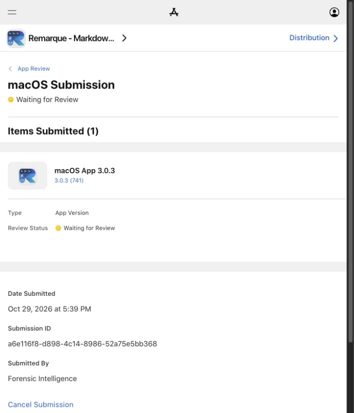

# Remarque 3.0.3 — App Store submission

- Build: 741
- Bundle identifier: `ca.forensicintelligence.remarkable`
- Team: FI Forensic Intelligence, Ltd. (`PATM9DNCLA`)
- Platform: macOS 14 or later; Apple silicon and Intel
- Source commit: `c591545b0b4d091dc3a17d135069901544614f59`
- Archive validation: passed 29 October 2026
- App Store record: Remarque - Markdown Editor (`6775993323`)
- Upload: confirmed by Xcode, 29 October 2026 at 5:33 PM America/Vancouver
- Submission status: **Waiting for Review** — confirmed in App Store Connect
- Submitted: 29 October 2026 at 5:39 PM America/Vancouver
- Submission ID: `a6e116f8-d898-4c14-8986-52a75e5bb368`
- [App Review record](https://appstoreconnect.apple.com/apps/6775993323/distribution/reviewsubmissions/details/a6e116f8-d898-4c14-8986-52a75e5bb368)
- Release mode: manual release after Apple approval (existing setting retained)

The exact submitted English (U.S.) description, promotional text, release notes, and review instructions are preserved in [the metadata record](APP_STORE_3.0.3_METADATA.json). Reviewer phone and email details are stored only in App Store Connect.

## What’s New

Remarque brings a more connected writing experience to Markdown, diagrams, and mathematics.

EDIT IN EITHER PANE
• Edit your Markdown source or the rendered document, with changes reflected in the other pane in real time.
• Select rendered content to jump to the matching Markdown source.
• Keep both panes aligned with synchronized scrolling, enabled by default and adjustable in Settings → Preview.

ONE SIMPLE FORMATTING TOOLBAR
• Format text, headings, lists, links, and tables from one toolbar.
• Insert Mermaid diagrams and LaTeX equations with dedicated buttons beside Table.

MORE DIAGRAMS AND VISUAL HELP
• Explore 33 Mermaid diagram families with 41 starter templates.
• Use visual editing for supported flowcharts, sequence diagrams, and simple state diagrams, with source editing available for other syntax.
• Browse 21 illustrated, searchable help guides with diagrams, rendered equations, and copyable examples. Help and rendering work offline.

FIXES AND IMPROVEMENTS
• Fixed missing equation glyphs in rendered content and exports.
• Improved scroll synchronization, selection retention, and formatting behavior.
• Improved UTF-8 document handling and SVG rendering.
• Restored the complete app icon for sharp display at every supported size.

## App Review notes

Remarque is a native macOS Markdown editor. No account, sign-in, subscription, or external service is needed to use its features. Rendering libraries and help content are bundled with the app.

Suggested review steps:
1. Create a new document and type Markdown in the left source pane.
2. Edit the rendered text in the right pane; the Markdown source updates immediately. Select rendered text to reveal its corresponding source.
3. Use the formatting toolbar above the right pane. Mermaid and LaTeX insertion buttons appear immediately after Table.
4. Open the Mermaid gallery to explore 33 diagram families and 41 starters. Visual editing is available for supported flowchart, sequence, and simple state syntax; other diagrams can be edited as source.
5. Insert an equation with LaTeX and confirm that it renders in the document.
6. Open Settings → Preview and toggle Synchronize scrolling. It defaults to on; disabling it permits independent scrolling while selection-to-source navigation remains available.
7. Open Help to browse the illustrated offline guides with rendered diagrams, equations, and source/result examples.

The app uses the macOS sandbox. File access is through user-selected documents and folders. Printing is supported. The network-client entitlement supports WebKit subprocess communication; the editor blocks remote HTTP/HTTPS resources. Remarque does not operate a document-upload service, account system, advertising system, or telemetry service.

Supported document imports are conversions. PDF import extracts selectable text and does not perform OCR. The visual Mermaid editor supports a bounded grammar and preserves source editing for unsupported constructs.

## Completed App Store forms

- Updated the English (U.S.) description, promotional text, and What’s New field.
- Added App Review instructions and the contact details supplied by the account owner. Contact details remain in App Store Connect rather than being copied into source control.
- Selected uploaded build 741 and answered the encryption algorithm question “None of the algorithms mentioned above”; the Missing Compliance status cleared.
- Completed the required updated age-rating questionnaire. Social media and social media for under-13 users are absent. Other content and capability answers remain None/No. Apple calculated a 4+ rating. No age override or Made for Kids designation was applied.
- The account owner confirmed accepting Apple’s updated Developer Program License Agreement.
- Existing screenshots, keywords, support and marketing URLs, copyright, rating history, and manual release mode were retained.

## Technical evidence for required forms

- Existing application identity is retained so this is an update to Remarque.
- Source contains no app-operated account, analytics, advertising, or cloud-service integration. Documents are stored locally or in locations chosen by the user.
- No custom cryptographic algorithm or encryption library was added. Any operating-system cryptographic functionality is provided by Apple. Answer the actual export-compliance questions against their precise wording.
- Contact, privacy-policy URL, copyright, age rating, pricing, territories, and release mode should be read from the existing App Store record before changing them.
- App Store Connect confirmed “1 Item Submitted,” then displayed “Waiting for Review” for macOS version 3.0.3, build 741. Approval and public release are pending.
