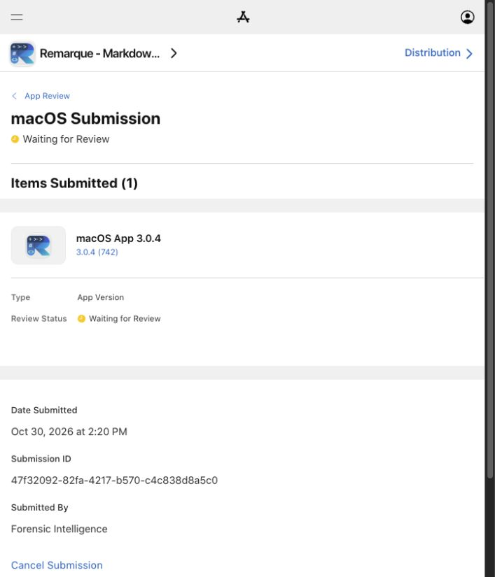

# Remarque 3.0.4 App Store submission

**Status:** Waiting for Review, confirmed in App Store Connect on 30 October 2026.

| Field | Value |
| --- | --- |
| App | Remarque - Markdown Editor |
| App Store ID | 6775993323 |
| Bundle identifier | ca.forensicintelligence.remarkable |
| Version / build | 3.0.4 / 742 |
| Submitted | 30 October 2026, 2:20 PM America/Vancouver |
| Submission ID | 47f32092-82fa-4217-b570-c4c838d8a5c0 |
| Build ID | a9f58f60-fbce-44e8-8475-bc6129eb3b69 |
| Release | Automatically after App Review approval |
| Rollout | Release update to all users immediately |
| Rating | Keep existing rating |

[Open the submission](https://appstoreconnect.apple.com/apps/6775993323/distribution/reviewsubmissions/details/47f32092-82fa-4217-b570-c4c838d8a5c0).

## Submitted changes

- Removed the incorrect Development label from the welcome screen and editor.
- Added the animated About window, including Reduce Motion support and pausing when inactive.
- Limited welcome-screen recents to five while preserving File → Open Recent.
- Improved window sizing, filename truncation, and separation of utility windows from document tabs.

[Exact release notes and reviewer notes](APP_STORE_3.0.4_METADATA.json). Existing description, keywords, support/marketing links, screenshots, privacy declarations, and reviewer contact information were retained. Promotional text was copied from the previous version. No app sign-in is required.

The encryption form was completed with **None of the algorithms mentioned above**, consistent with the previous release and unchanged encryption behavior. The build became selectable and was attached to version 3.0.4.

## Build and validation

Xcode validated the universal archive at 2:11 PM and confirmed upload at 2:14 PM. App Store Connect lists the upload at 2:15 PM. The archive remains at `~/Library/Developer/Xcode/Archives/2026-10-30/Remarque 3.0.4 (742).xcarchive`.

All 65 tests and universal release compilation passed independently in [GitHub Actions run 41129499435](https://github.com/ForensicIntelligence/Remarque/actions/runs/41129499435), for source commit `32f8e6e76504caaf8cb35a4022d1407c7e162cd7`. Local tests also passed; the native suite was repeated after the final utility-window adjustment.

A separate Developer ID ZIP is available locally as `dist/Remarque-3.0.4-742-macos-universal.zip`. Its extracted app passed strict signature verification and contains Apple silicon and Intel slices. This standalone ZIP is not notarized.

SHA-256: `086be704bf4cf1cd0058c173f2917a480bd6bc02d6d959bd675796b0e715e6e1`.

Submission is not approval. Version 3.0.3 remains live until Apple approves and releases this update. The installed App Store application was not overwritten during verification.
